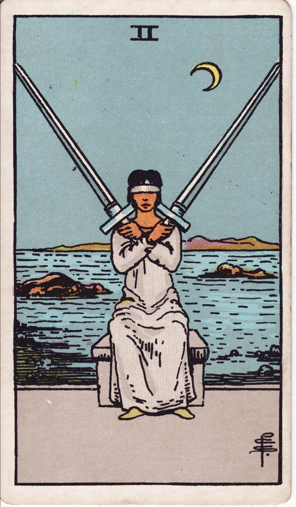
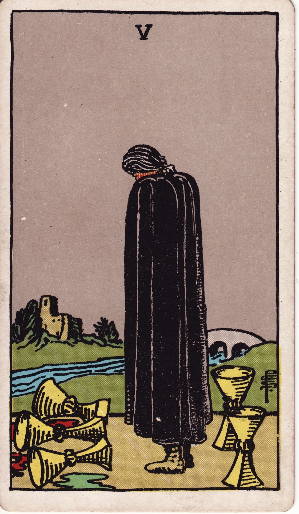
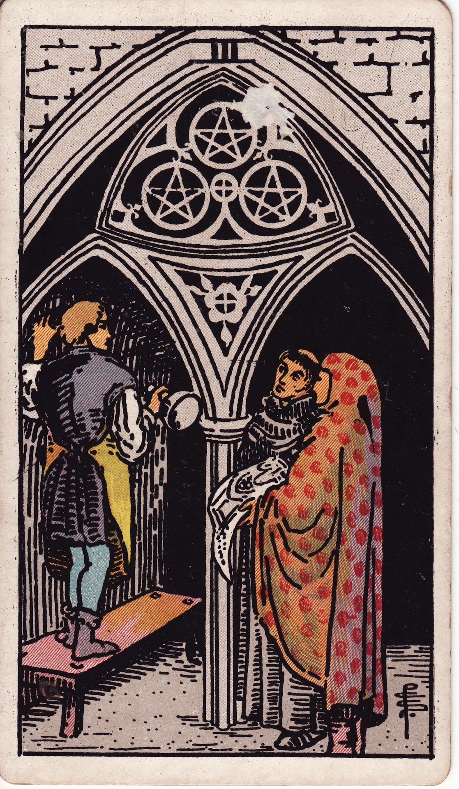

# 塔罗牌系统教程与全资料汇编

**新手自学修订版 · 2026 年 11 月 19 日**

这套课使用莱德–韦特–史密斯塔罗（Rider–Waite–Smith，简称 RWS）。你会先做一次单张解读，再学会辨认 78 张牌、查找牌义、读三张牌并复盘。每次解读都从能指出的图案开始，把联想带回真实处境，最后由你决定是否采取行动。

准备纸笔和一副 RWS 牌。手边还没有牌，可以直接用本页的示例牌开始。课程里的情境与示范答案均标明用途。正文用“星币”“王后”“侍者”，查资料时也会遇到“钱币／金币”“皇后”“侍从”等译名。

<a id="contents"></a>
## 学习目录

- [第 1 课　第一次单张读牌](#lesson-1)
- [第 2 课　把问题改成自己能处理的事](#lesson-2)
- [第 3 课　看懂一整副牌](#lesson-3)
- [第 4 课　读大牌、数字牌和宫廷牌](#lesson-4)
- [第 5 课　同一张牌放进不同问题](#lesson-5)
- [第 6 课　第一次三张连读](#lesson-6)
- [第 7 课　加入逆位](#lesson-7)
- [第 8 课　和他人练习](#lesson-8)
- [第 9 课　结业练习与复盘表](#lesson-9)
- [24 集视频课程蓝图](#video-course)
- [韦特系 78 张牌速查](#rws-reference)
- [牌阵与实占进阶手册](#spread-reference)
- [奥修禅塔罗 79 张与六种牌阵](#osho-reference)
- [进阶读牌与资料出处](#source-notes)

<a id="lesson-1"></a>
## 第 1 课　第一次单张读牌

**本课成果**　写下一次完整读牌记录，包含问题、两条图像细节、一条联想和一个能实行的行动。

### 抽一张牌

1. 把一个日常问题写下来。先由你决定它值得探索，也由你决定接下来做什么。示范用“这周小组作业一直没推进，我可以先做哪一步？”先给这个牌位定好任务，让它提示一个可以试的行动。
2. 先把牌的上边统一朝远离自己的一侧。保持牌面朝下，从牌叠抽取小叠并反复交错叠放，打乱顺序，尽量保持牌的方向。从牌顶取一张，像翻书页一样左右翻开。本课只用正位，若有一张翻过来，转正后再读。遇到倒吊人时，用牌上的编号和边框判断方向。
3. 写下牌名，按下面的三步完成一条记录。整次练习围绕刚才定好的问题，抽到陌生牌也能先描述。

### 用宝剑二跟做



牌图由 Pamela Colman Smith 绘制，现存 RWS 版扫描件。 [宝剑二图源](https://commons.wikimedia.org/wiki/File:RWS_Tarot_1910_-_Swords_02.png)

| S.E.E. 三步 | 现在做什么 | 宝剑二示范 |
| --- | --- | --- |
| 看图 See | 叫出牌名，写两处能指给别人看的细节。 | 人物蒙着眼，双臂交叉持剑。 |
| 代入 Embody | 想象自己在画中，用“我可能……”说一句。再试一个不同的解释。 | “我可能手头两件事都想抓着，暂时没有多余的手。”“我也可能在暂时按兵不动，等一条重要消息。” |
| 连回现实 Empower | 找一条现实信息支持或削弱解释，再决定一个行动。 | 小组已经分配了人手，只有交付格式还未确认。我可以先问清格式，同时完成已经确定的内容。 |

S.E.E. 是本课对 Mary K. Greer 描述、情绪、故事和提问练习的教学改编。行动和现实核对是本课程的收尾设计。写“此人害怕失败”时先想一想，画里可以指出什么，害怕又是谁的解释。如果卡片与问题暂时接不上，写“暂时没有贴合的联想”，练习仍可完成。 [本地《塔罗读牌21式》](<docs/塔罗读牌21式+(Mary+K+Greer).epub>)

**独立练习**　换一个轻量问题，例如“今晚如何开始整理书桌？”自己抽一张正位牌，用四行记下问题、两处可见细节、可能的解释、下一步。第二天记录行动有没有做、得到什么反馈，以及牌图联想哪里贴合或哪里说不通。

**自查**　同学能在图上找到你写的两处细节。你的行动可以在当天开始。若你的答案是“牌保证事情会解决”，回到事实和动作，把“解决”改成第一步。

<a id="lesson-2"></a>
## 第 2 课　把问题改成自己能处理的事

**本课成果**　把三个问题改写成具体、当事人能决定下一步、适合复盘的问题。

| 原来想问 | 练习用的问法 | 从哪里核对 |
| --- | --- | --- |
| 我什么时候能找到实习？ | 这周我可以做哪一步，让投递更有针对性？ | 已投清单、岗位描述和已收到的反馈。 |
| 他到底在想什么？ | 我想确认我们对见面安排的期待，可以怎样开口？ | 对方说过的话、日程和对方亲自给的回答。 |
| 我们会不会吵翻？ | 下次讨论前，我最想澄清哪件事？ | 上次争论实际涉及的话题、当事人同意怎么谈。 |
| 两个社团应该选哪一个？ | 我分别看重哪件事，还缺什么见面或试参与的信息？ | 时间表、活动安排和实际参与感受。 |
| 我身体到底有没有问题？ | 把健康疑问交给适当的检查或专业咨询；读牌练习另选日常主题。 | 症状、检查和专业判断。 |

给问题加上本周、下次沟通、活动结束后三天等时间条件，方便观察自己的行动。遇到医疗、法律、财务、考试录取等需要事实或明确判断的事项，先从相应的资料或人员获得答案。对他人内心的推测也需要当事人的说明。 [《塔罗葵花宝典》PDF 第 83–84 页](<docs/塔罗葵花宝典.pdf>)

**独立练习**　改写“我这辈子事业会不会成功”“朋友是不是故意放我鸽子”“我今天有没有坏运气”。一种参考写法是“本月试做哪件事能帮我了解自己喜欢什么工作”“我能怎样确认失约的原因和以后怎么约”“今天哪一件我能掌握的安排值得先做”。每题写出一条你需要落实或询问的现实信息。

<a id="lesson-3"></a>
## 第 3 课　看懂一整副牌

**本课成果**　从随手拿到的牌认出它属于哪一类，并用目录找到牌图和解释。

一套标准 RWS 有 **22 张大阿卡纳＋56 张小阿卡纳**。大阿卡纳简称“大牌”，编号从 0 愚人到 XXI 世界。小阿卡纳简称“小牌”，分四个花色，每组 14 张。A（Ace，王牌）到十是数字牌，随后是侍者、骑士、王后、国王四张宫廷牌。看到大牌编号 III，先看对应的整张大牌，看到星币三则先定位小牌的花色和数字。

| 花色 | 常见元素联想 | 一句入门问题 |
| --- | --- | --- |
| 权杖 Wands | 火，尝试、动力、行动 | 我想推动什么，准备付出多少精力？ |
| 圣杯 Cups | 水，关系、感受、想象 | 我的感受和期待是什么？ |
| 宝剑 Swords | 风，判断、沟通、界线 | 哪条信息或分歧需要说清？ |
| 星币 Pentacles | 土，资源、身体力行、练习 | 我可以用到哪些时间、材料和具体技能？ |

四元素是传统的读法。一个“如何和同事合作”的问题可以涉及圣杯的感受、权杖的推进、宝剑的沟通和星币的分工。各花色可以出现在任何问题里。熟悉图示时，先按课程使用的 RWS 认图。马赛系列的数字牌一般以重复花色符号为主，托特（也译透特）的牌名、编号或宫廷结构也有差异。更多比较见[三个牌系和资料出处](#source-notes)。 [《塔罗葵花宝典》PDF 第 3 章](<docs/塔罗葵花宝典.pdf>)

**拿到第一副牌**　按四花色和大牌查一遍张数，再逐张看清牌名与图案。挑一张最吸引你的，在干净平整的桌面做第一课的观察。抽到死神、高塔等画面强烈的牌时，先指出画中的动作，再想哪个日常阶段或安排正在变化，用事实核对联想。

**动手试**　从牌盒里各找一张大牌、数字牌、宫廷牌。写“愚人＝大牌 0”“权杖五＝火组数字 5”“星币侍者＝土组宫廷牌”这样的句子。再用速查表找一次你的三张牌。能找到、能说出牌名，就可以进入下一课。

<a id="lesson-4"></a>
## 第 4 课　读大牌、数字牌和宫廷牌

**本课成果**　用大牌抓主题，用小牌把主题落到细节。对同一个人，从宫廷牌读出不同的做事方式。

### 大牌用主题来记

可以把愚人放在序幕，用三个七张组读一段旅程。I–VII 常被用来讲如何试探环境、学习规则和做选择。VIII–XIV 可以练习理解行动、判断与调整。XV–XXI 可以练习识别束缚、突变、恢复和阶段收束。每段都可以跳跃、重复，也可以从一张牌单独练起。

先练三组易混牌。战车撑住方向，力量调节如何用力；隐士带灯探索，倒吊人借停顿换视角；死神可以谈阶段告一段落，高塔可以谈原有结构突然松动。每次都先找自己看到了什么，再把它放进问题试译。 [查阅大阿卡纳逐张速查](#ref-rws-majors)

### 数字与花色一起看

数字可以当作记忆线索。以四为例，权杖四的带花环柱子与人物场景可以读作庆祝阶段成果。星币四抱紧钱币，可以引出如何守住资源。两张都涉及安定，前者更着眼于共享空间和庆祝，后者更贴近守住个人掌控。牌图、牌位和问题提供具体区别。

| 数字 | 可尝试的记忆线索 | 数字 | 可尝试的记忆线索 |
| --- | --- | --- | --- |
| A | 新的起点或机会 | 六 | 经过摩擦后的调整、交换或过渡 |
| 二 | 两端的配合、取舍或平衡 | 七 | 检验做法、动机或界线 |
| 三 | 原先的尝试出现互动或结果 | 八 | 加快、重复练习或感到受限 |
| 四 | 建立并照看一个稳定框架 | 九 | 接近极限、成果或消耗 |
| 五 | 冲突、缺口或不再维持原状 | 十 | 把一个阶段发展到底并考虑接续 |

**动手试**　取权杖五和圣杯五。分别描述几个人在做什么、几个物件处于什么状态。问“下次团队准备活动时，我可以先处理什么？”权杖五可以引出争用资源或协调流程，圣杯五可以引出对已错过机会的在意。把两张牌的情境交换，再试着寻找解释是否还能成立。 [权杖五牌图](https://commons.wikimedia.org/wiki/File:RWS_Tarot_1910_-_Wands_05.png) · [圣杯五牌图](https://commons.wikimedia.org/wiki/File:RWS_Tarot_1910_-_Cups_05.png)

### 宫廷牌用行动辨认

| 位阶 | 先问的动作 | 用星币组练一次 |
| --- | --- | --- |
| 侍者 Page | 如何探索并学习未知的做法？ | 了解材料，今天先做一遍小样。 |
| 骑士 Knight | 如何持续推进眼前的任务？ | 把重复的工作拆开，按固定节奏完成。 |
| 王后 Queen | 如何照看实践依赖的条件？ | 给自己和同伴留出舒适的时间与空间。 |
| 国王 King | 如何组织资源并对结果负责？ | 建立预算、分配工具、明确谁收尾。 |

把同一个人放入不同阶段就能看见四种方式。宫廷牌出现在“行动”位时，优先把它读成可以尝试的行为。把年龄、性别或星座交给已知事实。 [《塔罗葵花宝典》PDF 第 3 章与第 5 章](<docs/塔罗葵花宝典.pdf>)

<a id="lesson-5"></a>
## 第 5 课　同一张牌放进不同问题

**本课成果**　同一张牌能写出两种贴合不同牌位的解读。每种解释都能指向牌图和已知情况。

### 牌义可以查三层

先记下图里的人物、道具、动作和数量。然后用向日葵的三层牌义找同一张牌的不同读法。

1. **共通牌义。** 先找这张牌在不同读法中可能共享的中心主题，例如隐士常引出独处、探索和经验。跨牌本时也要核对实际构图。
2. **主流牌义。** 查这份 RWS 速查，再对照说明书。先用和画面、问题都贴合的一两项。
3. **个人牌义。** 问这幅画让我想到什么经历。保留联想可能不适合这次问题的空间。

例如圣杯五画面有三只倒杯，身后仍有两只立着，远处能看到桥。作为“现况”，可以想想自己正在关注已经发生的损失。作为“资源”，可以问哪两项支持还在。若现实中没有可以确认的支持，这条假设需要重写。将牌位理解成给每张牌指定的子问题。 [《塔罗葵花宝典》PDF 第 2 章](<docs/塔罗葵花宝典.pdf>)



[圣杯五图源](https://commons.wikimedia.org/wiki/File:RWS_Tarot_1910_-_Cups_05.png)

**独立练习**　用“我准备下周重新组织一次读书会”作为情境，把星币三分别放在“手边资源”“我该采取的行动”。资源位置可以指已有伙伴或流程经验，行动则可以是约一次短会，把场地、宣传、主持写成三个待认领任务。再写一个解释目前还不成立的条件，例如已经从伙伴处得知他们本周都无法帮忙。

<a id="lesson-6"></a>
## 第 6 课　第一次三张连读

**本课成果**　按固定牌位解释三张正位牌，用一句话串起来，交出一个有具体执行条件的下一步。

### 摆好三张牌

约定全正位。洗牌前定好三个牌位，洗匀后从牌顶取三张，依次从左到右摆放，再按顺序翻开。

```text
[1 现况]    [2 阻碍]    [3 下一步]
```

每张先写一条你看见的细节，再写一句回应牌位的解释。只留下能连回真实处境的部分。全部看完后，尝试按“现在……，卡在……，我可先……”说成一段话。

### 跟做案例　读书会临时改期

**模拟已知信息**　第一次报名数低于预期，两位原定参加者周六临时出差。我正在考虑换成线上或延到下一周，还没有向大家发确认消息。有一位同伴愿意帮我处理报名。

**问题**　“我如何用下一步把改期这件事推进？”

| 牌位与抽到的牌 | 图里能指出的细节 | 结合此处境的解释 |
| --- | --- | --- |
| 1 现况 · 圣杯五 | 视线方向对着倒杯，身后还有立杯。 | 我还在意原计划没成，同时已经知道还有愿意配合的人。 |
| 2 阻碍 · 宝剑二 | 双剑交叉，眼睛蒙住。 | 我在两个方案之间犹豫，缺少参与者是否能接受新安排的信息。 |
| 3 下一步 · 星币三 | 三人在建筑内部碰面，其中有人拿着一份图样。 | 和愿意帮忙的同伴一起把方案写清，可以分工收集偏好和更新通知。 |



[星币三图源](https://commons.wikimedia.org/wiki/File:RWS_Tarot_1910_-_Pentacles_03.png)

**串起来说**　“我对原安排落空有点失落，而且两个方案都没和大家确认。今天我先和同伴把选项写清，发出一条投票消息，明晚按回复决定。没人回复的话，我会先问已经报名的人。”

**换一种可能**　如果早已有一份可用时间表，宝剑二也可以读成我迟迟没有作取舍。这时行动变成设一个明确的决定时间，而非再发一轮调查。课后按实际事实核对两者。

**独立练习**　给下一次小组任务抽三张。也可以用固定练习，依次摆出权杖五、圣杯五、星币三。小组将在周五展示，三位组员意见不一，原定的彩排取消了，但仍有两人能协助。问“怎样在周五前定好分工？”三张都回应自己的牌位，最后只留一个行动。参考思路为权杖五说“意见多”，圣杯五说“低估仍在的帮助”，星币三说“把计划拿出来共定分工”。用自己的问题与牌时，一样依据图像和事实自查。

<a id="lesson-7"></a>
## 第 7 课　加入逆位

**本课成果**　用同一张牌写出两种合理的逆位解释，说明在哪些情况下各自贴合。

正位是牌图正常朝向，逆位是在桌面上转了 180°。先用正位练到能稳定写出三张全流程，再加入逆位。练习时可以主动将一张示例牌转过来做对照。希望让逆位自然混入时，将一小叠背面朝上的牌在桌面旋转 180°，放回后洗匀。抽牌前确定以谁的方向为正位，继续左右翻牌。

初练只试两个角度。

- **受阻或尚未充分发生。** 星币三逆位在“阻碍”位，你可能发现人、工具或方案还没有约齐。
- **使用过度或失去作用。** 同一张牌在这位置，你也可能发现合作会议开得很多，实际交付却因反复讨论停滞。

回到事实问“大家是还没有约时间，还是已经开过很多会了？”选择有材料可核对的一条。如果都缺证据，就保留两个假设。遇到抽到的牌和常见解读不贴合时，也可以写“这部分暂不确定”。向日葵和 Greer 的其他逆位角度见[进阶读牌与资料出处](#source-notes)。

**独立练习**　把权杖五放在“需要调整什么”位。先写正位的有益一面，再写逆位的受阻与过度各一句。例如“意见交锋能提供备选”“顾虑太多，各人还未说出意见”“意见表达太多，会议一再跑题”。用今天真实发生的一件事选出更贴合的解释。

<a id="lesson-8"></a>
## 第 8 课　和他人练习

**本课成果**　得到同意后完成一轮读牌对话，把隐私和行动选择交给参与者。

1. **开始前取得同意。** 可以说“我在练习用图像梳理问题。你可以跳过问题或随时结束。你希望用哪件日常事情练习？”先谈清是否可以做记录、放在哪里、是否允许分享。
2. **请对方先描述。** “你看到哪些细节？”如果他们没有找到联系，试问“这幅图和你遇到的情况，哪里相似？哪里不同？”
3. **说出解释的依据。** 交代牌位、画面和他们刚才说过的事实。出现第三方动机的猜想时，问清哪些是实际说过或观察到的，哪些要另行沟通。
4. **收尾用对方的选择。** “这里哪一条对你有帮助？你愿意先做什么？”也允许对方选择暂不行动。若话题需要事实核实、专业判断，或对方明显不适，暂停读牌，把注意力放回现实支持。

**双人练习**　A 提供一个非敏感的、小范围的处境，B 用一张牌提出两个开放问题。交换角色后，分别记录哪句话让问题更清楚，哪句话暗中预设了答案。发布案例或课程素材前使用自编练习，或得到当事人的明确同意并去除身份信息。

<a id="lesson-9"></a>
## 第 9 课　结业练习与复盘表

**本课成果**　独立做完一次三张读牌，能解释用牌依据、承认不确定处、写下一个由自己选择的行动，并按实际结果复盘。

### 题目　社团海报赶工

**模拟信息**　海报版式周四要定稿，三位同学各自提出不同的版式，群里连续两天没有收敛。你手上有去年的可编辑模板，也可以请会排版的同学给十分钟反馈。用“我可以怎样帮助海报在周四前定稿？”做一次三张解读。

**独立作答**　依次把权杖五、星币五、魔术师三张正位牌放在现况、阻碍、下一步。先完成记录再参考下面的提示。

[权杖五图](https://commons.wikimedia.org/wiki/File:RWS_Tarot_1910_-_Wands_05.png) · [星币五图](https://commons.wikimedia.org/wiki/File:RWS_Tarot_1910_-_Pentacles_05.png) · [魔术师图](https://commons.wikimedia.org/wiki/File:RWS_Tarot_01_Magician.jpg)

**参考解读**　权杖五的多人举杖支持“意见多，有讨论空间”。星币五亮着的彩窗与经过的人可以引出“讨论一直向外找新方案，还没有回看现成支持”，这要通过“过去两天是否有人提过模板”核实。魔术师桌上陈列工具，可以引出“整理手头能用的资源，先做一个可反馈的版本”。行动可以是“今晚用现成模板做一版，明天约十分钟收反馈，结束后定稿”。若发现大家其实已经试过这个模板，就从未解决的版式分歧重写阻碍和行动。

### 一页记录表

```text
日期与主题
当事人能决定的事
牌阵、牌位与正逆规则
牌面上看见的细节
每张牌的一种解释、可替换解释
已知事实、待核对信息
我选择的下一步、准备什么时间做

复盘日期
实际做了什么，发生了什么
符合原联想的部分、没有吻合的部分
新发现的事实，下次准备改什么
```

| 自查项目 | 达标标志 |
| --- | --- |
| 问题 | 聚焦自己的选择或可参与的行动。 |
| 牌图与牌位 | 三个牌位各至少一个真实可指认的细节，并回应对应子问题。 |
| 解释 | 至少有一个替代解释，明确一条能确认或推翻它的实际信息。 |
| 行动 | 写得出谁在什么时候做什么，保留选择权。 |
| 复盘 | 记录吻合与未吻合，允许结论待确认。 |

五项均具备，就完成了入门练习。要练更复杂的牌阵，可从[牌阵与实占进阶手册](#spread-reference)找一个有明确步骤的布局。

<a id="video-course"></a>
## 24 集视频课程蓝图

视频可以沿用 12–18 分钟的单集规格。每集的顺序是先给任务，再演示一遍，让观众暂停作答，最后展示参考解法和另一种解释。牌义精讲集用少量代表牌演示，剩余牌由速查自学。EP04 延续原稿的 S.E.E. 主题，完整的新手学习可以从 EP01 开始。

| 集数 | 学习任务 | 课后交付 |
| --- | --- | --- |
| EP01 | 第一次单张解读。看宝剑二，跟做抽牌、观察、事实核对、行动。 | 两条可见细节和一个自己的行动。 |
| EP02 | 把“会怎样”改成当事人能参与的问题。 | 三个改写题及每题一条现实核对途径。 |
| EP03 | 认出 78 张的结构，辨别大牌、数字牌、宫廷牌。 | 从混合牌里抽出三类，标明花色或编号。 |
| EP04 | 用 S.E.E. 单独练看图、代入、连回现实。 | 对宝剑二写两种解释，向生活中找可确认的信息。 |
| EP05 | 用愚人之旅的三组读出大牌主题。 | 把愚人、力量、高塔放入三个情境各写一句。 |
| EP06 | 理解四花色和数字怎样提供不同线索。 | 对比权杖五和圣杯五的图与解释。 |
| EP07 | 用宫廷牌描述同一个人在四个阶段的做事方式。 | 把星币四张宫廷牌放进同一项学习任务。 |
| EP08 | 大牌 0–V。比较愚人、魔术师与女祭司的起步方式。 | 从该组自选一张，让解释回到两处图像细节。 |
| EP09 | 大牌 VI–X。比较战车和力量的行动方式。 | 为两个不同的团队处境各选择一张，写出理由。 |
| EP10 | 大牌 XI–XVI。用正义、死神与高塔练边界和改变。 | 写一条有现实依据的调整建议。 |
| EP11 | 大牌 XVII–XXI。用星星、月亮与太阳练希望、不确定和明朗。 | 指出三张里各一处可见细节，写一条待验证的信息。 |
| EP12 | 权杖从尝试、竞争到负荷。用五、九、十举例。 | 在“推进一项工作”中解释行动、坚持和分担。 |
| EP13 | 圣杯从情感到互动。用二、四、五练有感受也有事实。 | 把圣杯五分别放在现况、资源位。 |
| EP14 | 宝剑从判断到界线。用二、四、五看不同类型的困境。 | 比较暂停、保留意见和争执的图像特征。 |
| EP15 | 星币从材料到协作和长期累积。用三、四、八举例。 | 为一项练习写清资源、分工、重复节奏。 |
| EP16 | 跨牌本读图。比较 RWS 与 Trevisan 文艺复兴版同名牌。 | 圈出不同构图并解释为何读法可能变化。 |
| EP17 | 从一张进入三张。演示现况、阻碍、下一步。 | 完成读书会改期题并写一句综合结论。 |
| EP18 | 多张牌串联。练从画面到事实、再到行动。 | 给同一个三牌组合写一种替代读法。 |
| EP19 | 两人实练，练同意、开放问题、收尾与记录。 | 记录两个开放问题和一个经对方选择的行动。 |
| EP20 | 逆位如何使用。先练受阻与过度两种情况。 | 在同一牌位解释一张逆位，并陈述核对方案。 |
| EP21 | 需要比较选项时怎样选择牌阵。演示四张直指核心或二择一。 | 根据需要定义牌位，复演一个布局。 |
| EP22 | 从早期意大利牌戏到现代 RWS。认识马赛、托特与不同图版。 | 解释“古代游戏的将牌”与“现代大阿卡纳”的两种计数。 |
| EP23 | 进阶读牌。示范邬斯宾斯基的一组配对和 Greer 的一个练习。 | 选择一个方法，标注来自哪份资料及其适用范围。 |
| EP24 | 认识奥修禅塔罗并完成 RWS 综合练习。 | 交一份三张解读与复盘，用自查表找下一步。 |

### EP04 跟练节奏

开场先给完整的宝剑二练习结果，告诉观众本集结束时需要写出什么。第 2–5 分钟只描述牌面，让观众在图上逐一指认线索。第 5–8 分钟示范两种互相可替换的第一人称解释。第 8–12 分钟引入事件实际信息，示范删去一条不合适的联想。收尾用权杖九做新题，让学员暂停完成同样的四行记录。公开评论区使用自编案例或去除个人细节的记录。

<a id="rws-reference"></a>

## 韦特系 78 张牌速查

用 Rider–Waite–Smith（RWS，常称韦特系）练习，画面由帕梅拉·科尔曼·史密斯绘制。这一节采用 **0 愚人领读、VIII 力量、XI 正义**的教学顺序。韦特在《The Pictorial Key to the Tarot》把 0 愚人排在 XX 审判和 XXI 世界之间。不同版本的着色有出入，核对人物、动作、物件和构图即可。 [韦特原典·大阿卡纳](https://en.wikisource.org/wiki/The_Pictorial_Key_to_the_Tarot/Part_2) [韦特原典·小阿卡纳](https://en.wikisource.org/wiki/The_Pictorial_Key_to_the_Tarot/Part_3)

[大阿卡纳](#ref-rws-majors) · [权杖](#ref-rws-wands) · [圣杯](#ref-rws-cups) · [宝剑](#ref-rws-swords) · [星币](#ref-rws-pentacles) · [同名牌的版本对照](#ref-rws-compare)

点开牌名可以查看相应的 RWS 牌图。每条牌义先给画面线索，然后给一个常见的正位解释、一个可供选择的逆位解释和一个练习问题。牌放在「阻碍」时，说它如何卡住事情。放在「下一步」时，改写为一个自己做得到的动作。同一张牌可以支持多个解释，试着用问题和已知事实挑选最贴合的一个。只用正位练习时，可从同一张牌讨论资源和难点。本节的现代教学解读参考向日葵与沙若，并补写了练习问题。 [《塔罗葵花宝典》](<./docs/塔罗葵花宝典.pdf>) [《塔罗的藏宝》](<./docs/塔罗的藏宝：不讲牌面的牌意书（第二版）+(沙若).pdf>)

<a id="ref-rws-majors"></a>

### 大阿卡纳 22 张

大阿卡纳常用来辨认眼前处境的主题。例如，同样是往前走，愚人侧重初次试探，战车着重集中资源和维持方向，世界着重收尾与整合。 [RWS 图像与作者说明](https://en.wikisource.org/wiki/The_Pictorial_Key_to_the_Tarot/Part_2)

- **[0 愚人（The Fool）](https://commons.wikimedia.org/wiki/File:RWS_Tarot_1910_-_00_The_Fool.png)**。**看图** 人物带着行囊来到崖边，脚旁有狗。**正位** 陌生领域可以从一次低成本尝试开始。**逆位** 可能是走得太快，也可能是怕出错而迟迟未动。**练习** 我能先做哪一步，并保留回头的余地？
- **[I 魔术师（The Magician）](https://commons.wikimedia.org/wiki/File:RWS_Tarot_1910_-_01_The_Magician.png)**。**看图** 一手持杖向上、一手指地，桌上摆着四个花色的器物。**正位** 已有资源可以组合起来，做出第一个看得见的成果。**逆位** 可能是工具多却无明确目标，或表达超出了实际能力。**练习** 手上哪两项资源今天就能搭配使用？
- **[II 女祭司（The High Priestess）](https://commons.wikimedia.org/wiki/File:RWS_Tarot_1910_-_02_The_High_Priestess.png)**。**看图** 人物坐在标有 B 和 J 的两柱之间，手中的 TORA 卷轴部分被遮住。**正位** 信息还没齐，可以先倾听、记录和观察。**逆位** 可能把猜测当成证据，也可能忽视已有的细节。**练习** 我确知哪两件事，还要向谁核实什么？
- **[III 女皇（The Empress）](https://commons.wikimedia.org/wiki/File:RWS_Tarot_1910_-_03_The_Empress.png)**。**看图** 人物头戴星冠坐在丰盛的植物之间，身旁心形盾上有金星符号。**正位** 继续培育已经萌芽的事，给它空间、资源和时间。**逆位** 照顾可能耗尽自己的资源，也可能变成包办。**练习** 哪一项支持足以让这件事继续生长？
- **[IV 皇帝（The Emperor）](https://commons.wikimedia.org/wiki/File:RWS_Tarot_1910_-_04_The_Emperor.png)**。**看图** 人物坐在有公羊头装饰的石座上，一手握杖、一手握球。**正位** 划清责任，规定可执行的边界和流程。**逆位** 规则可能过严，也可能因没人负责而失效。**练习** 谁负责哪个环节，用什么标准交接？
- **[V 教皇（The Hierophant）](https://commons.wikimedia.org/wiki/File:RWS_Tarot_1910_-_05_The_Hierophant.png)**。**看图** 中央人物手持三重十字杖，两位人物在交叉钥匙前跪坐。**正位** 跟随成熟范例、请教老师或厘清共同规则。**逆位** 习惯做法可能已经不合用，或团队尚欠一个说得明白的约定。**练习** 哪条规则确实有帮助，理由是什么？
- **[VI 恋人（The Lovers）](https://commons.wikimedia.org/wiki/File:RWS_Tarot_1910_-_06_The_Lovers.png)**。**看图** 两个人物立在两棵树前，上方有张开双翼的天使。**正位** 让重要选择与自己的价值一致，靠对话确认共识。**逆位** 愿望、承诺与行动之间可能出现分歧。**练习** 我在这项选择中最不能放弃的条件是什么？
- **[VII 战车（The Chariot）](https://commons.wikimedia.org/wiki/File:RWS_Tarot_1910_-_07_The_Chariot.png)**。**看图** 战士立在星纹车篷下，车前并列两只斯芬克斯。**正位** 当目标清楚时，把争夺注意力的事务排出优先级。**逆位** 各方拉向不同方向，或推进速度超过了协调能力。**练习** 今天应抓哪一个目标，哪件事先暂停？
- **[VIII 力量（Strength）](https://commons.wikimedia.org/wiki/File:RWS_Tarot_1910_-_08_Strength.png)**。**看图** 一位人物用双手接触狮口，头上有横放的八字形符号。**正位** 察觉冲动或紧张，用有耐心的方式坚持界限。**逆位** 可能一直压抑感受，或事到临头才任由冲动主导。**练习** 我如何表达不同意见，同时给自己留出冷静时间？
- **[IX 隐士（The Hermit）](https://commons.wikimedia.org/wiki/File:RWS_Tarot_1910_-_09_The_Hermit.png)**。**看图** 高处的披袍人物提着一盏有星形光源的灯，另一手拄杖。**正位** 减少干扰，自己审视经验，或找一位有经验的人指点。**逆位** 独处可能变成回避反馈，也可能一直找不到安静思考的空间。**练习** 我需要一段独处时间，还是一条具体的外部反馈？
- **[X 命运之轮（Wheel of Fortune）](https://commons.wikimedia.org/wiki/File:RWS_Tarot_1910_-_10_Wheel_of_Fortune.png)**。**看图** 中央有一只带字母和符号的轮，四角的有翼形象各持书。**正位** 条件正在变化，可以识别可用的新机会与重复出现的模式。**逆位** 旧办法可能追不上变化，或计划依赖自己控制不了的条件。**练习** 哪项变动已发生，我能调整什么？
- **[XI 正义（Justice）](https://commons.wikimedia.org/wiki/File:RWS_Tarot_1910_-_11_Justice.png)**。**看图** 人物端坐在两柱之间，一手持剑、一手举天秤。**正位** 对照证据和共同约定作出一致的判断，承担相应责任。**逆位** 衡量标准可能不一致，或关键资料尚未听全。**练习** 如果换成另外一个人，我还会用同一标准吗？
- **[XII 倒吊人（The Hanged Man）](https://commons.wikimedia.org/wiki/File:RWS_Tarot_1910_-_12_The_Hanged_Man.png)**。**看图** 人物单脚倒悬在木架上，头周围有光轮。**正位** 暂停惯常解法，留时间换一个角度看取舍。**逆位** 可能是把停顿拖成僵局，也可能是尚未弄懂原因就急着恢复原做法。**练习** 改变一个假设，眼前还有哪些选项？
- **[XIII 死神（Death）](https://commons.wikimedia.org/wiki/File:RWS_Tarot_1910_-_13_Death.png)**。**看图** 骷髅骑士骑白马，手持带白花图案的旗帜。**正位** 一个阶段正在收尾，需要腾出资源给下一阶段。**逆位** 舍不得停止已经不合用的做法，或交接、告别尚未完成。**练习** 哪个承诺需要结束，哪项经验值得带走？
- **[XIV 节制（Temperance）](https://commons.wikimedia.org/wiki/File:RWS_Tarot_1910_-_14_Temperance.png)**。**看图** 有翼人物在两杯间倒水，一脚踏水、一脚立地。**正位** 在两种需要之间调配比例，试出能持续的节奏。**逆位** 可能过度投入一边，或忙于折中却没有可执行的规则。**练习** 从时间或精力中调一小格，怎样看到它是否有效？
- **[XV 恶魔（The Devil）](https://commons.wikimedia.org/wiki/File:RWS_Tarot_1910_-_15_The_Devil.png)**。**看图** 带角与蝠翼的形象立在台座上，两个人物颈间有链。**正位** 看清某个习惯带来的短期回报、长期开销和可选边界。**逆位** 已察觉限制，可能开始松动，也可能暂时回到旧做法。**练习** 什么在奖励我重复这个习惯，我能先改动哪一个触发条件？
- **[XVI 高塔（The Tower）](https://commons.wikimedia.org/wiki/File:RWS_Tarot_1910_-_16_The_Tower.png)**。**看图** 闪电击中高塔，塔冠与两个人物向下坠落。**正位** 一个原本依赖的安排失效，需要先稳住基本条件再重建。**逆位** 可能在小范围内提前修补，也可能因回避问题而拖延调整。**练习** 已经出现了哪条预警，哪项准备现在做更容易？
- **[XVII 星星（The Star）](https://commons.wikimedia.org/wiki/File:RWS_Tarot_1910_-_17_The_Star.png)**。**看图** 一个人分别向池中和地面倒水，上方是一颗大星和七颗小星。**正位** 困难结束后逐渐恢复方向感，用小动作延续希望。**逆位** 目标可能太远而感到灰心，或还没补回继续行动所需资源。**练习** 有什么细小迹象，让我知道自己在恢复？
- **[XVIII 月亮（The Moon）](https://commons.wikimedia.org/wiki/File:RWS_Tarot_1910_-_18_The_Moon.png)**。**看图** 两个犬科形象立在路旁，水边有甲壳动物，远处是两座塔。**正位** 在不确定时辨认担心和已经观察到的线索。**逆位** 模糊之处可能逐渐清楚，也可能因为急着找答案而过度推断。**练习** 我有什么证据，什么只是尚待求证的解释？
- **[XIX 太阳（The Sun）](https://commons.wikimedia.org/wiki/File:RWS_Tarot_1910_-_19_The_Sun.png)**。**看图** 孩童骑在白马上举起旗帜，围墙后方长着向日葵。**正位** 公开看得见的进展，体会一起完成事情的喜悦。**逆位** 进展可能已有一部分，也可能被过高的期待挡住了视线。**练习** 哪一步已达成，我能怎样具体地肯定它？
- **[XX 审判（Judgement）](https://commons.wikimedia.org/wiki/File:RWS_Tarot_1910_-_20_Judgement.png)**。**看图** 天使吹响号角，下方有人从棺形容器中起身。**正位** 回顾重要经验，根据新的理解回应选择。**逆位** 可能一直用旧结论评价自己，或迟迟不回应一个已经清楚的问题。**练习** 我从上一次经历学了什么，此刻该回应哪件事？
- **[XXI 世界（The World）](https://commons.wikimedia.org/wiki/File:RWS_Tarot_1910_-_21_The_World.png)**。**看图** 舞者手持双杖站在花环中，四角各有一只象征形象。**正位** 多个环节合起来，形成可总结、交付或转交的成果。**逆位** 可能只差最后一项验收，也可能完成后还未适应新的开始。**练习** 完成的标准是什么，还差哪一步可以收尾？

<a id="ref-rws-wands"></a>

### 权杖 14 张

权杖常用来观察主动性、尝试和投入。权杖二在选方向，权杖三观察已发出的行动，权杖七处理当下挑战，权杖九衡量还能撑多久。 [韦特原典·权杖图例](https://en.wikisource.org/wiki/The_Pictorial_Key_to_the_Tarot/Part_3)

- **[权杖一（Ace of Wands）](https://commons.wikimedia.org/wiki/File:RWS_Tarot_1910_-_Wands_01_%28Ace%29.png)**。**看图** 云中伸出的手握住抽叶的权杖，远处有地景和建筑。**正位** 新兴趣或方案需要一次小试。**逆位** 灵感可能还没落到具体条件，或初始热情很快消退。**练习** 怎样用最少的时间试出我是否愿意继续？
- **[权杖二（Two of Wands）](https://commons.wikimedia.org/wiki/File:RWS_Tarot_1910_-_Wands_02.png)**。**看图** 城垛旁的人手托小球，身边两根杖中有一根固定在墙上。**正位** 站在现有基础上比较方向。**逆位** 可能反复规划，或太快舍弃已有资源。**练习** 这两个方向各要增加什么投入？
- **[权杖三（Three of Wands）](https://commons.wikimedia.org/wiki/File:RWS_Tarot_1910_-_Wands_03.png)**。**看图** 人物站在高地扶杖远望，视野中有船。**正位** 已开始行动，等待外部反馈或扩展协作。**逆位** 可能缺反馈、预计进度过快，或范围扩得过大。**练习** 下一项可观察的反馈是什么？
- **[权杖四（Four of Wands）](https://commons.wikimedia.org/wiki/File:RWS_Tarot_1910_-_Wands_04.png)**。**看图** 四根杖挂着花环，两人举花，远处有建筑。**正位** 达到一个里程碑，可以确认阶段成果并与人分享。**逆位** 基础还要稳固，或成果已出现但团队尚未一起确认。**练习** 这一段的里程碑是什么，谁需要一起看到？
- **[权杖五（Five of Wands）](https://commons.wikimedia.org/wiki/File:RWS_Tarot_1910_-_Wands_05.png)**。**看图** 五个人各持一杖，长杖在画面中交错。**正位** 可以把意见分歧转为切磋，先设定规则再比较方案。**逆位** 争执可能压下去未处理，或已到了该停止内耗的时候。**练习** 用什么共同标准能让这场争论往前走？
- **[权杖六（Six of Wands）](https://commons.wikimedia.org/wiki/File:RWS_Tarot_1910_-_Wands_06.png)**。**看图** 骑马人物戴花冠，手杖上也套着花环，旁边有人步行。**正位** 看见阶段成果得到认可，借此总结可重复的做法。**逆位** 可能过度依赖评价，或实际成果没有被适当看见。**练习** 哪一条具体成果值得写下来？
- **[权杖七（Seven of Wands）](https://commons.wikimedia.org/wiki/File:RWS_Tarot_1910_-_Wands_07.png)**。**看图** 一人站在较高处横持权杖，下方另有六根杖朝上。**正位** 清楚主张，选择值得守住的立场。**逆位** 可能同时应付太多挑战，或把每条建议都当成攻击。**练习** 哪一条底线需要说明，其余哪些问题可以协商？
- **[权杖八（Eight of Wands）](https://commons.wikimedia.org/wiki/File:RWS_Tarot_1910_-_Wands_08.png)**。**看图** 八根杖平行斜过天空，下方可见水道和地面。**正位** 信息或动作同时加快，及时同步以减少错过。**逆位** 可能进度遇阻、消息遗漏，或推进太快来不及检查。**练习** 哪一条关键信息要先传达，谁来确认收到？
- **[权杖九（Nine of Wands）](https://commons.wikimedia.org/wiki/File:RWS_Tarot_1910_-_Wands_09.png)**。**看图** 头缠绷带的人手持一根杖，身后齐立八根。**正位** 利用过去经验保护剩余精力和边界。**逆位** 警戒可能一直开着，也可能已经撑不动。**练习** 何时需要守住，何时可以请人接班？
- **[权杖十（Ten of Wands）](https://commons.wikimedia.org/wiki/File:RWS_Tarot_1910_-_Wands_10.png)**。**看图** 一人弯腰抱着十根长杖，前方有一排房屋。**正位** 任务已堆在一起，先看见整体负荷再分配。**逆位** 可能开始卸下重担，或还在接过别人能够负责的工作。**练习** 哪件事可延后、分派或删掉？
- **[权杖侍从（Page of Wands）](https://commons.wikimedia.org/wiki/File:RWS_Tarot_1910_-_Wands_11_%28Page%29.png)**。**看图** 站立的人抬头看手中杖顶，背景是开阔的地面。**正位** 有试新的劲头，适合用小作品换反馈。**逆位** 可能只顾找新鲜感，或担心做不好而推迟开始。**练习** 第一个可展示的尝试要长什么样？
- **[权杖骑士（Knight of Wands）](https://commons.wikimedia.org/wiki/File:RWS_Tarot_1910_-_Wands_12_%28Knight%29.png)**。**看图** 骑士握杖，马前腿扬起，地景开阔。**正位** 抓住窗口集中行动，并让团队知道下一步。**逆位** 推进可能过急，或开头热烈而后续乏力。**练习** 这次冲刺结束后，谁接手收尾？
- **[权杖王后（Queen of Wands）](https://commons.wikimedia.org/wiki/File:RWS_Tarot_1910_-_Wands_13_%28Queen%29.png)**。**看图** 人物持权杖和向日葵，宝座前蹲着一只黑猫。**正位** 主动展现想法，也为周围人留出参与的空间。**逆位** 可能被评价牵动，或把支持别人变成替人决定。**练习** 我怎样邀请参与，同时允许对方有不同做法？
- **[权杖国王（King of Wands）](https://commons.wikimedia.org/wiki/File:RWS_Tarot_1910_-_Wands_14_%28King%29.png)**。**看图** 人物持发叶权杖，座位和服饰上可见动物纹样。**正位** 用清楚的方向把热情转成责任分工和行动。**逆位** 目标可能只剩口号，或带头者把所有决定抓在手里。**练习** 哪一步能交给团队独立推进？

<a id="ref-rws-cups"></a>

### 圣杯 14 张

圣杯常用来观察感受、关系和想象。圣杯一是自己的感受刚出现，圣杯二关注实际往来，圣杯三关注群体里的分享。 [韦特原典·圣杯图例](https://en.wikisource.org/wiki/The_Pictorial_Key_to_the_Tarot/Part_3)

- **[圣杯一（Ace of Cups）](https://commons.wikimedia.org/wiki/File:RWS_Tarot_1910_-_Cups_01_%28Ace%29.png)**。**看图** 云中手托着溢水的杯，白鸽靠近杯口。**正位** 察觉刚出现的感受，给它安全的表达机会。**逆位** 可能难以表达，也可能太急于投入。**练习** 我能怎样表达感受，同时给彼此留余地？
- **[圣杯二（Two of Cups）](https://commons.wikimedia.org/wiki/File:RWS_Tarot_1910_-_Cups_02.png)**。**看图** 两人面对面举杯，其上有赫尔墨斯双蛇杖和带翼的狮头。**正位** 双方有机会互相听见、对齐愿望或展开合作。**逆位** 可能在期待、投入或说法上有落差。**练习** 我们各答应了什么，可以怎样确认彼此听到的是同一件事？
- **[圣杯三（Three of Cups）](https://commons.wikimedia.org/wiki/File:RWS_Tarot_1910_-_Cups_03.png)**。**看图** 三人聚在一起举杯，地面可见果实。**正位** 与朋友或团队一起分享成果，接受群体支持。**逆位** 可能社交过量，也可能因为疏远而错过支持。**练习** 我想邀请谁一起分享，怎样照顾参与者的舒适度？
- **[圣杯四（Four of Cups）](https://commons.wikimedia.org/wiki/File:RWS_Tarot_1910_-_Cups_04.png)**。**看图** 一人抱臂坐在树下，地上有三杯，云中另递来一杯。**正位** 对熟悉选项兴致下降，给自己一点时间分清厌倦与需求。**逆位** 可能开始留意新选择，或进一步退回熟悉处。**练习** 哪个选项被我跳过了，有什么理由值得再看一眼？
- **[圣杯五（Five of Cups）](https://commons.wikimedia.org/wiki/File:RWS_Tarot_1910_-_Cups_05.png)**。**看图** 披斗篷的人低头面向倒下的三杯，身后还有两杯立着。**正位** 承认失落，同时慢慢辨认仍在的资源。**逆位** 可能逐渐接受变化，也可能迫使自己太快翻篇。**练习** 哪项损失需要给时间，哪一点支持现在仍可得到？
- **[圣杯六（Six of Cups）](https://commons.wikimedia.org/wiki/File:RWS_Tarot_1910_-_Cups_06.png)**。**看图** 较高的人将盛花的杯子递给另一个人，庭院里还有装花的杯子。**正位** 旧记忆或熟悉的照顾方式带来温暖与可用经验。**逆位** 可能用过去的标准看待当前，或准备更独立地尝试。**练习** 回忆里真正有帮助的是哪种照顾，我现在如何提供给自己？
- **[圣杯七（Seven of Cups）](https://commons.wikimedia.org/wiki/File:RWS_Tarot_1910_-_Cups_07.png)**。**看图** 人物面对云中七只杯，杯里分别有珠宝、塔形建筑和其他形象。**正位** 先让创意出现，再用标准筛选可能性。**逆位** 有些选项渐渐可排除，也可能信息过多而无法开始。**练习** 我能验证哪一个选项的成本和可行性？
- **[圣杯八（Eight of Cups）](https://commons.wikimedia.org/wiki/File:RWS_Tarot_1910_-_Cups_08.png)**。**看图** 一人持杖背离前景排列的八杯，向岩地走去。**正位** 旧模式已难满足需要，着手探索有意义的新方向。**逆位** 可能因舍不得投入而继续停留，也可能需要认真考虑是否回头。**练习** 如果决定离开，哪些责任要先交接？
- **[圣杯九（Nine of Cups）](https://commons.wikimedia.org/wiki/File:RWS_Tarot_1910_-_Cups_09.png)**。**看图** 人物双臂交叉坐在前方，九只杯在身后高台上排列。**正位** 看见具体愿望获得满足，给自己一点享受成果的时间。**逆位** 满足可能短暂，或目标完成后才发现还有另一种需要。**练习** 得到这件东西后，真正让我满足的是哪一部分？
- **[圣杯十（Ten of Cups）](https://commons.wikimedia.org/wiki/File:RWS_Tarot_1910_-_Cups_10.png)**。**看图** 四个人聚在户外，头顶形成十杯彩虹，远处有房屋。**正位** 共同生活或团队中的归属感，可以落实为双方认可的安排。**逆位** 外表和谐之下可能有人需求未被听见。**练习** 每个人对「过得好」的具体定义是什么？
- **[圣杯侍从（Page of Cups）](https://commons.wikimedia.org/wiki/File:RWS_Tarot_1910_-_Cups_11_%28Page%29.png)**。**看图** 站在水边的人举起圣杯，杯中探出一条鱼。**正位** 给新奇感受或想法一个轻松的表达机会。**逆位** 可能羞于说出感受，或把想象中的回应当成现实。**练习** 哪句简短的话能表达真实感受，同时邀请对方说明？
- **[圣杯骑士（Knight of Cups）](https://commons.wikimedia.org/wiki/File:RWS_Tarot_1910_-_Cups_12_%28Knight%29.png)**。**看图** 骑士端杯向前，马一只前蹄抬起，前方有水道。**正位** 把愿望化为邀请、提议或一项可落实的承诺。**逆位** 表达可能很动人，约定和后续行动仍需明确。**练习** 我能承诺哪件具体事情，并说出期限？
- **[圣杯王后（Queen of Cups）](https://commons.wikimedia.org/wiki/File:RWS_Tarot_1910_-_Cups_13_%28Queen%29.png)**。**看图** 人物在水边坐着，双手捧一只有盖、装饰繁复的杯。**正位** 认真倾听，容纳复杂感受并维护清楚的边界。**逆位** 可能过度承接他人情绪，也可能把感受收得太紧。**练习** 倾听多久合适，什么部分需要交回对方决定？
- **[圣杯国王（King of Cups）](https://commons.wikimedia.org/wiki/File:RWS_Tarot_1910_-_Cups_14_%28King%29.png)**。**看图** 宝座被水包围，人物一手持杯、一手持杖，远处有船。**正位** 在情绪起伏中稳住自己的反应，留空间处理分歧。**逆位** 平静可能成为回避沟通，或情绪开始影响决定。**练习** 如何听完不同意见，再明确自己能负责的一步？

<a id="ref-rws-swords"></a>

### 宝剑 14 张

宝剑常用来观察判断、沟通与冲突。宝剑二像等待判断，宝剑四像留出恢复时间，宝剑八提醒检查究竟有什么限制。 [韦特原典·宝剑图例](https://en.wikisource.org/wiki/The_Pictorial_Key_to_the_Tarot/Part_3)

- **[宝剑一（Ace of Swords）](https://commons.wikimedia.org/wiki/File:RWS_Tarot_1910_-_Swords_01_%28Ace%29.png)**。**看图** 云中手握一把竖剑，剑尖穿过冠环。**正位** 把问题切分清楚，用可验证的标准决定。**逆位** 可能话说得太快，也可能因概念含混无法选择。**练习** 我能用一句清楚、可核对的话把问题说出来吗？
- **[宝剑二（Two of Swords）](https://commons.wikimedia.org/wiki/File:RWS_Tarot_1910_-_Swords_02.png)**。**看图** 蒙眼人物坐着交叉两把剑，背后是水面和弯月。**正位** 意见或选项暂时相持，需要确定一项补充信息。**逆位** 可能因为信息增加而能决定，或被过量意见压得更难选择。**练习** 哪一条事实才真正足以改变判断？
- **[宝剑三（Three of Swords）](https://commons.wikimedia.org/wiki/File:RWS_Tarot_1910_-_Swords_03.png)**。**看图** 三把剑穿过一颗心，背景画着云和雨。**正位** 一句真相或一次分歧使人难过，可以先如实表达。**逆位** 伤痛可能缓和，也可能因未说出口而反复。**练习** 在安全的场合，我愿意说出哪一句具体感受？
- **[宝剑四（Four of Swords）](https://commons.wikimedia.org/wiki/File:RWS_Tarot_1910_-_Swords_04.png)**。**看图** 墓上的骑士雕像合掌，墙上三剑，墓侧一剑。**正位** 暂时退出高压事务，留出休息和整理计划的时间。**逆位** 可能准备回来，也可能还没有真正休息。**练习** 怎样判断休整已经足够，可以重新开始？
- **[宝剑五（Five of Swords）](https://commons.wikimedia.org/wiki/File:RWS_Tarot_1910_-_Swords_05.png)**。**看图** 前景人物持三把剑，地上留两把，另外两人向远处走。**正位** 看见争论的实际代价，判断是否值得继续。**逆位** 可以尝试修复关系，也可能仍在回避未解决的不满。**练习** 若继续争下去，会失去哪项合作条件？
- **[宝剑六（Six of Swords）](https://commons.wikimedia.org/wiki/File:RWS_Tarot_1910_-_Swords_06.png)**。**看图** 一人撑船载着两个人物，六把剑立在船头。**正位** 在过渡期间带上必要经验，找能帮你渡过难关的支持。**逆位** 可能交接尚未完成，或习惯性的难题跟着一起去到新环境。**练习** 搬到下一阶段前，最需要安排好的事情是什么？
- **[宝剑七（Seven of Swords）](https://commons.wikimedia.org/wiki/File:RWS_Tarot_1910_-_Swords_07.png)**。**看图** 人物抱五把剑回头看，身后地上还有两把，近处有营帐。**正位** 审视预留的信息、绕行方案和透明度。**逆位** 可能开始说明先前未说出的信息，或需要重新判断捷径的代价。**练习** 我在省略什么，怎样表达会更清楚也更公平？
- **[宝剑八（Eight of Swords）](https://commons.wikimedia.org/wiki/File:RWS_Tarot_1910_-_Swords_08.png)**。**看图** 人物蒙眼、上身被缚，周围插剑，双脚露在外面。**正位** 当人感到选择少时，区分真实约束和还没检验的假设。**逆位** 可能发现一个出口，也可能因为害怕尝试而更不愿动。**练习** 哪项限制可以先问清楚？我能向谁求助？
- **[宝剑九（Nine of Swords）](https://commons.wikimedia.org/wiki/File:RWS_Tarot_1910_-_Swords_09.png)**。**看图** 人物坐在床上掩面，九剑横陈在背景。**正位** 烦恼不断占据注意力，可以写下最困扰的事并找支持。**逆位** 可能逐渐看清担忧，也可能因为不愿求助而独自反复想。**练习** 这项烦恼里，什么能处理，什么要等待新信息？
- **[宝剑十（Ten of Swords）](https://commons.wikimedia.org/wiki/File:RWS_Tarot_1910_-_Swords_10.png)**。**看图** 一人俯卧，背部一带插着多把剑，远处天际出现亮色。**正位** 接受某种做法到了尽头，整理残局和可用经验。**逆位** 可能逐渐恢复，也可能仍试图维系已失效的安排。**练习** 什么需要结束，最简单的恢复行动是什么？
- **[宝剑侍从（Page of Swords）](https://commons.wikimedia.org/wiki/File:RWS_Tarot_1910_-_Swords_11_%28Page%29.png)**。**看图** 人物站在高地双手执剑，天空有云与飞鸟。**正位** 用好奇心查证消息，先问够再下结论。**逆位** 可能只搜集信息却迟迟不行动，或传播了尚未核实的说法。**练习** 这条消息来自哪里，我能核实到哪一步？
- **[宝剑骑士（Knight of Swords）](https://commons.wikimedia.org/wiki/File:RWS_Tarot_1910_-_Swords_12_%28Knight%29.png)**。**看图** 骑士高举剑，马向前奔，树枝呈倾斜状。**正位** 有了足够证据后快速沟通或行动，说明判断依据。**逆位** 速度可能让人忽视反馈，或把辩论当成解决问题。**练习** 有哪一个人必须先听到我的计划？
- **[宝剑王后（Queen of Swords）](https://commons.wikimedia.org/wiki/File:RWS_Tarot_1910_-_Swords_13_%28Queen%29.png)**。**看图** 人物直立持剑，另一手向外伸，宝座上有雕纹。**正位** 用清楚、具体的措辞说明标准，给对方回应机会。**逆位** 边界可能表达得太尖锐，或为避免不适而模糊不清。**练习** 如何把评判改成一条可理解的要求？
- **[宝剑国王（King of Swords）](https://commons.wikimedia.org/wiki/File:RWS_Tarot_1910_-_Swords_14_%28King%29.png)**。**看图** 人物面向正前方坐在宝座上，右手举剑，背后有飞鸟。**正位** 比较证据，公开判断标准，并对决定负责。**逆位** 可能只承认符合自己立场的信息，或用权威代替解释。**练习** 哪项反例最值得认真纳入判断？

<a id="ref-rws-pentacles"></a>

### 星币 14 张

星币也常译作钱币。可从时间、资源、技能和日常安排切入。星币三看分工协作，星币七看投入回报，星币八看重复练习。四组宫廷牌都可读作当事人采取的行事方式，用场景判断角色即可。 [韦特原典·星币图例](https://en.wikisource.org/wiki/The_Pictorial_Key_to_the_Tarot/Part_3)

- **[星币一（Ace of Pentacles）](https://commons.wikimedia.org/wiki/File:RWS_Tarot_1910_-_Pentacles_01_%28Ace%29.png)**。**看图** 云中手托着一枚星币，园中小路通向树篱拱门。**正位** 有一个具体起点，可以盘点资源、订预算并小规模试做。**逆位** 机会可能尚未具备门槛条件，或资源匹配度不足。**练习** 开始需要的最低时间、材料和费用是什么？
- **[星币二（Two of Pentacles）](https://commons.wikimedia.org/wiki/File:RWS_Tarot_1910_-_Pentacles_02.png)**。**看图** 人物手边两枚币由环带连接，船在身后波浪间行进。**正位** 在起伏中协调两项责任，给日程留余量。**逆位** 事务超过可调度范围，或某项任务持续被挤压。**练习** 哪件事需要固定时段，哪件可暂时削减？
- **[星币三（Three of Pentacles）](https://commons.wikimedia.org/wiki/File:RWS_Tarot_1910_-_Pentacles_03.png)**。**看图** 一人站在凳上，另两人在旁，其中有张展开的图样。**正位** 找彼此补足的技能，靠图样或样件协作。**逆位** 可能分工含糊，或大家对完成标准理解不同。**练习** 谁提供什么技能，用什么样件验收？
- **[星币四（Four of Pentacles）](https://commons.wikimedia.org/wiki/File:RWS_Tarot_1910_-_Pentacles_04.png)**。**看图** 人物怀里抱一币，头顶一币，双脚各踩一币。**正位** 守住必要的资源和边界，制定保留额度。**逆位** 可能把资源攥得太紧，也可能放得太快。**练习** 为安全要留多少，哪些资源可以放心开放？
- **[星币五（Five of Pentacles）](https://commons.wikimedia.org/wiki/File:RWS_Tarot_1910_-_Pentacles_05.png)**。**看图** 两人在雪地中经过发亮的窗，一人拄拐。**正位** 承认眼前的资源缺口，寻找已存在但未接触的支持。**逆位** 可能开始恢复资源，也可能因不好意思而仍没有求助。**练习** 谁能够提供一种实际支持，我能怎样开口？
- **[星币六（Six of Pentacles）](https://commons.wikimedia.org/wiki/File:RWS_Tarot_1910_-_Pentacles_06.png)**。**看图** 站着的人手持天秤并分发钱币，另外两人跪在身旁。**正位** 关注交换的条件、分配规则及给予和接受的角色。**逆位** 回报期待可能未说清，或一方承担过量。**练习** 这份帮助附带什么条件，是否能自由拒绝？
- **[星币七（Seven of Pentacles）](https://commons.wikimedia.org/wiki/File:RWS_Tarot_1910_-_Pentacles_07.png)**。**看图** 一人倚着长柄工具，望向结有星币的植物。**正位** 投入过一段时间后，用实际进展决定继续、调整或等待。**逆位** 可能回报不及投入，也可能检查得太早。**练习** 应当在哪一天用什么指标决定是否继续？
- **[星币八（Eight of Pentacles）](https://commons.wikimedia.org/wiki/File:RWS_Tarot_1910_-_Pentacles_08.png)**。**看图** 工匠坐着雕刻星币，旁边排着已经制作的星币。**正位** 通过重复练习和反馈把一项技巧做好。**逆位** 可能机械重复却缺反馈，或过度追求细节耽误完成。**练习** 只改一项技法，我要怎么比较前后效果？
- **[星币九（Nine of Pentacles）](https://commons.wikimedia.org/wiki/File:RWS_Tarot_1910_-_Pentacles_09.png)**。**看图** 一人在葡萄藤间立着，戴手套的手托着鸟。**正位** 正视既有成果和独立空间，想想怎样维护它。**逆位** 可能为了维持表面成绩而透支，或忽略维持成果需要的支持。**练习** 哪项成果我想长期保有，维护它有多少真实成本？
- **[星币十（Ten of Pentacles）](https://commons.wikimedia.org/wiki/File:RWS_Tarot_1910_-_Pentacles_10.png)**。**看图** 门廊附近有老人、成年人、孩童和狗，星币覆盖画面。**正位** 关注可传承的资源与长期组织安排。**逆位** 可能传承或分配规则不透明，也可能个人需要与家族期待冲突。**练习** 哪项资源需要约定归属、记录或交接？
- **[星币侍从（Page of Pentacles）](https://commons.wikimedia.org/wiki/File:RWS_Tarot_1910_-_Pentacles_11_%28Page%29.png)**。**看图** 年轻人物举币端详，脚下有草地和花。**正位** 用具体实践检验一个学习目标，从基本功开始。**逆位** 可能只买工具、做计划，尚未安排固定练习。**练习** 本周交出哪一项小作业能验证进步？
- **[星币骑士（Knight of Pentacles）](https://commons.wikimedia.org/wiki/File:RWS_Tarot_1910_-_Pentacles_12_%28Knight%29.png)**。**看图** 骑士在几乎静止的马背上托币，身后可见田垄。**正位** 用可靠的节奏持续交付，允许进度平缓。**逆位** 稳定可能变成惯性，也可能重复工作而忘了检查结果。**练习** 这项例行工作到哪一步需要改方法？
- **[星币王后（Queen of Pentacles）](https://commons.wikimedia.org/wiki/File:RWS_Tarot_1910_-_Pentacles_13_%28Queen%29.png)**。**看图** 人物坐在植物环绕的宝座上低头看币，右下有兔。**正位** 在资源有限时照顾日常、留出休息与支持。**逆位** 照顾范围可能超出了能力，或把照料自己一再推后。**练习** 如何安排一项可长期坚持的照顾？
- **[星币国王（King of Pentacles）](https://commons.wikimedia.org/wiki/File:RWS_Tarot_1910_-_Pentacles_14_%28King%29.png)**。**看图** 人物坐在带牛头装饰的宝座上持币与杖，背景有藤蔓和建筑。**正位** 把资源转成稳定、可维护的计划。**逆位** 可能把所有价值都换算成钱，或已有资源却缺少维护规则。**练习** 预算应给质量、维护与试错各留多少？

<a id="ref-rws-compare"></a>

### 同名牌在不同牌组中的画面

《塔罗时刻》本地扫描本的魔术师、恋人、命运之轮和权杖二、三、四，均可与 Giorgio Trevisan 绘制的《文艺复兴塔罗》逐图对应。该书第 160 页的宝剑九提到「文艺复兴塔罗」，多个发行版本使用近似中文译名，查具体牌面时应核对绘者和出版社。 [《塔罗时刻》书页 57、70、78、123–125、160](<./docs/《塔罗时刻》牌意部分+(碧水行云).pdf>) [Lo Scarabeo 原版与绘者署名](https://www.loscarabeo.com/products/i-tarocchi-rinascimentali) [Trevisan 样例牌图](https://www.aeclectic.net/tarot/cards/tarots-of-the-renaissance/)

| 同名牌 | 韦特系的画面与练习 | 《塔罗时刻》所用画面与练习 |
| --- | --- | --- |
| 权杖二 | 人物在城垛旁远望，托着小球。问「两个方向各需要什么资源？」 | 两人持杖交锋，背景有远塔。问「这场争执需要什么共同目标？」 |
| 权杖三 | 人物站在高处，视线通向远方的船。问「哪条反馈能说明行动正在推进？」 | 戴叶冠的人物在三根杖围成的三角形前。问「我怎样把已有想法组织起来？」 |
| 权杖四 | 四杖悬挂花环，人们举花。问「哪个阶段成果已经值得庆祝？」 | 海边人物面对地上四根杖组成的路标。问「有哪些迹象支持我改变方向？」 |

想比较牌意时，先分别写出两幅画里实际看得见的细节，再做解释。占星、卡巴拉、神话和古典断语都可作为不同作者的研究专题。遇到「愚人对应风或天王星」一类写法，先问对应来自哪套传统。风是金色黎明的元素对应，天王星是一些近现代解释使用的行星对应。《塔罗奥义》第四章书页 169–176 的权杖、圣杯等条目还附有纸牌占卜断语，适合在阅读流派史时查阅。 [韦特原典及编排说明](https://en.wikisource.org/wiki/The_Pictorial_Key_to_the_Tarot/Part_2) [金色黎明《Book T》条目](https://www.thelemic.wiki/doku.php?id=book_t) [《塔罗奥义》](<./docs/[塔罗奥义].云峰.扫描版.pdf>)


<a id="spread-reference"></a>

## 牌阵与实占进阶手册

### 九组常用牌阵

牌阵给每张牌预先指定一个问题。练习时，把牌图当作联想的起点，用已知事实检验联想。涉及健康、法律、财务以及未到场者的想法时，回到可核实的信息、本人表达或适当的专业意见。先练正文的单张和三张，再尝试更多牌位。

#### 1. 单张｜今天留意什么

围绕一件具体小事抽一张，例如「明天下午的演练，我想留意自己的哪种反应？」记一个画面细节、一条可能的解释和一个可尝试的动作。事后同时记下解释吻合、未吻合或无法确认的地方。 [《塔罗葵花宝典》，第 92–93 页](docs/塔罗葵花宝典.pdf#page=92)

#### 2. 三张｜现状、阻碍、下一步

从左到右摆 1、2、3。第 1 位梳理已知状况，第 2 位提出一个值得查证的困难，第 3 位整理一个可自行尝试的动作。传统「时间之流」可用相同布局，依次问过去、现在、维持原做法可能出现的走向。先选定一组牌位，再抽牌。《塔罗奥义》第 189 页将直排图标在「时间之箭」变体旁。 [《塔罗葵花宝典》TXT，“時間之流”](docs/塔罗葵花宝典.txt) · [《塔罗奥义》，第 189 页](docs/%5B塔罗奥义%5D.云峰.扫描版.pdf#page=189)

#### 3. 四要素｜用四个角度看一件事

按向日葵 TXT 的顺序，第 1 位火，问可采取的行动。第 2 位土，问资源和现实条件。第 3 位风，问需要想清或说清的事。第 4 位水，问关系与感受。《塔罗奥义》第 190 页把四位编为火、水、风、土，图也不同。练习时照一套图与编号。

```text
[1 火]  [4 水]
[2 土]  [3 风]
```

《塔罗奥义》的「爱情金字塔」也用四张。下横排依次为「2 对方、1 自己、3 关系」，上方为「4 未来发展」。双人参与时，第 2 位交给对方解释。单人练习可改为「1 我的感受、2 我已观察到的互动、3 关系现状、4 我愿意尝试的下一步」。 [《塔罗葵花宝典》TXT，“四要素”](docs/塔罗葵花宝典.txt) · [《塔罗奥义》，第 190 页](docs/%5B塔罗奥义%5D.云峰.扫描版.pdf#page=190)

#### 4. 二择一｜把两个方案放在一起

先写下 A、B 各是什么，选一条共同的比较标准，例如通勤、学习机会或可用时间。顺取五张按图摆。第 1 位看当前处境，第 2、3 位看两个方案的实施过程，第 4、5 位分别考虑可能的体验和代价。分别读 2→4、3→5 后，写下各缺什么信息，最后由提问者选择。

```text
       A                      B
  [4 可能结果]           [5 可能结果]
     [2 过程]            [3 过程]
            [1 当前处境]
```

原书 22 张数牌版可按原叠位置 6、12、13、19、20 核对，跳过的牌先放到一边。 [《塔罗葵花宝典》TXT，“二擇一”](docs/塔罗葵花宝典.txt) · [《塔罗奥义》，第 192 页](docs/%5B塔罗奥义%5D.云峰.扫描版.pdf#page=192)

#### 5. 六芒星｜梳理内外因素和对策

连续取七张，按图摆放。先读 1、2、3 的来龙去脉，再联系第 5 位外部环境、第 6 位自己的态度。用第 4 位提出一个可尝试的动作，第 7 位写整体小结与需要关注的后续信号。这里沿用原书布位，简化取牌程序。 [《塔罗奥义》，第 196 页](docs/%5B塔罗奥义%5D.云峰.扫描版.pdf#page=196)

```text
             [1 过去]
      [5 环境]      [6 态度]
             [7 综合]
      [3 走向]      [2 现在]
             [4 对策]
```

#### 6. 克尔特十字｜已有三张解牌经验后再用

两版均将第 2 张横放在第 1 张上，右侧立列由下向上排 7、8、9、10。先把第 2 张按正常方向看清再横摆，可以用它联想一个障碍或助力。练习任选下列一版。

**78 张版**使用整副牌，不另设指示牌。可以从洗好的牌连续取十张。按原书数牌法则取原叠第 7、14、21……70 张，所有未用牌留在一旁。 [《塔罗奥义》，第 204 页](docs/%5B塔罗奥义%5D.云峰.扫描版.pdf#page=204)

```text
               [3]                         [10]
[5 过去]     [1 + 2]     [6 走向]          [9]
               [4]                         [8]
                                           [7]
```

**22 张版**先选一张大阿卡纳当指示牌，其余大阿卡纳中顺取十张，第 1 张盖住指示牌。原书九张变体省去第 2 张，其余牌位含义保留。 [《塔罗奥义》，第 183–187 页](docs/%5B塔罗奥义%5D.云峰.扫描版.pdf#page=183)

```text
               [3]                         [10]
[6 走向]     [1 + 2]     [5 过去]          [9]
               [4]                         [8]
                                           [7]
```

| 位置 | 练习时可以问 |
| --- | --- |
| 1 核心 | 目前最需要澄清的是什么？ |
| 2 交叉影响 | 哪个已知的障碍或助力值得重视？ |
| 3 目标 | 我想达成什么状态？ |
| 4 根基 | 哪些已有条件或经历影响现在？ |
| 5 过去 | 最近发生了什么，可以从哪里核实？ |
| 6 走向 | 如果维持现状，接下来可能遇到什么？ |
| 7 自己 | 我目前采取什么立场？ |
| 8 环境 | 哪些外部因素会影响行动？ |
| 9 期望 | 78 张版着眼愿望，22 张版着眼内心感受、直觉或顾虑。 |
| 10 总结 | 哪些线索最值得保留，下一步准备做什么？ |

第 180–182 页「继续工作还是结婚」的八张例题使用「一般方法」。第 185–187 页的「重返职场」是克尔特十字例题，指示牌为皇后，第 1 张女教皇盖在其上，第 2 张教皇横放在第 1 张上。 [《塔罗奥义》，第 179–187 页](docs/%5B塔罗奥义%5D.云峰.扫描版.pdf#page=179)

#### 7. 是非题｜把旧规则改作资源和障碍练习

从左到右摆三张。原书的读法按正逆位计数，全正为 Yes、全逆为 No，两正一逆为可能 Yes，两逆一正为可能 No。可借用原书进一步的解法，用正位联想可调用的资源，用逆位联想值得核实的困难。只练正位时，可直接给三张指定「资源、顾虑、应对」。 [《塔罗葵花宝典》，第 85–86 页](docs/塔罗葵花宝典.pdf#page=85)

**例题｜出国前是否表白。** 原书切牌为圣杯七，阵中依次是圣杯侍者正位、钱币二逆位、星星正位。可以用钱币二联想到变动期间要安排的事，用侍者和星星想想怎样坦诚表达、怎样给双方留下空间。最后问自己「无论对方如何回应，我愿意承担什么结果？」源书记录了读牌过程，未记录对方事后的回应。 [《塔罗葵花宝典》，第 85–86 页](docs/塔罗葵花宝典.pdf#page=85)

#### 8. 人际关系｜把互动拆开看

顺取六张按图摆，若刚认识可在抽牌前约定略去第 3 位。有对方参与时，第 2 位请对方自己讲述。单人练习可改为「我实际观察到对方做了什么」，把自己对这些行为的解释另记一栏。

```text
             [2 对方]
[3 过去]  [6 环境] [4 现在]  [5 可能走向]
             [1 自己]
```

**例题｜交往两年后发生争执。** 切牌为宝剑三，1 至 6 位依次是宝剑侍者逆位、钱币七、权杖三、宝剑五、圣杯一逆位、命运之轮。第 6 位可引出「最近你们各自有没有遇到什么变化？」原书记录当事人随后说明男友刚退伍并接受外地工作。用这个信息重新理解争执，写下一句愿意在冷静后问对方的话。对方是否想分开、怎样修复关系，由两人交流确认。 [《塔罗葵花宝典》，第 86 页](docs/塔罗葵花宝典.pdf#page=86)

#### 9. 直指核心｜整理卡住的现实问题

顺取四张按图摆。先把第 1 张说成一个具体问题，对照第 2、4 张分别写障碍和已有资源，由第 3 张提出一个愿意尝试的下一步。

```text
             [1 问题]
[2 障碍]     [3 对策]     [4 资源]
```

**例题｜朋友借钱后迟迟未还。** 切牌战车，1 至 4 位依次是钱币骑士逆位、圣杯三、正义、钱币六。「正义」可以引出把约定写明的思路，「圣杯三」可以用来讨论对交情的顾虑。回到现实，检查已有的转账和约定记录，再考虑怎样沟通、是否需要专业意见。源书提供了读牌意见，未记录实际还款。 [《塔罗葵花宝典》，第 87 页](docs/塔罗葵花宝典.pdf#page=87)

### 向日葵 TXT 的十一项牌阵资料

下表按本地转载文本末段顺序整理，保留名称供查阅。同名牌阵可能有不同牌数或牌位，抽牌前确认采用的版本。 [《塔罗葵花宝典》TXT，文件末段](docs/塔罗葵花宝典.txt)

| 名称 | 结构及阅读提示 |
| --- | --- |
| 时间之流 | 三张横排，过去、现在、未来。原文另给五张远近分段、七张组合分段。 |
| 周历／月历／年历 | 周历七张、月历按实际天数、年历十二张。可为各时段选观察主题。 |
| 身心灵 | 上方 3、下方 1 和 2。单人回顾身体感受、情绪思路、目标。两人回顾相处、沟通、共同目标。 |
| 四要素 | 左上 1 火、左下 2 土、右下 3 风、右上 4 水。 |
| 赛尔特十字 | 主阵十位，原文另放指示牌于第 1 张下。核对所用版本的牌位与方向。 |
| 二择一 | V 形五张，1 现况，左侧 2、4 为 A 的过程和结果，右侧 3、5 为 B。 |
| 感情牌阵 | 底部 1 和 2 是各自视角，其上 3 现况、4 发展。可邀请双方分别表达。 |
| 安琪拉双人关系 | 双方都在场，各有四张，依次谈付出、角色、感受到的收获、想要的东西。 |
| 一见钟情 | 三张横排，可练习「我的第一印象、我实际知道什么、接下来怎样了解」。 |
| 人际关系简易版 | 三张横排，谈各自贡献及怎样配合。对方的部分请本人确认。 |
| 新状况 | 三张横排，问新环境、可能遇到的挑战、先准备什么。 |

安琪拉阵是文本记录的 Arrien 课堂做法，目的为双方沟通。A 方从上到下为 A1、A2、A3，A4 在底部中央。B 方从上到下为 B3、B2、B1，B4 在顶部中央。可以用两副牌，或一方先抽并记录后放回，再由另一方洗牌。先比较 A1 与 B3，再比较 B1 与 A3，分别听双方怎样理解付出与收获。 [《塔罗葵花宝典》TXT，“安琪拉”](docs/塔罗葵花宝典.txt)

### 《塔罗奥义》第五章的五十五项索引

按扫描版印刷页码查阅。第 189–215 页有 53 个标题，另加第 179 页的一般方法和第 183 页的克尔特十字。第 189 页的「时间之箭」随圣三角登记为变体。第 187 页的克尔特九张变体和第 211 页的用牌分支计在各自条目内。涉及预测、疾病、他人隐私或胜负的传统用语在此只用于定位文献。 [《塔罗奥义》，第 179–215 页](docs/%5B塔罗奥义%5D.云峰.扫描版.pdf#page=179)

| 页码 | 原书索引 |
| --- | --- |
| 179–182 | 1. 一般方法 |
| 183–188 | 2. 克尔特十字（22 张版，第 187 页另有九张变体） |
| 189 | 3. 圣三角占卜法（另载「时间之箭占卜法」变体） |
| 190 | 4. 要素占卜法、5. 钻石展开法、6. 爱情金字塔 |
| 191 | 7. 三角形牌形、8. 自我探索的占卜（一）、9. 自我探索的占卜（二） |
| 192 | 10. 二择一占卜法、11. 吉普赛十字法 |
| 193 | 12. 大十字占卜法、13. 爱情之树占卜法 |
| 194 | 14. 寻找对象的占卜、15. X 字牌型、16. 友谊的占卜 |
| 195 | 17. 未来发展的占卜、18. 爱之星占卜法 |
| 196 | 19. 六芒星占卜法、20. V 字形马蹄铁的占卜 |
| 197 | 21. 卡尔米克展开法、22. 七行星占卜法 |
| 198 | 23. 酒杯占卜法、24. 灿烂的心 |
| 199 | 25. 婚姻的占卜、26. 七张牌的占卜法 |
| 200 | 27. 三选一牌型、28. 星形牌型 |
| 201 | 29. 马蹄铁占卜法、30. 心灵指引法 |
| 202 | 31. 珍珠项链占卜法、32. 愿望展开法 |
| 203 | 33. 统治女神占卜法、34. 前世今生占卜法 |
| 204 | 35. 抉择法、36. 克尔特十字法（78 张版） |
| 205 | 37. 生命之树占卜法 |
| 206 | 38. 精神状态占卜法、39. 镜像展开法 |
| 207 | 40. 幸运之神占卜法、41. 时间占卜法 |
| 208 | 42. 法老王之门占卜法、43. 全年占卜法 |
| 209 | 44. 工作的占卜法 |
| 210 | 45. 真心的占卜法、46. 一周运势法 |
| 211 | 47. 出生宫位占卜法（78 张和 22 张两支） |
| 212 | 48. 漩涡占卜法、49. 所罗门之星展开法 |
| 213 | 50. 七芒星占卜法、51. 维纳斯爱的占卜法 |
| 214 | 52. 狮身人面像的占卜法、53. 女王的星座 |
| 215 | 54. 处理麻烦、55. 迷宫的尽头 |

几项需要同时核对原图和文字。第 192 页吉普赛十字铺三排各五张，只翻十字上的五张。第 202 页珍珠项链是 1 至 7 横排，0 放在 4 下方。第 214 页女王的星座图标出 36 个编号位置及两张王后。第 211 页出生宫位 78 张版照「每第七张」取时，第 13 张需要数到 91，原文未说明如何循环。练习可用 22 张版，从原叠第 7 张起连续取至第 19 张，共 13 张。 [《塔罗奥义》，第 192、202、211、214 页](docs/%5B塔罗奥义%5D.云峰.扫描版.pdf#page=192)

### 日历对应与自创牌阵

把期限写进问题可以帮助收窄行动，例如「接下来两周我能做哪些求职准备？」用周历、月历或年历做图像练习时，可为各时段定观察主题，日期取自实际日历。大牌编号、星座和牌组日期可作为神秘学文化资料浏览。 [《塔罗葵花宝典》，第 89–91 页](docs/塔罗葵花宝典.pdf#page=89)

《塔罗葵花宝典》的小牌方法取 52 张牌，即 56 张小牌去除四张侍者。原文用 Ace、宫廷牌与数字牌分别对应季节、星座月份和旬段，日期表主要采用 Mary K. Greer 的对应体系。各区间天数不完全相同。这些对应也可以转作季节主题或写作提示。 [《塔罗葵花宝典》，第 90–91 页](docs/塔罗葵花宝典.pdf#page=90)

自创牌阵时，先决定要了解的事，再拆出各牌位所要回答的小问题，最后画图编号。可借用原书的问号形状，左侧 1、顶部 2、右侧 3 分给三个待查地点，竖柄 4 记「最容易核实的线索」，底部 5 记「最后一次确认在哪里」。先按实际路线寻找，再记录发现。 [《塔罗葵花宝典》，第 94–95 页](docs/塔罗葵花宝典.pdf#page=94)

<a id="osho-reference"></a>

## 奥修禅塔罗 79 张与六种牌阵

奥修禅塔罗由 Ma Deva Padma 绘制，1995 年首版，配套文字取材于奥修的讲述。全副有 23 张主牌和 56 张副牌，额外的「师父」无牌面编号。本节把它用作当下觉察和自我提问的选修练习。奥修关于禅、前世等说法属于牌组自身的思想背景，读者可以用日常经验来理解对应的比喻。 [绘者创作说明](https://madevapadma.com/osho-zen-tarot/) [官方牌组说明](https://shop.osho.com/en/osho-zen-tarot) [本地中文资料](<./docs/奥修禅塔罗牌[附图]（版本二）.txt>)

[主牌](#ref-osho-majors) · [火](#ref-osho-fire) · [水](#ref-osho-water) · [云](#ref-osho-clouds) · [彩虹](#ref-osho-rainbows) · [六种牌阵](#ref-osho-spreads)

副牌的火、水、云、彩虹，按**花色结构**可类比韦特系的权杖、圣杯、宝剑、星币。两副牌共享数字与牌阶的一些形式，图像与主题请依手中牌组阅读。主牌可以按印刷号码查找。以下中文名沿用本地资料，读者也可用英文名核对自己的牌。本节默认牌面朝上读，手册的左手抽牌是可尝试的仪式，任选方便的手即可。 [本地资料的基础结构与使用简介](<./docs/奥修禅塔罗牌[附图]（版本二）.txt>)

<a id="ref-osho-majors"></a>

### 奥修主牌 23 张

把主牌看作对当下主题的一种提问线索。牌阵里出现数张主牌时，可以优先讨论与实际问题关联最清楚的一张。 [奥修中文资料第 39–49 行及各主牌条目](<./docs/奥修禅塔罗牌[附图]（版本二）.txt>)

- **0 傻瓜（The Fool）**。崖边的人迈向未知。尝试放松对结果的预设。我能给什么一小次安全的试探？
- **I 存在（Existence）**。人坐在荷叶上仰望星空。留意无需先达成某种条件也能体会的归属感。此刻我在哪里感到自己可以安稳存在？
- **II 内在的声音（Inner Voice）**。成对的海豚与中央的面孔引向安静倾听。等一等外界意见，感受自己的需要。我能写下哪句真实的感受？
- **III 创造力（Creativity）**。图像把人物、色彩和自然形态放在一起。把创造力用在一件普通小事上。我愿意用哪种新方式完成今天的任务？
- **IV 叛逆者（The Rebel）**。火把与断开的链条可引出自主选择。先辨认规则的用途与代价。哪一项期待是我确实愿意认领的？
- **V 空（No-Thingness）**。近乎全黑的画面提供留白。给一个结论尚未形成的时刻一点空间。哪些答案可以晚一点再给？
- **VI 爱人（The Lovers）**。人物彼此靠近，画面有彩虹色彩。观察亲密、自由与关心如何同时存在。怎样表达感情，同时保有双方的选择权？
- **VII 觉知（Awareness）**。火焰和幕帘般的边缘围着安静坐像。留意当前的观察如何受到预设影响。如果把第一印象放一放，我还能看到什么？
- **VIII 勇气（Courage）**。小花从岩石间长出。成长可以从很小的动作开始。现有阻力中，哪一步我仍然做得到？
- **IX 单独（Aloneness）**。独行者带着光走在昏暗中。体会独处带来的安静，也留意自己何时需要陪伴。对我来说，两者分别满足什么需要？
- **X 改变（Change）**。旋转的图案中可见太极与不同符号。用它观察自己的重复节奏。哪些事一直在变，我希望保留怎样的节奏？
- **XI 突破（Breakthrough）**。人物处于强烈的色彩与爆发形态中。旧做法遇到瓶颈时，可以选择一项可控调整。哪件事已经无法靠加倍用力解决？
- **XII 新的洞见（New Vision）**。一处身体轮廓贴地，另一处展开双翼。把现实条件与长远视野放在一处看。我能试出哪一个未考虑过的角度？
- **XIII 蜕变（Transformation）**。牌面并置蛇、剑和断链等变化意象。让一个已经结束的做法完成告别。旧习惯松开后，我想把时间留给什么？
- **XIV 整合（Integration）**。鹰、天鹅与太极图形同时出现。观察两种需要能否找到兼顾的安排。如果把两边各保留一部分，我会怎样做？
- **XV 制约（Conditioning）**。狮子被羊群环绕，也带着羊的装扮。留意自己因习惯或归属需要而扮演的角色。哪个要求来自我的选择，哪个来自习惯？
- **XVI 雷电（Thunderbolt）**。火光、坠落的人和安静坐像同时出现。事情突然变化时，先把经历与反应记下来。我眼下可以先恢复哪项靠得住的安排？
- **XVII 宁静（Silence）**。满月与星空倒映在湖面。给感受一点沉淀时间。我能在哪个时段关掉干扰，安静体会片刻？
- **XVIII 前世（Past Lives）**。牌面有连续的面孔与两侧的蜥蜴。在自我练习中，可用这些意象观察现实中重复的习惯。我曾在哪些已知处境里有过相似反应？
- **XIX 天真（Innocence）**。老人欣赏一只小昆虫。用好奇心看待已经很熟悉的事。今天有什么平常之物值得多看一眼？
- **XX 超越幻象（Beyond Illusion）**。蝶与面孔并置，眉心附近有莲花。察觉快速判断可能遮挡的细节。我的叙述里，哪些是观察，哪些是解释？
- **XXI 完成（Completion）**。最后一块拼图被放回脸部的图案。整理经验并承认一个阶段已收尾。这段经验中，我想留下哪项经验或作品？
- **无编号 师父（The Master）**。牌面人物安静正坐，源资料以此讨论自我觉察。用它问自己会怎样承担选择。在有人给出意见时，我如何保留自己的决定权？

<a id="ref-osho-fire"></a>

### 火之牌组 14 张

火组可用来观察主动性和投入的分寸。火七常问「手上接了多少压力」，火九常问「现在还剩多少精力」。 [奥修中文资料火组各条](<./docs/奥修禅塔罗牌[附图]（版本二）.txt>)

- **火一 源头（The Source）**。发光火球可以提示精力的起点。什么活动让我愿意主动投入？
- **火二 可能性（Possibilities）**。鹰飞在开阔地景上。拉远视角，我还能列出哪个选项？
- **火三 正在经验（Experiencing）**。人贴近树木。能否在给经历命名之前，先记录一种真实感觉？
- **火四 参与（Participation）**。不同方向伸来的手相互连接。我能给这项共同活动贡献哪一小部分？
- **火五 全然（Totality）**。空中表演者在交接时需要配合。此时此刻最值得集中注意力的动作是什么？
- **火六 成功（Success）**。骑在虎上的人物被喝彩包围。怎样享受这次成果，同时为下个阶段留余地？
- **火七 压力（Stress）**。杂耍者一边维持平衡一边兼顾许多事。哪一项我可以暂时放下？
- **火八 旅行（Traveling）**。小径穿过远近不同的地景。行程或过渡期间，我想留意什么已经改变？
- **火九 精疲力竭（Exhaustion）**。人物忙于照料复杂机器般的结构。哪道例行流程可以暂停、简化或请人协助？
- **火十 压抑（Suppression）**。人物被紧缚。哪种感受总被搁下，我能选择什么安全做法表达它？
- **火侍从 游戏的心情（Playfulness）**。跃动的人物提醒用一点游戏感缓和较劲。什么小尝试即使失败也可以笑一笑？
- **火骑士 强烈（Intensity）**。人形像迅速穿过亮色空间。若要集中一段时间，我愿意把它用在哪件事上？
- **火王后 分享（Sharing）**。人物手持可以分给他人的东西。哪项已经拥有的资源能在力所能及的范围内分享？
- **火国王 创造者（The Creator）**。静坐人物周围映着火的颜色。我想把热情持续用在哪种创造上？

<a id="ref-osho-water"></a>

### 水之牌组 14 张

水组可用来观察感受如何出现、表达和流动。「友谊」强调各自扎根，「投射」适合用来查证我们替别人的行为加上了什么解释。 [奥修中文资料水组各条](<./docs/奥修禅塔罗牌[附图]（版本二）.txt>)

- **水一 顺着流走（Going with the Flow）**。有人仰浮在水上。哪些条件已经发生，我可以怎样随之调整？
- **水二 友谊（Friendship）**。两棵开花树木的枝叶相接，各自有根。什么互动可以同时照顾联结和界限？
- **水三 庆祝（Celebration）**。三人在雨中跳舞。现在已有哪件小事值得庆祝？
- **水四 转入内在（Turning In）**。静坐人物周围有模糊的脸孔和轮廓。如果先听听自己的反应，最清楚的感受是什么？
- **水五 执着于过去（Clinging to the Past）**。人物抱住装着旧记忆的盒子。哪段回忆可以珍惜，眼前又有什么值得分出注意力？
- **水六 爱情梦（The Dream）**。牌上有人和想象中的亲密画面。我的理想关系里，有哪项期待愿意用直接对话来确认？
- **水七 投射（Projections）**。两个人物面对面，现实身影与映出的样子重叠。我从对方哪里看到事实，又加上了哪些猜想？
- **水八 放手（Letting Go）**。水滴从叶边落向下方水面。什么已不必再由我紧紧维持？
- **水九 懒惰（Laziness）**。人物悠闲躺着，周围有裂开的表面。我现在需要休息，还是已经准备好做一项想做的小事？
- **水十 和谐（Harmony）**。两只海豚在静坐者周围划弧。我怎样安排一点能感到安稳的时间？
- **水侍从 了解（Understanding）**。小鸟面对敞开的笼子。有什么看似关着的门可以先从安全的一步试试？
- **水骑士 信任（Trust）**。腾空的人像投入开阔空间。哪一种愿意信任的关系或机会，可以用一件小事逐步验证？
- **水王后 接受性（Receptivity）**。长着莲花般形态的水中人物敞开双臂。哪段对话里我能先听完，再表达自己？
- **水国王 治疗（Healing）**。裸身人物周围有莲花形图案。本牌名来自牌组，在练习中可问「我现在需要怎样的关怀或支持？」

<a id="ref-osho-clouds"></a>

### 云之牌组 14 张

云组常讨论念头和判断。云二聚焦选项拉扯，云四聚焦反复推迟，云五聚焦拿他人的标尺评价自己。 [奥修中文资料云组各条](<./docs/奥修禅塔罗牌[附图]（版本二）.txt>)

- **云一 意识（Consciousness）**。巨大的静坐形象和星空并置。先停一下，我能把哪种念头当作此刻路过的事情来观察？
- **云二 两难（Schizophrenia，旧译「精神分裂」）**。牌上人物横跨两处峭壁。这一牌名的练习意义取自画中两边拉扯的比喻。哪两种需要正在拉扯我，我还可以试出怎样的第三个选项？
- **云三 封闭（Ice-olation）**。被冰包围的脸流下彩色的泪。什么情况下我会收起感受，我愿意从哪里开始表达？
- **云四 延缓（Postponement）**。人物透过方框看着有色彩的景象。我今天能做哪一件让计划可推进的小事？
- **云五 比较（Comparison）**。竹与橡树并列。我正在比较哪个指标，它适合评价我的真实目标吗？
- **云六 重担（The Burden）**。一个人背着另一个人上坡。我背负的责任里，哪些可以重新协商？
- **云七 政治手腕（Politics）**。脸孔、面具和蛇出现在同一画面。我在回避说哪项真实意图，能怎样清楚表达？
- **云八 罪恶感（Guilt）**。人物抱住头部，周围有密集形状。若我的确做错了事，什么方式可以修补？
- **云九 忧伤（Sorrow）**。哀伤的人物低头，在画面中独处。哪份失落需要时间，我可以向谁获得支持？
- **云十 再生（Rebirth）**。骆驼、狮子与孩子组成层次。经历服从和反抗之后，我还想试怎样的表达？
- **云侍从 头脑（Mind）**。人物的头部被机械零件般的形状占据。我能把一直在想的事情逐条写下，再圈出一个可处理的问题吗？
- **云骑士 抗争（Fighting）**。身穿甲胄的形象握紧拳头。哪条边界需要保护，又有什么对话能减少对抗？
- **云王后 道德律（Morality）**。严肃的人物与黑白图样相伴。我在用哪一把尺衡量自己或别人，是否愿意给具体处境留位置？
- **云国王 控制（Control）**。人物置于坚硬的几何框架中。我必须掌握的变量有哪些，其他决定可以交还给谁？

<a id="ref-osho-rainbows"></a>

### 彩虹之牌组 14 张

彩虹组适合观察身体感受、生活节奏和现实资源。「耐心」侧重等待并复查，「成熟」侧重已经积累到可以分享的东西。 [奥修中文资料彩虹组各条](<./docs/奥修禅塔罗牌[附图]（版本二）.txt>)

- **彩虹一 心智圆熟（Maturity）**。人物周围和身体内侧出现繁花形态。哪项积累已经足以支撑我迈出一步？
- **彩虹二 一个片刻接着一个片刻（Moment to Moment）**。有人踏着水中的石块保持平衡。现在只看下一步，我要把脚落在哪里？
- **彩虹三 引导（Guidance）**。有彩色羽翼的形象引领另一位人物。什么意见或内在提醒值得拿现实情况核对一下？
- **彩虹四 守财奴（The Miser）**。人物把财物紧紧围在身边。哪些存量确实需要保护，哪些可以用于当前的需要？
- **彩虹五 外人（The Outsider）**。孩子站在有链条的门外。哪一条进入条件我一直假定存在，可以找人核实？
- **彩虹六 妥协（Compromise）**。两个人物以相似姿态出现在画面中。对我而言，哪些属于可以协商的安排，哪些涉及需要守住的原则？
- **彩虹七 耐心（Patience）**。孕育中的人物上方排着月相。在哪一天复查进展，能让我安心等待？
- **彩虹八 平凡时机（Ordinariness）**。人物出现在安静的自然景色中。今天做哪项日常小事时，我愿意把注意力放回正在做的动作？
- **彩虹九 成熟（Ripeness）**。果实在枝头达到饱满。哪些现成的证据说明一个成果已经能用、能展示或能分享？
- **彩虹十 四海一家（We Are the World）**。人们手拉手围绕地球。每个人能贡献什么，怎样让集体成果的分配更公平？
- **彩虹侍从 冒险（Adventure）**。孩童沿着彩虹色光线走向开阔处。我能选哪一件新的日常活动试一回？
- **彩虹骑士 慢下来（Slowing Down）**。乌龟背着自己的壳。什么节奏能让我完成工作，同时留给自己恢复的时间？
- **彩虹王后 开花（Flowering）**。花与种子围绕位于莲台的人物。哪项正在发展的技能值得分享，或继续留空间给它长大？
- **彩虹国王 丰富（Abundance）**。人物坐在书上，手持一朵花。哪些物质与非物质资源已在手边，我能怎样使用和分享？

<a id="ref-osho-spreads"></a>

### 奥修六种牌阵

以下位置按本地资料第 79–203 行整理。先写好问题，再按数字顺序摆牌。练习关系阵时，牌位涉及他人的部分，用已知互动经历或对方明确表达过的内容来读。段落中的「洞见」可以写成暂时的理解和下一次沟通要核实的问题。 [《奥修禅塔罗》中文资料·牌阵](<./docs/奥修禅塔罗牌[附图]（版本二）.txt>)

#### 单张静心

~~~text
[1]
~~~

1. 当下处境的一条观察线索，或今天的反思题。问「我今天想留意什么？」写下一项实际能观察到的信号。

#### 钻石形五张

~~~text
        [5]
    [2] [1] [3]
        [4]
~~~

1. 问题的核心。
2. 容易略过的内在影响。
3. 已经知道的外在影响。
4. 澄清问题需要的行动、条件或能力。
5. 汇总前四张得到的理解。

#### 关系快速四张

~~~text
    [1] [2]
    [3] [4]
~~~

1. 我给这段关系带来的行为或态度。
2. 对方已经表达或做过的事。
3. 前两项如何在互动中相遇。
4. 我可以带走的一条理解或继续确认的问题。

#### 镜子十二张

~~~text
           [12]
           [11]
    [3]    [10]    [6]
    [2]            [5]
    [1]    [ 9]    [4]
           [ 8]
           [ 7]
~~~

1. 与 4 配对看身体和行动。左列 1–3 从自己的角度看，右列 4–6 用对方说过或显露于互动中的信息。
2. 与 5 配对看感受。
3. 与 6 配对看想法。
4. 与 1 配对。尽可能用可描述的生活行动。
5. 与 2 配对。必要时把判断改写为可询问的话。
6. 与 3 配对。核对实际听见过的意见。
7. 与 10 讨论关系中的亲密、靠近和连结。
8. 与 11 讨论彼此怎样支持成长。
9. 与 12 讨论这段关系中已经得到的益处。
10. 与 7 一起阅读。
11. 与 8 一起阅读。
12. 与 9 一起阅读。

#### 钥匙八张

~~~text
        [8]
    [5] [6] [7]
        [4]
        [2] [3]
        [1]
~~~

1. 被压下或没有表达的东西。
2. 接受与倾听的一面。
3. 行动与回应的一面。
4. 可以回到当下的静心线索。
5. 对身体感受的洞见。
6. 对情感的洞见。
7. 对自己重视之事的洞见。
8. 把其他牌连起来得到的整体理解。

#### 飞翔的小鸟七张

~~~text
    [6]                 [7]
        [4]         [5]
            [2] [3]
              [1]
~~~

1. 此时此地的起点。
2. 害怕尝试来自哪里。
3. 面对恐惧可以怎样回应。
4. 支持自己回应的内在线索。
5. 可获得的外在支持和行动。
6. 哪里可以放松或接受现状。
7. 这次练习带来的新理解。

<a id="source-notes"></a>

## 进阶读牌与资料出处

### 从纸牌游戏到现代牌系

- **15世纪意大利**已有用于吃墩游戏的塔罗牌。以维斯康提–斯弗扎牌所代表的形式为例，一副完整牌有四组各14张的普通花色牌、21张将牌和1张有特殊规则的愚人。21张将牌和愚人在现代韦特–史密斯体系中合称22张大阿卡纳。维斯康提–斯弗扎牌现存74张，分藏于多处。约1491年上彩的 Sola Busca 已在数字牌中绘入复杂场景。 [摩根图书馆的实物目录](https://www.themorgan.org/manuscript/158525) · [布雷拉美术馆的 Sola Busca 展览资料，第3节](https://pinacotecabrera.org/wp-content/uploads/2024/11/Il-Segreto-dei-tarocchi-eng.pdf)
- **法国的马赛传统**以大牌与宫廷牌的人物构图、数字牌的花色排列为鲜明特征，后世许多再版沿用这套构图。到18世纪后期，塔罗在原有游戏用途之外逐渐进入占卜和秘传著述。葛贝林在1781年提出古埃及起源说，随后艾特拉（Etteilla）出版了专门用于占卜的塔罗牌。古埃及、罗姆人传播、亚特兰蒂斯、度母、费兹法师和圣杯传说适合当作后世解释史阅读。波拉克在预览中也另辨现代扑克鬼牌与塔罗愚人两条线索。 [摩根图书馆的历史说明](https://www.themorgan.org/manuscript/158525) · [《塔罗全书》预览 PDF 第12、19–24页](<docs/塔罗全书(瑞秋波拉克)全彩经典预览版.pdf>) · [《塔罗读牌21式》第10式](<docs/塔罗读牌21式+(Mary+K+Greer).epub>)
- **1909年的韦特–史密斯**由亚瑟·爱德华·韦特与插画家帕梅拉·科尔曼·史密斯合作。它将整套数字牌的图像化设计带入现代塔罗的广泛传播，包括宝剑三、权杖八等以物件和环境表达主题的画面。托特塔罗由阿莱斯特·克劳利设计，弗里达·哈里斯绘制，创作期为1938–1943年，出版商将首次出版记为1969年。 [摩根图书馆的韦特–史密斯展览](https://www.themorgan.org/exhibitions/tarot) · [托特塔罗出版商说明](https://www.usgamesinc.com/tarot-and-inspiration/Tarot-Decks/crowley-thoth-tarot-deck-large.html)

| 常见牌系 | 数字牌如何呈现 | 换牌时先核对什么 |
| --- | --- | --- |
| 马赛 Tarot de Marseille | 多以花色符号和数目组织画面，可从数量、摆放、方向和留白入手 | 常见版正义 VIII、力量 XI，愚人通常无编号。先看牌名、版本与数字牌说明 |
| 韦特–史密斯 RWS | 40张数字牌均有独立画面，人物、物件与环境都可作为读图线索 | 力量 VIII、正义 XI，愚人 0。重绘牌的颜色与细节可能不同，以手中的图为准 |
| 托特 Thoth | 花色、几何构图、色彩和标题常是主要线索 | Adjustment VIII、Lust XI，宫廷为骑士、王后、王子、公主。优先读该套牌自己的说明 |

迈都隐士在2011年文章里把设计细分为威斯康提、马赛、泛伟特、伟特、透特五类，其中“泛伟特”特指数字牌以花色排列为主体并辅以局部场景的过渡设计。遇到现代重绘牌时，直接核对它的编号和图像是否沿用韦特–史密斯，往往比争论中文标签更有用。 [《关于塔罗牌设计体系划分》PDF 第1–5页](<docs/关于塔罗牌设计体系划分.pdf>) · [托特牌出版说明](https://www.usgamesinc.com/tarot-and-inspiration/Tarot-Decks/crowley-thoth-tarot-deck-large.html)

荣格用“共时性”讨论被当事人视为有意义、彼此没有因果关系的巧合。《塔罗奥义》的“休斯顿飞控”可以用来说明发现问题后调整做法的观念。在练习中，先观察图像带来的联想，再问它和哪些现实经历吻合、哪些不吻合。 [荣格《共时性》原作](https://doi.org/10.2307/j.ctt7s94k.8) · [《塔罗奥义》第二章](<docs/[塔罗奥义].云峰.扫描版.pdf>)

### 牌义从哪里来

向日葵把牌义分为共通、主流、个人三层。用星币二练习时，可以记下共同主题“同时应对多项事务”，再分别从韦特图中的人物动作和身后海浪联想到调度与波动，最后补记自己的联想，例如“两个项目的截止日重叠”。对别人读牌时，可以请对方确认这些联想，在题目、牌位和画面都支持的地方选用。沙若将牌面视为能够容纳多种解释的符号，提醒读者顺着具体图像和处境寻找关联。 [《塔罗葵花宝典》PDF 第5–8页](<docs/塔罗葵花宝典.pdf>) · [《塔罗的藏宝》PDF 第10–11页](<docs/塔罗的藏宝：不讲牌面的牌意书（第二版）+(沙若).pdf>)

| 向日葵的六种练习 | 怎么练 |
| --- | --- |
| 参考书籍或网站 | 给同一张牌找两段说明，写下各自援引的牌面细节 |
| 牌面推理 | 先白描并写一个可能的故事，再对照参考书增补或修正 |
| 想象与冥想 | 看权杖九，分别写一句牌中人和过路人可能说的话，比较两个视角。保持睁眼书写也可以 |
| 比较 | 把恋人与恶魔并排。分别写下共同构图和人物关系的变化。只为这些观察提出可能的解释 |
| 结合 | 先读圣杯五加权杖十，再对调牌位。按题目比较“带着失落面对压力”和“负荷挤走了照顾感受的空间” |
| 练习与复盘 | 留存当时的题目、牌位、观察和解释。回看哪些联想有依据，哪些在得知结果后才补上 |

以上操作为便于自学的改编。 [《塔罗葵花宝典》PDF 第6–8页](<docs/塔罗葵花宝典.pdf>)

### 数字和宫廷牌的进阶对照

**愚人之旅可以排三遍。** 第一遍把0–21排成一线，用每张牌的一句动作串起故事。第二遍把1–10排在11–20上方，比较同列的主题，例如 III 女皇与 XIII 死神的生长与结束。第三遍让0站在旁边，把1–21排成三行七列，按向日葵的框架从外在生活、内在经验到更广的意义阅读。每次都保留当前主课所用的韦特牌序。 [《塔罗葵花宝典》PDF 第10–12页](<docs/塔罗葵花宝典.pdf>)

**横向比较数字牌。** 并排四张五，可以先从冲突、损失或不稳定这个暂定主题出发，再根据图像区分表现。权杖五可提示行动路线争抢，圣杯五可提示失落遮住仍拥有的东西，宝剑五可提示赢了争执却损害合作，星币五可提示资源和支持难求。同一个数字贴近不同主题的方式仍由图像与问题决定。格里尔第7式提供了用同一趟登山旅程比较四组数字牌的方法。 [《塔罗葵花宝典》PDF 第13–15页](<docs/塔罗葵花宝典.pdf>) · [《塔罗读牌21式》第7式](<docs/塔罗读牌21式+(Mary+K+Greer).epub>)

**宫廷牌可以拆成花色与角色。** 花色提示处理的领域，头衔提示行动方式。例如星币侍者可以提出“先练一项具体技能”，星币骑士提醒“按可重复的节奏推进”，星币王后着眼于“给日常工作提供照料和资源”，星币国王着眼于“统筹资源并对长期结果负责”。同一个人在不同情境中可以用不同方式行动。向日葵记录了两套阶层元素对应，依国王、王后、骑士、侍者排序，一套为火、水、风、土，另一套为土、水、火、风。用作选修时，标明采用哪套。 [《塔罗葵花宝典》PDF 第15–16、92–93页及附录](<docs/塔罗葵花宝典.pdf>)

### 格里尔的互动读牌与自学索引

R.I.T.E. 指读牌（Reading）、互动（Interactive）、转化（Transformational）、赋能（Empowering）。在练习中，读牌人负责引导观察和提问，参与者可以补背景、调整解释或保留自己的看法，最后由当事人决定下一步。下表的练法依据本地 EPUB 相关章节概括，并用适合课堂的方式重述。 [《塔罗读牌21式》导论与 R.I.T.E. 专节](<docs/塔罗读牌21式+(Mary+K+Greer).epub>)

| 式 | 方法 | 可以这样练 |
| --- | --- | --- |
| 0 | 像愚人那样起步 | 放慢呼吸、坐稳，再翻牌。暂时搁下对答案的预期 |
| 1 | 牌的名称 | 读出牌名，记下第一个联想，再问它来自字义、语气还是经历 |
| 2 | 描述图像 | 写三项眼睛可见的事实，再另写自己的解释。例如皇帝手握球体是观察，把球体视为权威是解释 |
| 3 | 情绪与氛围 | 为牌中人物或整幅图写一个可能的感受，说明哪一处颜色、动作或环境支持这个联想 |
| 4 | 讲故事 | 用开头、当下、下一步写三句虚构故事，再问哪一句和现实题目有关 |
| 5 | 数字与等级 | 用一个词描述数字的主题或宫廷角色的行动方式，回看牌面是否支持 |
| 6 | 元素与牌组 | 宫廷牌问谁或怎样行事，2–10问什么处境，大牌问什么主题，王牌问机会在哪个领域。王牌仍属于数字牌，练习时单列便于读牌 |
| 7 | 综合 | 把花色、数字或角色、牌面并成一句，写明哪部分最贴近题目 |
| 8 | 象征与隐喻 | 把一个可见物件改写成生活用语，问两者相似之处。例如把绷带联想到经受过压力后仍在保护自己 |
| 9 | 提问与获取 | 先问“图里发生什么”，再问“现实中哪件事和它类似”。允许对方说无关或换一种理解 |
| 10 | 书本牌义 | 查一本同牌系的牌义，把候选关键词写成问题，检验它能否照亮当前处境 |
| 11 | 牌义的范围 | 写出同一主题在此情境的有利端与不利端。给当下处境定位，并找一个能让它朝希望方向移动的动作 |
| 12 | 修正意义 | 用题目、牌位、个人背景、正逆位和相邻牌之间的关系逐项修正第一版解读 |
| 13 | 探究符号 | 选一个图像细节，问它有什么用途、给你什么感觉、在你的生活里会对应什么。再查文化语境，比较不同解释 |

第2式的中文节选用皇帝示范从白胡子和盔甲等细节联想到自己举止像父亲。第9式还列有27个引导问题，适合挑一到两句讨论。谈到第11式时，格里尔把会变化、彼此重叠的牌义比作阿米巴变形虫。多牌练习可圈出共同线索，再写下关键差异与牌位是否支持同一个解释。练习时，让不同解释都能接受现实信息的检验。 [《塔罗读牌21式》第2、9、11式](<docs/塔罗读牌21式+(Mary+K+Greer).epub>)

本地 EPUB 的详细中译止于第13式。导论列出第14–21式，依次是**牌格与主题、与牌图对话、勾画牌图、塔罗之舞、想象力、原型与神话、牌卡比对与冥想、创造可能性**。后续章节的完整步骤、案例及尾声需要查阅英文版。 [《塔罗读牌21式》导论和第13式末尾](<docs/塔罗读牌21式+(Mary+K+Greer).epub>) · [英文版出版资料](https://www.llewellyn.com/product.php?ean=9780738707846)

### 逆位的两套参考

向日葵列出九种修正思路，分别是被压抑或否认的情绪、内在或隐性潜能、减弱或增强、过度或不足、时间阶段变化、滥用或误用、相反义、牌面演绎和前位法。区别“程度变化”和“过度或不足”时，可以问这种变化是否已经影响实际行动。前位法适合探索序列关系，例如出现太阳逆位时借前一张月亮问是否还有不确定因素需要厘清。 [《塔罗葵花宝典》PDF 第8–9页](<docs/塔罗葵花宝典.pdf>)

格里尔第12式列出十三种思路，分别是阻碍或压制、主观投射、延迟或困难、内在或私下、新月状态、突破或改变方向、否定或缺失、过多或过少、误用、重新着手、纠正、非传统理解、回看同组前一张牌。新月状态举例用的是可横竖转向的圆形牌。她另举宝剑九倒转后像阶梯的例子，供视觉联想。实际练习时先说出正位核心，再选一种与题目和牌位吻合的修正。 [《塔罗读牌21式》第12式](<docs/塔罗读牌21式+(Mary+K+Greer).epub>)

**自学题。** 对“如何让项目计划动起来”抽到权杖三逆位，先写主旨“观察正在展开的计划”。若现实中已提交审批但仍未收到回应，可以用进度延迟解释，并确认审批节点。若连路线、成本与交付目标都还未定，可以用前位法回到权杖二，先比对两条可行路线。同一张牌可生成不同假设，记录时注明自己凭哪些信息选定读法。

### 邬斯宾斯基的三种排列

邬斯宾斯基用牌的位置呈现其秘传哲学。三种排列各有用途。选修时可先比较同一张牌在不同排列里承担的角色。 [《塔罗牌的象征意义》PDF 第3–7页和后续“钢笔画”章节](<docs/The+Symbolism+of+the+Tarot+(Ouspensky)塔罗牌的象征意义中文译本+(Ouspensky邬斯宾斯基，张欣荣翻译).pdf>)

| 排列 | 布局与读法 |
| --- | --- |
| 导论几何图式 | 56张小牌排在正方形四边，每边14张。21张编号大牌排在内嵌三角形，每边7张。0愚人在中心，代表灵魂。三角形与正方形分别象征思想世界和可见世界 |
| 三个七张主题组 | 人的组为 I、0、V、IX、VI、XV、XII。自然的组为 III、X、XIII、XIV、XVI、XIX、XX。更高知识的组为 II、IV、VIII、VII、XI、XVII、XVIII。XXI 世界作为 X 的对应牌，在中心或三角外 |
| 十一组对称“钢笔画” | I 对 0，II 对 XXI，III 对 XX，依次排到 XI 对 XII。按邬氏自己的牌名，V 为战车，VII 为圣职者。使用韦特–史密斯练习时按牌名取牌，例如邬氏 V 战车与 XVIII 月亮配对，在韦特–史密斯应取 VII 战车与 XVIII 月亮 |

邬斯宾斯基也用神圣四字母 Yod、He、Vau、He 对应主动、接受、对立的平衡以及结果或潜在能量。四元素与四花色的对应可用来了解这套象征体系。《塔罗读牌21式》第6式也有关于对应框架的讨论。 [《塔罗牌的象征意义》PDF 第4–5页](<docs/The+Symbolism+of+the+Tarot+(Ouspensky)塔罗牌的象征意义中文译本+(Ouspensky邬斯宾斯基，张欣荣翻译).pdf>) · [《塔罗读牌21式》第6式](<docs/塔罗读牌21式+(Mary+K+Greer).epub>)

### 本地资料索引

下表页码以 PDF 阅读器显示的页序为准。波拉克预览的原书版心页码另有注明。EPUB 可从章节标题查找。牌义或练习采用编写者的措辞时，可以根据对应章节对读。

| 原始资料 | 本地内容与查阅位置 |
| --- | --- |
| [关于塔罗牌设计体系划分.pdf](<docs/关于塔罗牌设计体系划分.pdf>) | 迈都隐士2011年文章，第1–5页为五类设计、过渡体系和常见三类 |
| [塔罗占卜系统课之一（上）](<docs/塔罗占卜系统课之一【塔罗入门】（上）.pdf>) | Milk 的34页入门课件，可参考牌系图例和用途。第8页与第11–13页介绍韦特和克劳利，第16–20页展示用途 |
| [塔罗占卜系统课之二（中）](<docs/塔罗占卜系统课之二【塔罗入门】（中）.pdf>) | 第2–34页与上册一致，第1页的课程标题和房间号不同 |
| [塔罗占卜系统课之三（下）](<docs/塔罗占卜系统课之三【塔罗入门】（下）.pdf>) | 第2–31页与上册一致，第32页换结语，删去上册第33页魔术师，最后的致谢顺延至第33页 |
| [塔罗全书全彩经典预览版](<docs/塔罗全书(瑞秋波拉克)全彩经典预览版.pdf>) | Rachel Pollack 著、孙梅君译。PDF 第6页为目录，第11–16页为结构与小牌等内容，第19–24页为部分传说。PDF 第24页对应印刷第23页，随后为预览结束页。印刷第24页起的《史料的记载》与第127页起的《塔罗占卜》在现有资料中只见目录 |
| [塔罗奥义](<docs/[塔罗奥义].云峰.扫描版.pdf>) | 云峰编著，扫描版。第二章可查占卜观念和飞控比喻，第五章可查牌阵，第六章可查作品记载的操作传统 |
| [塔罗葵花宝典.pdf](<docs/塔罗葵花宝典.pdf>) | 向日葵著、sk-fool 整理。第5–9页查学习和逆位，第10–16页查结构，第84–93页查牌阵、读法和宫廷牌，第98页查伦理。第91页宝剑九与宝剑五区间存在相邻分段重叠，若采用6月10日、1月29日作结束日，应注明为按表内顺序推校 |
| [塔罗葵花宝典终极完整修正版](<docs/塔罗葵花宝典终极完整修正版（图文版）.pdf>) | 与前一项的文件 SHA-256 相同，页码可通用 |
| [塔罗葵花宝典.txt](<docs/塔罗葵花宝典.txt>) | 网页材料汇集，可在末尾“牌阵初窥”查补充牌阵，与 PDF 对读 |
| [塔罗的藏宝 第二版](<docs/塔罗的藏宝：不讲牌面的牌意书（第二版）+(沙若).pdf>) | 沙若著。PDF 第10–11页为标识与符号的讨论，各牌章节可查处境和人物行为的不同解释 |
| [塔罗牌的象征意义 中文译本](<docs/The+Symbolism+of+the+Tarot+(Ouspensky)塔罗牌的象征意义中文译本+(Ouspensky邬斯宾斯基，张欣荣翻译).pdf>) | 邬斯宾斯基著、张欣荣译。第3–7页可查几何图、神圣四字母与三组分法，后文逐对展开意象 |
| [塔罗时刻 牌意部分](<docs/《塔罗时刻》牌意部分+(碧水行云).pdf>) | 碧水行云编。案例措辞与图像以该书对应的牌本为背景，查看同名小牌时先对照构图 |
| [塔罗读牌21式](<docs/塔罗读牌21式+(Mary+K+Greer).epub>) | Mary K. Greer 著，阿尔法@亮译、整理。本文采用本地可查的第0–13式与后续章节提纲 |
| [奥修禅塔罗牌 版本二](<docs/奥修禅塔罗牌[附图]（版本二）.txt>) | 可查奥修禅塔罗的师父牌、火水云彩虹四组与使用方法，按该套牌手册理解 |
| [死亡塔罗牌](<docs/死亡塔罗牌+(Unknown).epub>) | 小说，可作讨论大众文化如何使用塔罗意象的旁读材料 |
