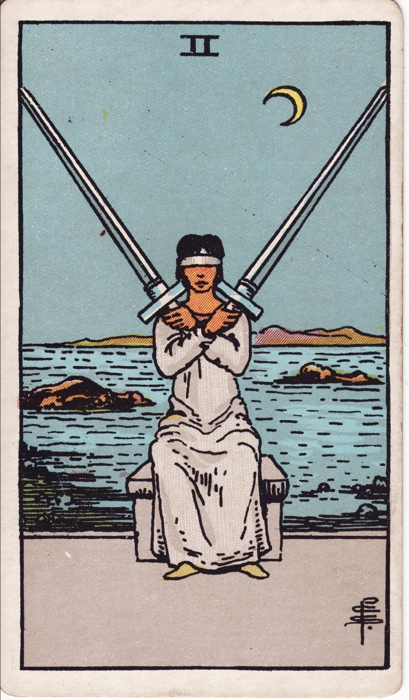
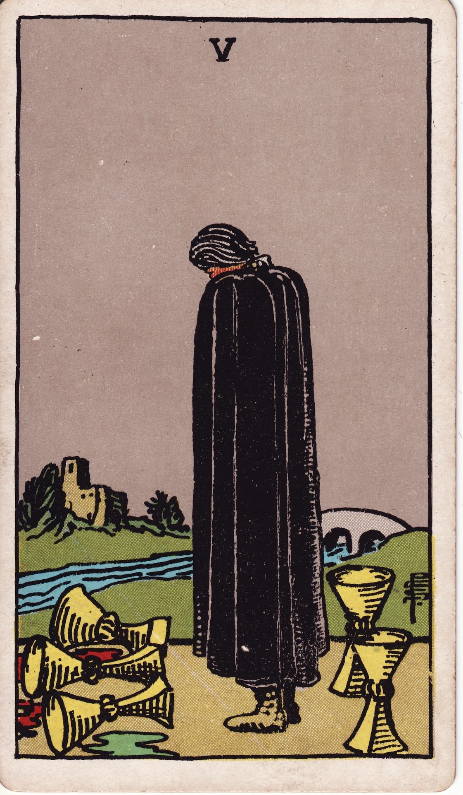
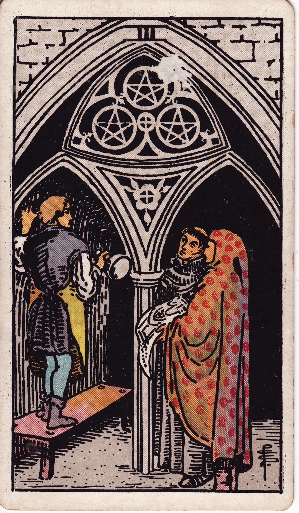

# 塔罗牌系统教程与全资料汇编

**视频制作整合版 · 24 集零基础教程 · 页面成片修订**

课程以莱德–韦特–史密斯塔罗（Rider–Waite–Smith，简称 RWS）为主要教具。观众第一集就跟做一张牌，之后学习牌组、完成一组三牌解读，再练逆位、与他人互动和较大的牌阵。学完应能指出牌面的依据，解释牌位，提出可以核查的联想，并写下自己愿意采取的一步。

这份文档是页面视频的制作底稿。每集写明口播、画面、暂停题和讲评，并选一处用代码演示看图、比较或改判。页面上摆清楚题目、原始牌图和当下需要用到的事实。文末可以查 78 张 RWS、79 张奥修牌、牌阵及原始资料。

<a id="start"></a>
## 页面成片的统一做法

### 正片的基本顺序

旁白先提出一个具体任务。页面带观众做一遍，给出暂停题，再逐步揭示参考解法。牌面描述用具体的名词和动作。说“我可能在等消息”时，把它标为解释。最后亮出案例中的已知信息，让观众看到为什么这条解释被保留、修改或放下。脚本中的时段覆盖镜头、动作、回看画面和互动，正片长度可随实际试录和练习停顿调整。

| 屏幕上写什么 | 讲解时做什么 |
| --- | --- |
| 题目与已知情况 | 先介绍观众能参与的事，让观众知道要解决哪个小问题。 |
| 牌名与牌位 | 牌面出现时同步标注牌名和牌位。切到逆位时明确标出方向。 |
| 画面、联想、核对 | 在牌上圈出实际线索，再叠加联想。给出支持和不支持解释的事实。 |
| 暂停题与参考解读 | 暂停前把牌图、问题、已知事实放在同一画面。讲评给一种参考读法和判断依据。 |
| 下一步与记录 | 用人物、时间和动作写出可重复的练习。选一天回来记录结果。 |

全课用“星币”“王后”“侍者”。源资料里常见“钱币”“皇后”“侍从”。女皇是大阿卡纳 III，王后是小阿卡纳的宫廷牌。正位与逆位说的是朝向，牌本的编号和牌名另行核对。

### 哪些判断用代码演示

每集的「本集用代码演示什么」先交代三件事。**固定**指前后一样的牌、牌位、问题或画面位置。**改变**指这一轮只替换的事实、牌位、花色或观察焦点。**观众判断**写成一句可以回答的问题。先给出题目和当前事实，留出作答时间。案例有新事实时，让观众看清变动并先写下自己的修正，随后给出参考解读。观众可用视频原有的暂停操作作答。

| 镜头用法 | 画面怎么变 | 适合的课 |
| --- | --- | --- |
| 圈出牌面的证据 | 保留完整牌图，按口播亮出一个细节。观察和推测使用独立的文字区。 | EP01、EP04、EP14 |
| 并排看同一条件 | 保持标题、缩放与位置一致，只推进同一个比较维度。 | EP06、EP09、EP16 |
| 替换事实并修正解释 | 保持牌、牌位和提问同框。替换一张事实卡，停顿，再标出哪句解释被改掉。 | EP17–EP19 |
| 标出牌位和顺序 | 先展示空阵图，牌图按顺序进入编号格。需要旋转时先露出牌边基准，再标出 180° 和正逆朝向。 | EP17、EP20、EP21 |

页面制作时，「俯拍」用平面牌位视图，「特写」用原图局部放大。脚本里的摆牌、转牌或手指提示，用牌图入位、平面旋转或描框表现。对话用分角色的文字与旁白，按顺序揭示，保留供观众核对的原句。实体洗牌和翻牌见[牌面朝向与基本操作](#page-card-basics)。

### 画面和口播怎么配合

暂停前把问题、牌面和当前事实放在同一屏，答案等讲评才出现。动效跟着学习动作走，先让观众看到细节，然后用口播说明这条线索支持什么。遇到多个候选时，画面只保留本轮需要判断的两条。撤掉旧解读时加上划线或文字标记，配色可作辅助。

先在手机大小预览题目、牌名和需要指出的细节。再静音看一遍，检查能否分辨题目、作答时机、变了哪条事实。最后打开声音，检查旁白是否说明了取舍依据。代码分镜是制作约定，停留时间按试录后的实际语速与观众阅读速度校准。

<a id="sample-ep17"></a>

### 可先做的 50 秒样片

从 EP17 的读书会改期截出一段做样片。使用项目已有的牌图，按下表安排镜头。在 HyperFrames 里把问题、固定牌位、事实 A、事实 B、两版解释和动作作为输入。代码负责控制揭示时间和替换范围，具体解释按讲稿校对。

| 时间 | 画面与口播 |
| --- | --- |
| 00:00–00:05 | 牌面亮起，宝剑二占画面重点。提问“牌没换，为什么建议会变？” |
| 00:05–00:18 | 显示「还没问报名者」，请观众先选「问信息」还是「定方案」，停顿后亮出第一条参考解读。 |
| 00:18–00:32 | 牌和牌位留在原处。只把事实卡切为「已收齐回复，两种都可行，还没定案」。留出短停顿，让观众挑一句要改的解释。 |
| 00:32–00:50 | 划掉「信息不够，先投票」，显示「还没取舍，先定选择标准」。口播“牌上还是同样的两把剑。让我改主意的，是刚知道的这条消息。” |

样片先检查一次。只听到「牌没换」还不够，观众应能说出更新的事实，并说明为什么原先的投票建议已经失去作用。长课沿用同一逻辑，用三张牌保留完整语境，并给观众留出作答时间。

### 案例、口播与牌图

- **案例状态上屏。** “模拟教学案例”指片中为训练设定的背景与反馈。“据原书改编”给出书页，并注明原书是否记录后续。请真人配合示范时，先取得对练习、录音和公开使用的同意。
- **使用牌图时。** 主课以 RWS 原始牌图为准。全图先上屏，局部放大时同时保留整张牌的定位图。片尾标注绘者、版本和图源。做牌本比较时，按本集注明的版本核对牌名、绘者和画面，使用有使用许可的图像或标明出处的构图示意。
- **遇到需要现实判断的问题。** 对疾病、怀孕、法律、借贷投资等事项，画面把问题引回检查、文件、专业意见和当事人选择。当事人缺席时，请观众回到已经发生的互动和可以设法确认的表达。读牌练习可随时暂停。
- **统一正位流程。** 页面先给问题和牌位，再展示指定的正位牌图，依次观察、核对和记录。观众用实体牌自练时，可按[图解](#page-card-basics)先定朝向、洗牌和翻牌。EP20 再演示如何混入和处理逆位。
- **制作检查。** 静音看一遍，确认观众能从字幕找到题目和牌位。用手机尺寸预览一次，确认牌名、编号与关键细节容易辨认。按页面顺序核对牌数、朝向、牌位及事实和答案的揭示顺序。

### 页面素材和已有示例牌图

制作时准备原始牌图、牌位标签和画面用的练习栏。观众用纸笔或手机便签即可跟练。下面三张是主线示例。其他牌可从[逐张牌图索引](#rws-reference)打开。

| 宝剑二 · EP01、EP04 | 圣杯五 · EP13、EP17 | 星币三 · EP15、EP17 |
| --- | --- | --- |
|  |  |  |

牌面绘制为 Pamela Colman Smith。 [宝剑二扫描件](https://commons.wikimedia.org/wiki/File:RWS_Tarot_1910_-_Swords_02.png) · [圣杯五扫描件](https://commons.wikimedia.org/wiki/File:RWS_Tarot_1910_-_Cups_05.png) · [星币三扫描件](https://commons.wikimedia.org/wiki/File:RWS_Tarot_1910_-_Pentacles_03.png)

<a id="course-index"></a>
## 24 集目录

| 集数 | 这一集学什么 | 重点代码镜头 | 看完提交什么 |
| --- | --- | --- | --- |
| [EP01](#ep01) | 第一次单张读牌 | 正位宝剑二开场，揭示群消息筛选解释 | 两处画面、两种联想、一项核对和一个行动。 |
| [EP02](#ep02) | 问出可行动的问题 | 同一提问换核对材料 | 改写一个问题，并指出去哪里了解事实。 |
| [EP03](#ep03) | 分清牌本，认出 78 张的结构 | 同一副 78 张牌逐组点亮 | 认出一张大牌、一张数字牌和一张宫廷牌。 |
| [EP04](#ep04) | 用 S.E.E. 从图像连回现实 | 同一张牌与题目，对照两种现实情况 | 为权杖九写两种解释、一条能区分它们的核对问题，以及核对后的行动。 |
| [EP05](#ep05) | 通过愚人之旅定位 22 张大牌 | 同一趟旅程换观察焦点 | 按图把一组大牌放回旅程，并用一句话解释节点。 |
| [EP06](#ep06) | 把四花色和数字合起来读 | 数字五固定，逐个对照花色 | 比较同为数字五、花色不同的两张牌。 |
| [EP07](#ep07) | 把四种宫廷位阶读成行为 | 星币骑士从现况移到下一步 | 用同一人四个阶段的动作解释宫廷牌。 |
| [EP08](#ep08) | 大牌 0–V，认识起步方式 | 同一张魔术师换牌位 | 对比两张示例牌，并给出一种迁移解读。 |
| [EP09](#ep09) | 大牌 VI–X，区分方向与用力方式 | 同一困境换两个子问题 | 用战车和力量提出两种处理同一情况的动作。 |
| [EP10](#ep10) | 大牌 XI–XVI，识别边界和改变 | 从旧规则切到试行安排 | 用牌图描述阶段结尾或结构变化，并找现实依据。 |
| [EP11](#ep11) | 大牌 XVII–XXI，区分希望、疑虑与明朗 | 投稿格式从待确认变为已核实 | 指出观察线索和一个尚待验证的事实。 |
| [EP12](#ep12) | 权杖的行动、坚持与负荷 | 用任务卡演示重新分工 | 给行动卡点写下可以推进或分担的做法。 |
| [EP13](#ep13) | 圣杯的感受、失落与转向 | 观察框从倒杯移向立杯 | 对照关系或个人选择中的两个情绪情境。 |
| [EP14](#ep14) | 宝剑的判断、暂停与限制 | 核实报价后重新选标准 | 从两张示例牌辨认不同难点，写出核查问题。 |
| [EP15](#ep15) | 星币的资源、协作与累积 | 改字号，比较试读记录 | 换一个场景练盘点资源、向谁询问或怎样分工。 |
| [EP16](#ep16) | 同名牌在不同牌本中的画法 | 同名牌换牌本，比较图像与动作 | 分别描述两副牌的图，指出至少一处影响解释的差异。 |
| [EP17](#ep17) | 第一次完整三张连读 | 三牌固定，只换报名反馈 | 按现况、阻碍、下一步写一次综合解读。 |
| [EP18](#ep18) | 筛选三张牌的候选解释 | 只换准备方向，筛选三种判断 | 写下哪条解释被反馈改变、为什么改变。 |
| [EP19](#ep19) | 听到反例后撤回判断 | 逐条揭示模拟聊天消息，划掉失据推测 | 写一句明确的撤回和一个开放的下一问。 |
| [EP20](#ep20) | 加入逆位 | 实拍旋转，用箭头标正逆 | 用同一张逆位比较受阻和过度，并列判断条件。 |
| [EP21](#ep21) | 用四张直指核心，也认识二择一 | 揭示右下牌位的用途 | 把一个日常问题拆成四个牌位。 |
| [EP22](#ep22) | 牌戏简史与三个常见牌系 | 同为 VIII，换牌系认牌名 | 分清历史游戏的将牌和现代 22 张大阿卡纳。 |
| [EP23](#ep23) | 进阶互动和两张牌的配对 | 双牌固定，从观察切到联想 | 用一组配对写共同点、差异和一项待核查信息。 |
| [EP24](#ep24) | 奥修禅塔罗选修与结业 | 先做结业题，再逐位揭示参考 | 整理 RWS 三张解读和个人复盘。 |

**配套查阅**　[50 秒样片分镜](#sample-ep17) · [牌面朝向与基本操作](#page-card-basics) · [屏幕练习卡与考核](#practice-assessment) · [转岗、室友与四牌案例](#coach-cases) · [韦特 78 张](#rws-reference) · [牌阵手册](#spread-reference) · [奥修 79 张](#osho-reference) · [读牌进阶与 15 份资料](#source-notes)

<a id="scripts"></a>
## 24 集分集讲稿与拍摄提示

<a id="ep01"></a>

### EP01 第一次单张读牌

**本集交付**　跟着一张正位宝剑二完成单张读牌。说出两处看得见的细节，写两种可能的联想，选一项可以查证的信息，再定一个今天能做的小动作。计划片长 6 分 20 秒，含跟练留白。

**页面素材**　使用帕梅拉·科尔曼·史密斯绘制的 RWS 宝剑二扫描图。首屏直接显示正位全图和题目。准备一条虚构的小组群消息，以及“看见／可能／核对／行动”四栏记录。群消息用文字排版呈现，标明“模拟案例”。 [宝剑二扫描件出处](https://commons.wikimedia.org/wiki/File:RWS_Tarot_1910_-_Swords_02.png)


**本集用代码演示什么**　固定正位宝剑二和小组作业题。先让观众比较两种联想，再揭开同一条群消息，更新哪种联想有依据。最后保留一个完整示范记录供观众逐栏对照。

**00:00–00:35　用这张牌开始**

- **页面**　宝剑二正位全图从第一屏起保持可见。题目显示“今天我可以做哪一步，让小组作业往前走？”只把当前要填的栏加亮。
- **口播**　“这是宝剑二。今天就用这一张牌。想象你在做小组作业，大家还没提交，你想知道自己现在能做什么。先跟我看图。答案会在你想过以后再出现。”

**00:35–01:40　说两件能指出来的事**

- **页面**　留 10 秒看完整牌图。先空着“看见”一栏，口播提问后再依次圈出眼罩、交叉的手臂和双剑。圈线移开以后保留牌图和两句观察。
- **口播**　“你能从图上找出两件可以指给我看的事吗？我看到一个人坐着，眼睛蒙了布。我还看到这个人双臂交叉，两手各握一把剑。我们先把这两句写下来。有人一看就说‘她怕做决定’，你能指给我看的是蒙住眼睛的布，怕不怕是我们下一步要想的。”

**01:40–02:55　同一幅图，先想两种可能**

- **页面**　题目与牌图原位保留。“可能”一栏逐条出现两句短提示“A 两件事顾不过来”“B 在等一条消息”。每条先显示它对应的图像位置，再显示文字。末尾留 10 秒让观众比较。
- **口播**　“看到两手各握一把剑，我想到，也许我们手上的任务太多，哪件都舍不得先放下。再看蒙着的眼睛，我也可以想到还缺一条信息，先停下来等一下。用自己的话说一遍，‘可能是我同时顾两件事’，或者‘可能是我还没拿到继续做的消息’。现在两种都留着。”

**02:55–04:10　查一件事，再决定哪种更合适**

- **页面**　先显示“可以查哪条消息？”，把答案区域留空 10 秒。随后逐行揭示同一条模拟群消息。第一行“分工已确认”，第二行“提交格式待老师确认”。在 A 旁加“暂缺依据”，B 旁加“目前较贴合”。保留两句解释及完整消息，给观众读完。
- **口播**　“如果这是你的组，你会查哪里？我会先翻一下小组群，看到底还有哪件事没定。群里这条消息说，分工已经确认，提交格式还在等老师答复。这就支持了‘我们还在等信息’。至于是不是活儿太多，这条消息还看不出来。先保留这个可能，别把它写成已经查到的情况。”

**04:10–05:10　把联想变成一步行动**

- **页面**　“核对”栏填入“分工已定，格式待确认”。下一拍在“行动”栏写“晚饭前在组群问清提交格式”，再显示可以照着写的一条消息。全程保留“模拟案例”标记。
- **口播**　“我选的动作是晚饭前在组群发一条消息，确认这次交 PDF 还是可编辑文档。‘让作业别卡住’有点空，换成‘晚饭前问清提交格式’，我就知道自己什么时候做什么。要是群里已经补发了模板，我就先打开它，对照自己负责的那一段。”

**05:10–06:20　暂停走一遍，再对照**

- **屏幕练习**　保留原题和宝剑二，清空四栏答案，给 20 秒停留并提示可暂停。让观众自己说两处细节、写两种联想、指出能查的那条信息，最后选一个小动作。想换自己的情境，可以用“今晚整理书桌，我从哪里开始？”
- **参考记录**　看见“眼睛被布蒙住，双手各握一把剑”。可能“事情同时压在手上／还在等信息”。核对“小组群里分工已确认，提交格式还没定”。行动“晚饭前发一条消息问清提交格式”。
- **口播与下集衔接**　“能在图上找到你说的两处细节吗？你的解释能被查到的信息支持吗？行动能在今天开始吗？如果还想不到贴合的联想，也可以写‘暂时没有’。下一集我们就练怎样问出一个自己能处理的问题。”

手边有实体牌、想了解日常操作时，可看[牌面朝向与基本操作](#page-card-basics)。

<a id="ep02"></a>

### EP02 问出可以行动的问题

**本集交付**　三道问题改写，每道都写出当事人可做的事、时间范围和一条现实核对途径。正片约 8 分钟。

**开拍准备**　三张“观众原问”白卡、三张空白改写卡、分栏记录纸、虚构投递记录。桌面左列“我知道什么”，右列“我还能核对什么”。本集先把牌扣在一旁，让学员看见提问先于抽牌。 [《塔罗葵花宝典》PDF 第83–84页](<docs/塔罗葵花宝典.pdf>)

**本集用代码演示什么**　固定“我会找到实习吗？”这张原问卡。改变桌上可查的材料，逐张对照“简历漏链接”和“还未选方向”。观众判断当前先改材料还是先缩小岗位范围。

**00:00–01:10　先想要解决什么**

- **画面**　镜头读第一张卡“我会找到实习吗？”翻过来是一行空白。讲师在空白处先写“这周”、再写“投递”。
- **口播**　“如果有人回答‘会’，你这周准备做什么？如果回答‘不会’，你又会放下哪些可以试的事？先把想问的结果翻成一个你能参与的动作。”

**01:10–03:15　同一个原问，可以有两个有效方向**

- **画面与揭示**　把原问卡留在桌面上方。一次只亮一张模拟资料，先展示投递表的六条记录，突出其中四条职位的“需作品链接”和当前简历的空栏。在讲师写新问题前留 8 秒，提示“先改什么？”答完露出“这周我先改哪一项投递材料？”再切换到“作品链接已齐，岗位方向未定”的另一份样例。原问和位置保持，右栏换成“这周我先投哪类岗位？”
- **口播**　“第一份记录已经指出一个能补的缺口，我先把作品链接放进简历，再对照岗位要求检查。第二份已经有链接，我会挑三条想投的岗位，看自己的经历够不够贴合。原问一样，手边已有的信息改变了我们先问什么。”
- **镜头落点**　两张写好的实体卡并排。下方各显示一条核对途径“比对简历与岗位要求”“比对三条岗位要求”。留 10 秒，让观众能读完这组对照。

**03:15–05:35　把另一个人的想法还给他**

- **画面**　原问“朋友是不是故意没赴约？”展示消息“今天没赶上，抱歉”，卡片另分“看到”和“猜到”。
- **口播**　“收到这条消息，我知道约没见成，也看到了道歉。是否故意，我还不知道。有两个方向可以选。想弄清经过，就问‘我怎么开口确认上次发生了什么？’想继续来往，就问‘下次约见面前，我们可以怎样确认时间？’一题选一个目标。”
- **镜头**　第三张卡“我现在是不是生病了？”改放在“需另行核验”的区域。口播“身体疑问要看症状记录、合适的检查和专业判断。想练牌，可以另选一个自己能安排的日常问题，例如‘今天我能怎样整理待办，让自己腾出休息时间？’”

**05:35–08:00　暂停改三道题**

- **屏幕练习**　“我的事业这辈子会成功吗？”“同事是不是故意拖我后腿？”“两个社团我该选哪个？”每题写一句改写和一条核对途径。留 20 秒后翻参考卡，可暂停。
- **参考与自查**　“本月可以试做哪种任务，帮助我认识自己喜欢的工作？”查实际体验和反馈。“这次任务要怎样确认接手时间和交付要求？”查分工和消息。“这周我能怎样试参加 A、B 的活动？”看时间表并记参与感受。每题有具体处境、当事人能参与的动作和能查的信息，就过关。
- **下集衔接**　“问题写好后，抽到哪张牌都先要知道自己拿的是什么。下集把七十八张摊开，学会定位。”

<a id="ep03"></a>

### EP03 看懂 78 张与选择入门牌

**本集交付**　从三张示例牌找出大牌、数字牌和宫廷牌，核对手中的牌能否和课程画面对上。正片约 8 分钟。

**开拍准备**　一副 78 张 RWS、四条花色标签、三条类别标签、RWS、马赛、托特三套权杖五的实物或授权图。现代重绘只作对照，画面标清牌本。 [RWS 整套牌图](https://commons.wikimedia.org/wiki/Category:Rider-Waite-Smith_tarot_deck_(TaionWC))

**本集用代码演示什么**　固定同一副 78 张 RWS 和镜头中的真实牌图。改变桌面上被点亮的类别或牌位，计数随分组展开。观众用牌名、编号、花色判定星币骑士应落在哪个格子。

**00:00–01:15　三张牌认出三类**

- **画面**　把 III 女皇、星币三、星币侍者放在同一行。先圈女皇的罗马数字，再圈星币三的三个花色符号，最后圈侍者的英文头衔。
- **口播**　“同样看见一个‘三’，女皇的 III 是大牌序号。星币三的‘三’，是牌上星币符号的数量。星币侍者有角色名，也带着这个花色。认牌先找编号、花色或者头衔，别急着查关键词。”

**01:15–03:30　拆开 22 加 56**

- **画面与揭示**　实拍铺愚人、力量、正义、世界作大牌行的定位牌。对齐俯拍网格，上编“0–XXI”，下分权杖、圣杯、宝剑、星币四行。讲师铺出星币一行的实际牌，暂时留出一个空格。代码先括出 A 到十，再括宫廷牌的四个位置，全屏用同一顺序补齐其余三行。顺着讲师的手显示“22＋4×14＝78”。让星币骑士单独入镜，给观众 8 秒指出它所属的行和角色，再用手把牌放进空格。
- **口播**　“一副标准 RWS 有二十二张大牌，从零号愚人到二十一号世界。四组小牌每组有 A 到十，再加侍者、骑士、王后、国王。A 读 Ace，就是王牌，也放在数字牌这一栏。现在我拿着星币骑士，你能先指出它在哪一行，再指出它放在哪一类位置吗？”停顿后收音“先找星币组，再找骑士。这样就不用从头翻整副牌。”

**03:30–06:30　看三处就知道用哪套说明**

- **画面**　同名权杖五三分屏。RWS 放多人举杖的场景，马赛传统放对称花色符号，透特放有几何构图的牌。再出力量与正义的编号条。
- **口播**　“我们主要跟 RWS。它的数字牌各有自己的画面，有的画人，有的主要是物件。马赛传统的数字牌常用花色、数量、排列来组织画面。透特的数字牌常用几何和色彩，有些还印着关键词。先对照你手里那副，不同画面可以从不同线索入手。”
- **演示**　“RWS 的力量是八、正义是十一。马赛常见版次正义是八、力量是十一，愚人通常没有编号。托特第八叫 Adjustment，第十一叫 Lust，宫廷里还有王子和公主。认不出牌本时，先查盒内说明，再决定跟读哪套牌义。手里是 RWS 重绘也可以，遇到画面不同就把原图放旁边。” [迈都隐士的设计分类，第1–5页](<docs/关于塔罗牌设计体系划分.pdf>) · [托特牌出版说明](https://www.usgamesinc.com/tarot-and-inspiration/Tarot-Decks/crowley-thoth-tarot-deck-large.html)

**06:30–08:15　暂停辨认**

- **屏幕练习**　依次露出愚人、权杖五、星币侍者，保留牌面和名称。写它们的类别、牌号或花色，再从自己手里的牌找一项和 RWS 一致或不同的地方。屏幕留 20 秒，可暂停。无实体牌可翻本集牌图目录。
- **参考与自查**　愚人是大牌零号，权杖五是权杖数字牌，星币侍者是星币宫廷牌。三个答案要能指出牌面依据。换成马赛数字牌时，原来从人物姿态得出的解释要按实际图像重做。
- **下集衔接**　“会认牌之后，试着面对同一个画面说出两种站得住的解释。下集就专练这件事。”

<a id="ep04"></a>

### EP04 用 S.E.E. 从看图走到行动

**本集交付**　用同一组画面细节写出两个不同解释，提出一条能区分它们的现实核对问题，并随事实更新。计划片长 7 分 45 秒，含暂停跟练。

**页面准备**　使用 RWS [宝剑二本地图](docs/assets/rws/swords02.png)与[权杖九本地图](docs/assets/rws/wands09.png)，保留完整牌边与牌名。右侧排四栏「看见／可能／查阅／核对与行动」。预制可移动的例句条、可按时揭示的模拟记录与文字状态标签。由同一旁白读出示例，页面用描框、标签移动和逐步揭示来呈现推理。 [宝剑二牌图](https://commons.wikimedia.org/wiki/File:RWS_Tarot_1910_-_Swords_02.png) · [权杖九牌图](https://commons.wikimedia.org/wiki/File:RWS_Tarot_1910_-_Wands_09.png)

**本集用代码演示什么**　先固定宝剑二、同一道定稿问题和两处可见细节。把一句推测移进「可能」，再切换模拟记录，让观众根据各自的事实为两条候选调整标签。迁移题保留权杖九和空表，参考答案在观众写完核对问题、读到新记录之后出现。

**00:00–00:35　同一组细节能给出两种解释**

- **页面**　屏幕仅保留宝剑二与新题「彩排前，我怎么把两版讲解稿定成一版？」角标写「模拟案例」。依次点亮 S.E.E. 三步「See 看见／Embody 用第一人称说一种可能／Empower 用事实核对并决定行动」。
- **口播**　“第一集带我们做完一次单张读牌。这次放慢其中一步。两种解释都能接上画面时，我会写下一个问题，找一条能把它们分开的事实。”
- **来源字幕**　S.E.E. 是本课教学改编。观察与第一人称复述、从图像联想到现实问题等思路参考格里尔。 [《塔罗读牌21式》第 2–4、8–10 式](<docs/塔罗读牌21式+(Mary+K+Greer).epub>)

**00:35–01:45　See 把能指出的东西留在观察栏**

- **页面**　宝剑二静置 8 秒。四栏只打开前两栏，「看见」中先出现三条例句「眼睛被布遮住」「双臂交叉，各握一把剑」「她在逃避」。请观众用 12 秒找出一句不能直接指给别人看的话。
- **揭示与口播**　描框从遮眼的布移到交叉握剑的双臂。前两行各在图上找到位置。第三行移入「可能」并改写成「我可能迟迟没有选」。旁白“看得见的是布和交叉握剑的双臂。这幅图还没告诉我们人物为什么蒙眼。‘她不愿意看’也要移进可能栏，等现实里有线索再选。”

**01:45–03:00　Embody 同两处细节，试写两句第一人称**

- **页面**　显示已知「两稿都写好了，一版按过程讲，一版先展示成果，彩排前要定稿」。牌面和两处观察始终保留。「可能」栏给两个空位，请观众用 15 秒各写一句以「我可能」开头的话，再打开答案。
- **揭示与口播**　“A 我可能担心定一稿就得舍掉另一稿的内容，所以迟迟没选。B 我可能有意先留着两稿，等约好的计时对照再选。交叉握着两把剑，让我想到两个选项还在手里。遮住眼睛，让我想到现在没有选定。这里的 Embody，就是用‘我’说出一个可能的处境。”
- **查阅**　点亮「查阅」栏，显示宝剑二常用的主题「暂时相持／还需确定什么」。旁白“查阅让我们确认两句都和牌面接得上。下一步找能区分 A、B 的记录。” [宝剑二所在的牌义速查](#ref-rws-swords)

**03:00–04:55　Empower 找一条能改判的事实**

- **页面与口播**　给 15 秒写自己要核对的问题。然后显示示范问题「有没有约好一次对照试讲和定稿时间？」停一拍，揭示模拟记录 1「群里已约好 17:00 两稿各试讲三分钟，17:30 定稿」。两条解释保持原样，只在 B 旁标「目前更贴合」，A 标「暂缺支持」。
- **示范选择**　“这条记录有具体时间和选法。有了它，我更倾向于 B。我今天可以准备两稿，按同样时长试讲，让一位同学记哪里更好懂，再按约定定稿。”把行动写进末栏。
- **反证练习**　卡片标题切成「另一种情况，题目和牌都相同」，换一份模拟记录「两稿已试讲，记录已有。我舍不得删掉另一稿的内容，定稿两次推迟」。留 8 秒让观众先选。揭晓 A 改为「目前更贴合」。口播“现在可以拿试讲记录一起商量重点，约一个今天能完成的定稿时间。换的是现实情况，牌上看得见的仍是那两处。”

**04:55–07:20　换权杖九，等到记录出现再选**

- **页面练习**　显示权杖九和新题「展板明天验收，主体已完成，我还在来回翻文件。我该怎样收尾？」给 35 秒写两处看见、两个以「我可能」开头的解释和一条要核对的问题。屏幕提示「写完再继续」。模拟验收单此时合起，参考答案保持隐藏。
- **事实揭示**　展示「待查项只有尺寸、出血线和图片链接。最新导出文件的三项都已确认，文件尚未上传」。给 10 秒在原答案旁写下哪种解释更贴合，以及最先做哪件事。再显示完成的四栏表。
- **参考与口播**　“我看到头缠绷带的人握着一根杖，身后立着一排杖。绷带看得见，‘现在还有危险’已经在猜。我可能在确认一项未查的内容，也可能已经核对，却还反复翻同一份文件。我会核对最新版还有哪项没查。看到三项都已确认，第二种更贴合。今天上传这份已验过的文件，记下版本号。若清单实际还漏了一项，就先查那一项。”查阅栏标「警觉、坚持」，让观众分辨这是读法里的共同主题。 [权杖九所在的牌义速查](#ref-rws-wands)

**07:20–07:45　自查再交接**

- **页面与口播**　“图上能指出两处吗？两句‘我可能’能被同一个问题分开吗？行动随着核对过的事实改变了吗？把这三点留在记录里。下一集我们用短故事，把大牌记成一条路线。”

<a id="ep05"></a>

### EP05 愚人之旅导览

**本集交付**　认出三个七张组，并为其中三张牌各写一句有画面根据的解释。正片约 8 分钟。

**开拍准备**　22 张 RWS 大牌、三条用来分隔三行的色带、愚人、战车、力量、高塔的图像特写。一张纸写虚构情境“学生小组准备第一次公开演示”。 [RWS 整套牌图](https://commons.wikimedia.org/wiki/Category:Rider-Waite-Smith_tarot_deck_(TaionWC))

**本集用代码演示什么**　固定同一副大牌和公开演示题。改变桌面矩阵中当下放大的牌，并从实拍细节回到它的序号位置。观众给愚人、力量、高塔定位，再解释一处真正看见的细节。

**00:00–00:55　把愚人放到门口**

- **画面**　讲师把 0 号愚人放在左侧，右方三条色带空着。在画中圈出行囊和脚边缘，镜头给完整构图。
- **口播**　“愚人带着小行囊来到悬崖边。你可能想到愿意迈出第一步，也可能想到起步前有个风险值得确认。今天让这张牌站在旅程入口。从一到二十一排成三行，每行七张，先用故事记住它们的位置。”

**00:55–03:35　三行都用同一个任务来讲**

- **画面**　从右方三色带依次展开 I–VII、VIII–XIV、XV–XXI。每次只放大一张示意，避免快闪。字幕随镜头落下“外在规则／自我调整／变化与收束”，这些字卡标为本课记忆提示。
- **口播**　“第一行，一到七。小组从有个念头出发，学习方法、建立规则、选择方向。到第七战车，画面像准备朝一个方向走，团队此时也要明确先把哪件事做完。”
- **口播**　“第二行，八到十四。知道方向后，我们还得处理怎样用力、停下来判断以及什么时候换方法。第八力量牌里，人的双手靠近狮口。我可以联想到能在紧张处保持耐心，或者提醒自己别把所有问题都用更大的力气压过去。”
- **口播**　“第三行，十五到二十一。计划可能遇到束缚、突变、恢复与收尾。第十六高塔里，闪电击中塔，塔顶被掀开。演示投影坏了可以让我们想到突然中断。排练发现方案根本讲不清，也可以让我们想到主动放下原结构，换一种讲法。” [《塔罗葵花宝典》PDF 第10–12页](<docs/塔罗葵花宝典.pdf>)

**03:35–05:50　别用阶段替代上下文**

- **画面**　分屏并列战车、力量。左屏字幕“团队分歧一直转圈”，右屏“排练时着急，把同伴话打断”。切近景看战车人物和两只颜色不同的狮身像，再看力量人物与狮子。
- **口播**　“战车可以问‘哪件工作需要定方向？’也可以问‘我们是不是推进太急，没让人跟上？’力量可以问‘怎样不急着反驳，先听完一个意见？’也可以问‘我已经忍耐太久，哪里需要说清底线？’本集借牌序把主题排好，真正读牌时，看手头的问题和画面的细节。”

**05:50–08:05　暂停，把三张牌各写一句**

- **屏幕练习**　实拍矩阵仍在，画外放愚人、力量、高塔三个牌面近景，依次配“首次报名”“排练紧张”“投影不可用”。矩阵先只显示序号与分行边界，0 号留独立格。请观众写出三张的位置，每张再写一条图像依据和一句解释。给 20 秒停留，可暂停。
- **揭示与自查**　随着讲师摆回三张纸牌，代码依次给 0、VIII、XVI 原位加框，旁边各出现“一处依据”。依次定格行囊、靠近狮口的手、被掀开的塔冠，口播“愚人放在三行外，你可以想到轻装开始，或者借图上的崖边问清报名规则。力量在第二行，有人紧张时可以把引导动作放慢。高塔在第三行，突然失去原有设备，先核对能否借用设备或改成纸面展示。只记对位置还不够，把解释连回你圈的东西。”
- **下集衔接**　“下一集把注意力移到小牌。四张牌都是五，为什么各自说的事不一样？”

<a id="ep06"></a>

### EP06 四花色与数字怎么合读

**本集交付**　用同一条现实问题解释四张五的差异，并能把方法迁移到一张新的数字牌。正片约 8 分 30 秒。

**开拍准备**　RWS 权杖五、圣杯五、宝剑五、星币五与星币三。准备“活动组需要提高到场率，距离活动还有三天”的问题卡，四张背景事实卡和三列表格“画面／暂定解释／下一步”。 [权杖五牌图](https://commons.wikimedia.org/wiki/File:RWS_Tarot_1910_-_Wands_05.png) · [RWS 整套牌图](https://commons.wikimedia.org/wiki/Category:Rider-Waite-Smith_tarot_deck_(TaionWC))

**本集用代码演示什么**　固定数字 5 和“还有三天，先核对哪项会影响到场率？”这道题。每次只切换花色与相应图像。观众把线索与真实牌图配对，说出哪项现实信息值得去查。

**00:00–01:30　先看共同数字，再找差异**

- **画面**　四张五并排，放大各自符号和人物。把“五”和四组花色分别标在卡片上。镜头在每张牌上停 6 秒再移动。
- **口播**　“五可以先当作干扰原有安排的线索。再问它发生在哪里、怎么发生。权杖常看行动，圣杯常看感受或关系，宝剑常看分辨和交锋，星币常看可用资源。任何花色都可以用来读同一个问题。”

**01:30–04:25　一个活动，四种值得核对的困难**

- **画面与配对**　上方始终留“5”和“还有三天，先核对哪项会影响到场率？”下方用同一尺寸的实拍牌图切换四个花色。先把四张牌缩到同一排，屏幕只问“三只倒杯、两只立杯，在哪张？”给观众 9 秒。搭档指出圣杯五，随他的手停在倒杯、立杯处再显轮廓。镜头返回单张对照，固定问题与数字仍在。
- **切到权杖五**　框住交错的杖。讲师“我们先核对各人的宣传做法有没有汇总。有人在试各自渠道，也可能已经约好一起复盘。”翻背景卡“没约统一发布”，下方只写“查发布安排”。
- **切到圣杯五**　框住三倒两立。搭档“我先看看还有谁愿意协助，刚才只顾问没来的熟人。”下方只写“查仍在的联系”。
- **切到宝剑五**　先看一人手里的剑，再看远处两人。讲师“讨论过后，有人可能退出，也可能只是暂时离开。先查群里的原话和谁还在接任务。”下方只写“查沟通记录”。
- **切到星币五**　保留雪中行人和亮窗。讲师“到不了现场也可能是交通或场地的问题。先问两位没报名的人，再核对实际路线。”下方只写“查到场条件”。最后回到同一排四张图，短停给观众比较刚才圈出的细节。

**04:25–06:10　让三条线索指向同一件事**

- **画面**　写下“星币＋三＋人物对着图样”。在黑板上列“资源与工作”“合作初步成形”“三个人在建筑下交流”。
- **口播**　“星币给我们现实的材料和做法。三可以用来记互动。在星币三的画里，有人站在长凳上，另两人在旁，其中有一张图样。放回活动题，我可能建议把渠道任务写成一张共同清单，请愿意帮助的人认领。如果情况是大家已有清单，解释也可以是先拉齐每一项的完成标准。”
- **制作**　并排放“没清单”和“已有清单”两种背景，突出同一牌在相同题目下怎样随已知信息移动。 [《塔罗葵花宝典》PDF 第12–15页](<docs/塔罗葵花宝典.pdf>) · [《塔罗读牌21式》第5–7式](<docs/塔罗读牌21式+(Mary+K+Greer).epub>)

**06:10–08:30　暂停写两句**

- **屏幕练习**　“读书会报名不及预期，有三个不同宣发方案，两位老成员愿意帮忙。”用权杖五和圣杯五，各写一项“我可以先留意什么”，并用星币三补一个可分配的行动。保留 20 秒，可暂停。
- **参考与自查**　权杖五可指宣传做法未协调，圣杯五可问留存的支持是否被忽略。星币三可以建议把“更新报名页、联系老成员、安排提醒”写成三个可认领任务。每句话要有牌面线索并符合这个处境。若写出“圣杯只能讲感情”，再问支持成员的关系为什么对活动有影响。
- **下集衔接**　“数字牌能帮你看见处境。下集看宫廷牌，同一个人可以怎样换一种做事方式。”

<a id="ep07"></a>

### EP07 四种宫廷角色

**本集交付**　用星币四张宫廷牌描述同一位成员的四种做事方式，并在一个新场景中判断当前最需要哪一种。正片约 8 分 30 秒。

**开拍准备**　RWS 星币侍者、骑士、王后、国王，一个小型展板模型，卡片“学习”“执行”“照料资源”“统筹”。四张牌用姓名牌大小的托架排开，图下显示中英文头衔。 [RWS 整套牌图](https://commons.wikimedia.org/wiki/Category:Rider-Waite-Smith_tarot_deck_(TaionWC))

**本集用代码演示什么**　固定一张星币骑士、一位展板制作成员和同一项任务。改变牌位从“现况”到“下一步”以及问题标签。观众判断什么时候在读已有行为，什么时候在提一个可试的做法。

**00:00–01:05　先问画里这个角色怎样做事**

- **画面**　四张星币宫廷整组亮出，剪入桌上同一双手在看样件、按表贴字、照顾工具、审核清单的四个动作。
- **口播**　“想象做展板的是同一个人。她今天学着出小样，明天在按批次制作，交付前整理所有材料与时间。宫廷牌可以帮我们描述怎样做事，有时也可以描述一个人在这件事里提供了什么。”

**01:05–04:45　四张牌在一个项目里走一遍**

- **画面与讲解**　侍者双手托币，注视它。“侍者可以问‘我需要学会哪个动作？’放到展板上，先拿一小块废材测试胶带。也可能我过度留在尝试，迟迟没有做正式版本。先看第一份小样到底有没有经过检查。”
- **画面与讲解**　骑士坐在停驻的马上，一手持币。“骑士可以问‘我怎样持续执行？’有了合格样件，就按同一手法批量做。另一种可能是坚持了不合适的做法，尺寸变了还按旧模板剪。确认验收要求，再确定要不要调整。”
- **画面与讲解**　王后坐着照看膝上的币，画面周围有植物。“王后问‘怎样提供能让事情继续的条件？’可以把工具归好，让晚到的同学也能接着做。若自己把每件小事都揽了，组织起来的方式要再调一调。”
- **画面与讲解**　国王手持币与权杖，座旁有植物纹样。“国王问‘谁把资源和结果统起来？’可以把预算、交付时间和检验责任写在一处。假如已经有分工，可能更需要交接清楚，让负责人收到能判断结果的信息。” [《塔罗葵花宝典》PDF 第15–16、80–81页](<docs/塔罗葵花宝典.pdf>)

**04:45–06:35　换一个牌位，先改变要回答的小问题**

- **画面与揭示**　实拍星币骑士留在中间，纸张、样件和制作表保持原位。讲师先在牌旁放“现况”，代码显示“已按同一套步骤做了几份？”再用手换成“下一步”。暂时藏住回答，留 8 秒“你现在问哪件事？”等搭档说完，才显示“怎样把做法写成可重复步骤？”两个短句分别出现，牌图不动。
- **口播**　“牌还是这张。现况位让我去核对已经做了什么，可以看制作表。下一步位是请我提出一项可试的做法，比如把排版顺序写下，其他人接手也能照着做。若纸张还没到，可以先定尺寸和裁切清单，再等材料齐。这次我们看一个人在项目里的行为。”
- **镜头**　让牌位纸条留在原处，讲师用手换成侍者，引出下一段练习。

**06:35–08:30　暂停选一种角色**

- **屏幕练习**　“小组明天交展板。版式有了，只有一人懂怎么贴字。材料齐全，但多人不知道如何接手。”先选一张回答“下一步”，再写另一种选择在哪种情况下更合适。停 20 秒，可暂停。
- **参考与自查**　“选侍者，我用废材让两位同学各做一次，先确认方法。若大家都已经会贴，只是工具凌乱、接不起来，可以选王后，准备材料和工位。若方法稳定，便按骑士的节奏推进。”答案要说清当下缺哪种行动、依据哪处牌面与哪条事实。举出现况或角色时，把它说成可核对的行为。
- **下集衔接**　“接下来开始分组认识大牌。先从愚人、魔术师、女祭司看三种起步方式。”

<a id="ep08"></a>

### EP08 第一次认识大牌 0 到 V

**片长** 8 分钟。**课前摆放** 预排 0、I、II、III、IV、V，另备两张便签写「眼前资源」「下一步」。使用取得拍摄许可的韦特系牌图或实体牌。观众本集练会用大牌辨认处境的主题，并把一个主题说成手上做得到的事。 [韦特原典·0 到 V 的图版](https://en.wikisource.org/wiki/The_Pictorial_Key_to_the_Tarot/Part_2)

**本集用代码演示什么** 固定市集报名表、魔术师和已知事实，只切换牌位「眼前资源／下一步」。请观众判断哪句话分别回答两个牌位。

**00:00–00:45 先问一道眼前题**

镜头从「第一次负责市集报名表」的任务纸推到六张牌。口播「你只有四天，主办方发来一堆零散要求。第一步是马上开做，还是再问一句？今天我们用两张牌练怎么把这个问题拆开。」

**00:45–02:40 拍六张，每张圈出两处**

按序巡拍，每张定格约十秒，先请观众用自己的话描述，再打上主题词。愚人圈崖边与脚旁小狗，提示试探。魔术师圈举起的杖与桌上四样器物，提示启用资源。女祭司圈两柱与半露卷轴，提示信息尚未齐。女皇圈麦田与心形盾，提示培育。皇帝圈石座羊头与手中圆球，提示规则与责任。教皇圈交叉钥匙与下方两位人物，提示现成范例和共同约定。口播「人、物和位置是我看到的。后面那个主题，是我给画面的一种读法。」

**02:40–05:30 完成案例**

屏幕左边锁定魔术师和现场事实「有去年报名表和志愿者名单，容量和截止时间待确认」。右边先挂「眼前资源」，再把同一个位置标签切到「下一步」。口播「桌上四样东西没变。哪个位置在问我手上有什么，哪个在问我拿这些东西做什么？」停 15 秒让观众分别写一句，两个答案区保持空白。依次揭示「手上有可复用的旧表和名单」与「用旧表做一份最小草稿」，再切回桌拍，当场打开草稿。把本次第二张牌女祭司推到「下一步」。口播「她的卷轴只露一部分。这个问题还有两条信息没齐，我可以问负责人容量和截止时间。」镜头写出两条问题，回放草稿与提问，展示两个动作可以并行。

**05:30–07:20 停顿练习与讲评**

把「下一步」换成皇帝。给屏幕 45 秒，留三栏「看到什么／怎样回答牌位／我做什么」。随后展示参考答案「石座和圆球让我想到安排和责任。我会把‘谁审批、谁收集、何时关表’写进同一张交接单。」如果写成「老板会很严格」，请回到谁能做什么和哪些规则已经确认。

**07:20–08:00 交接到下一集**

回放魔术师的桌与皇帝的石座。口播「一个提醒盘点可用材料，一个提醒明确负责和规则。下集继续学往前走的牌，比较战车和力量在同一个难题里能各做些什么。」

<a id="ep09"></a>

### EP09 大牌 VI 到 X 与两种往前走的方式

**片长** 8 分 40 秒。**课前摆放** VI 到 X 排开，放一张周末排练日程与三人任务条。观众能用战车解释如何集中行动，用力量解释如何面对紧张和坚持边界。 [韦特原典·恋人、战车、力量、隐士、命运之轮](https://en.wikisource.org/wiki/The_Pictorial_Key_to_the_Tarot/Part_2)

**本集用代码演示什么** 固定两小时截止、三项任务与目标，在「先做哪项」和「怎么说出这个决定」之间切换提问。请观众分别为任务优先级和沟通选一条行动。

**00:00–00:45 开场对照**

战车、力量并排，身份名先用便签盖住。口播「周日下午要交小组演示，三个人想先改三件不同的事。你已经有点急了。先看这两幅画，它们各有怎样的动作？」停八秒，只指画面上的手、狮子和车前两只斯芬克斯。

**00:45–02:15 五张定位**

依次慢扫画面。恋人是天使下的两人，提醒对照共同重视的东西。战车是星纹车篷下的战士和车前两只斯芬克斯，适合问如何聚焦。力量是人物用手接触狮口，提醒有耐心地应付紧张。隐士举灯拄杖，适合留出复盘时间。命运之轮让图上的轮和四角有翼形象入镜，适合问外在条件变动后怎样调整。逐张展示短标签，最后回到头两张示范牌。

**02:15–05:35 完成同一案例**

页顶始终显示「两小时内完整试播一次」。三条任务横排，A 想重做封面，B 想加功能，C 发现视频还没跑通。战车和力量的牌始终同框。屏幕先亮「怎么带队推进」，遮住任务列的参考答案，口播「现在、可晚点、本次不做，三项工作怎么摆？」停 15 秒。亮起战车前的两只斯芬克斯，任务条依次滑入「现在试播／试播后有余量再修封面／功能本次不加」。口播「两股方向摆在一辆车前，我想到先对齐验收目标。」任务排序保留，只把提问切到「怎么说出这个决定」。再给 15 秒写一句可说的话，然后亮起力量牌中接触狮口的手。口播「我知道你想补完封面。我们先试播一次，成功后再看有没有十五分钟能改。」回到实拍，保留一次犹豫与一句重说，让观众听见如何把边界说清楚。

**05:35–08:00 变更情境与练习**

字幕「试播前半小时，大家才发现平台改了提交格式。『下一步』抽到命运之轮。」给 45 秒填「变化／可控条件／下一步」。展示参考答案「知道变化发生了。先找新格式说明，转出一个最短样片，试传并记录结果。」回放两小段，说明若任务本身已经对齐，战车也能落到分工。若难点在沟通，力量可以提示等怒气缓下来再说明边界。

**08:00–08:40 交接**

让观众各写下一个能概括战车、力量的动词，再翻到 XI。口播「今天练了两种前进的方法。下一集谈规定怎么定、旧做法如何收尾，以及变化发生后先稳住什么。」

<a id="ep10"></a>

### EP10 大牌 XI 到 XVI 与一次流程改版

**片长** 8 分 50 秒。**课前摆放** 排开 XI 到 XVI，备「旧安排」「已知事实」「小范围替代」三张纸，示范用正义、死神和高塔。观众能从容易引起紧张的图像回到具体变化，并为不同牌位写出下一步。 [韦特原典·正义、倒吊人、死神、节制、恶魔、高塔](https://en.wikisource.org/wiki/The_Pictorial_Key_to_the_Tarot/Part_2)

**本集用代码演示什么** 固定共学群人数、已发生的情况和下周反馈目标，只把旧规则改成小范围试行规则。请观众先选择要收尾和要保留的部分，再检查改版效果该怎么记录。

**00:00–00:55 从看见图开始**

俯拍死神的白马和白花旗帜，画面停八秒。口播「看到骷髅，觉得不安很正常。现在先说你能指出的两样东西。今天问一个周末共学群的安排。问题写在哪里，我们的读法就回到哪里。」

**00:55–02:30 六张定位**

每张推近一个画面组合，再回到全图。正义持剑与秤，问评价标准。倒吊人一脚倒挂，头旁有光轮，问暂停后另一种看法。死神是白马和旗帜，问什么该收尾。节制一脚在水、一脚在地，两杯间水在流动，问怎么调配。恶魔牌上两人颈有链条，问惯性带来哪些回报和代价。高塔是闪电击塔顶、冠形物落下，问已经失效的条件。

**02:30–05:50 完成案例**

固定显示「12 人共学群」「过去两周只有 3 人交」「有人不自在公开分享」，下方保留问题「如何让下周真实发生一次反馈？」把正义、死神、高塔分别放在「定标准／收尾／处理已发生的问题」。屏幕并排给出旧流程「全员公开提交→公开催交→评阅」和空白的试行区，停 20 秒请观众选「公开催交」或「以前积累的可用材料」中哪项应结束，哪项应留下。答案揭晓时划去旧流程的公开催交，把材料卡移进「保留」栏，再逐步填上「自愿报名→两人互评十分钟→约回顾日」。口播「正义的秤提醒我明说参与标准。死神的旗帜让我想到为旧做法收尾。面对高塔，先承认旧流程已经很难照跑，再通知新的试行安排。」屏幕最后留下空白的「实际参加人数／收到的反馈」记录，等试行后据实填写。

**05:50–08:10 停顿练习与迁移**

屏幕另给情境「每周复习总想安排两小时，最近只坐得住三十分钟」。把节制放在「下次怎么改」。留 45 秒写画面、落点和可测动作。参考答案「两杯之间在调配，小改一段时间比例。先排两段各二十分钟，中间休息五分钟，结束后记录实际完成的内容。」回看「同一张高塔若放阻碍，先问哪个前提已经不成立。作下一步，就写下先停止哪项受影响的动作。」

**08:10–08:50 交接**

镜头将三张牌滑入书签，保留「事实／调整／复查」三项。口播「变化有大小。下集跟着星星、月亮和太阳，练怎样在不同清晰度下给出可检验的行动。」

<a id="ep11"></a>

### EP11 大牌 XVII 到 XXI 从星光到日光

**片长** 8 分 30 秒。**课前摆放** 星星、月亮、太阳朝上并排，右侧预留审判、世界，备一张投稿清单。观众能从三张牌中分开希望、不确定性和可观察的进展。 [韦特原典·星星到世界图版](https://en.wikisource.org/wiki/The_Pictorial_Key_to_the_Tarot/Part_2)

**本集用代码演示什么** 固定投稿问题、三张牌与已完成字数，只把格式栏从「待核实」切到「已确认 PDF」。请观众判断复核完成了哪一步，以及下一步还要做什么。

**00:00–00:50 从同一个问题开始**

镜头扫过三张牌上不同的天空，保持牌面清晰十秒。口播「我上次投稿没有收到回信。这次又改完了一篇。我想问，接下来怎样把它完成并送出去？这三个画面，可以给三种不同的下一步。」

**00:50–02:30 找能核对的细节**

让观众先找容器、路和旗帜，再给手部特写。星星的人分别把水倒到地面和池里，大星、七颗小星在上方。月亮有水边的甲壳动物，两座塔之间有路。太阳有骑白马的孩子，围墙后面有向日葵。口播「星星给我一个愿意持续的方向，月亮让我检查路况，太阳让我看得到已经做成什么。你可以从图里找到自己的联想，先说清楚联想根据哪一处。」

**02:30–05:45 完成案例**

口播「这篇已经写够字数，栏目和格式还没核对，上一封邮件也没有回信。」把星星、月亮、太阳分别推入「想保留什么／要核实什么／怎样看到进度」。星星下写下愿意继续打磨的主题，月亮下列出待查栏目和格式，太阳下列出改稿、通读、实际投递三步。把示范用的投稿说明滑进画面，只更新「格式」一栏为「已确认接收 PDF」。停 15 秒问「只知道格式后，备稿清单里哪格可以勾？哪格还空着？」再揭晓，勾「已核对格式」，保留「核对栏目」「导出并通读」「实际投递」未勾。口播「月亮让我把疑问列清楚，太阳把确实完成的步骤显示出来。格式确定了，上次没回信的状态仍然是未确认。」切回桌拍，演示填入「本周三前通读一遍」。

**05:45–07:45 停顿练习**

换情境「你练完一首曲子，录音里总有一段断掉」。把审判、世界并排，分别给出号角与起身者、花环与双杖两个图像提示。请用 40 秒写「复盘重点／完成标准」。参考答案「审判提醒我听旧录音找到断点，世界提醒我定义完整一遍的标准。今天标出两处断点，本周用舒适速度录一遍不中断的版本。」

**07:45–08:30 交接**

把 22 张大牌缩略为一条顺序书签，屏幕仅展示已学五个定位词。口播「查阅时用大牌找到处境的主题就够用了一步。接下来练小牌，先看权杖怎么把主题落到任务量和行动上。」

<a id="ep12"></a>

### EP12 权杖 从坚持到重新分工

**片长** 8 分钟。**课前摆放** 权杖七、九、十和三张任务卡「图文」「场地」「报名」。观众能按相同的方法区分守住立场、带着经验防备和承担太多任务。 [韦特原典·权杖小牌](https://en.wikisource.org/wiki/The_Pictorial_Key_to_the_Tarot/Part_3)

**本集用代码演示什么** 固定权杖十、三项工作与周五通知期限，只改变每项任务的负责人。请观众判断哪两项能完整交接、交接是否已经确认。

**00:00–00:50 开场看动作**

牌名用纸遮住，请观众找三个人各自身体的方向。口播「人手一根杖，动作却不一样。哪张在面对外面的挑战？哪张在留心过去的经验？哪张抱着一大捆向前走？」

**00:50–02:30 找三种压力**

权杖七先圈上方人物和下面六根杖，给十五秒观察空间。权杖九用近景拍绷带与身后整排杖。权杖十拉全景，拍人物弯腰抱杖和远处房屋。口播「七可以问我到底守哪条边界。九可以问我还剩多少力气。十把一整捆事务放在眼前，可以问，我为什么全都自己抱着？」

**02:30–05:35 完成案例**

题目和权杖十「阻碍」位固定在左侧。右侧三张任务卡「图文／场地确认／报名表检查」全叠在我名下，顶栏保留「周五发通知，两名同伴愿意帮忙」。口播「牌里一捆杖都在一个人手上。我也确实揽了三件，哪两项能交出完整成果？」暂停 20 秒写负责人和验收物。随后逐张移开场地和报名卡，演示将它们分给两名同伴，图文留给自己。人数列从「我 3 项」更新为「每人 1 项」，总数仍显示 3。新任务卡先标「待确认」，实拍完成简短对话「周四晚你能发场地确认截图吗？另一位能发报名表检查结果吗？」听到同意后才点亮「已确认」。保留交接表十五秒，让观众看清谁负责、何时交、验收看什么。

**05:35–07:20 停顿练习**

屏幕换事实「三项工作已分开，活动结束时间临时被要求延后一小时，你此前只承诺原定时间」。放权杖七到「下一步」，留 45 秒写「我已有的约定／要守的界限／可协商的部分」。参考答案「先说明只能工作到原定时间，再请有人有空接班，或提议当天把流程缩短。」读到权杖九时另给一句对比「我可以先确认体力和已有值班记录，再决定还接多少。」

**07:20–08:00 交接**

回放三张的身体动作。口播「我用任务分工检查了解释。下一集换一副问题，在圣杯里分清暂时提不起劲、正在失落和想离开。」

<a id="ep13"></a>

### EP13 圣杯 区分没兴趣、失落和离开

**片长** 8 分 20 秒。**课前摆放** 圣杯四、五、八，备一张读书活动旧通知和两张新活动卡。观众能结合眼前感受与现实选择，按牌位写有分寸的读法。 [韦特原典·圣杯小牌](https://en.wikisource.org/wiki/The_Pictorial_Key_to_the_Tarot/Part_3)

**本集用代码演示什么** 固定读书组散组的事实和圣杯五，只把观察框从地上倒下的杯移到身后立着的杯。请观众分别说出已经失去的安排和仍能保留的联结。

**00:00–00:55 开场看人和杯**

先按四、五、八横排，遮牌名。口播「三幅画里都能看到杯。看一看，哪个人坐着，哪个低头，哪个正在走？」留十秒观察，再逐一揭牌名。

**00:55–02:30 从三幅图找方向**

单拍圣杯四树下抱臂的人和云里递来的杯，示意视线可以有不同读法。圣杯五拍地上倒了的杯与身后站立的两杯。圣杯八跟拍持杖者背离八杯的方向。口播「四让我问自己到底还对什么有兴趣。五让我先给失落留位置，再看看什么仍在。八让我问是否要主动调整投入。这三个词先放进问题里，读法才会变得具体。」

**02:30–05:50 完成案例**

任务纸固定显示「原读书组散了，老朋友愿意偶尔线上聊，另有线上、线下活动可以试听」。问题是「我该怎么安排下两周？」先让圣杯四回答「我容易忽略什么」，保留「我可能连新活动时间表都没看」。切到圣杯五的正面，用观察框先圈住三只倒杯，再平移到两只立杯。两框旁各出现一道空栏「失去的安排／还有的联结」，给 20 秒让观众用已知事实分别作答，背景和牌保持不动。随后揭示「固定小组散了／老朋友可以偶尔线上聊」。口播「两件事可以同时成立。原组散了，我确实失落，另外的联系也还在。」再将圣杯八放进「下一步」，镜头把旧的每周聚会移出日程，保留询问朋友时间和试听一次活动。收束「这周先问朋友有何时段，再决定要不要报名试听。」

**05:50–07:40 停顿练习**

新问题「以前喜欢的兴趣社群，现在每次活动都没有兴致。怎样确认还想不想参加？」把圣杯四移到「下一步」，给 40 秒写一个可观察的尝试。参考答案「记一次活动里最有劲和最没劲的环节，下次试着只参加自己感兴趣的一段，看感受有无变化。」回放问答，说明情绪可以被记录，人际关系要靠实际沟通确认。

**07:40–08:20 交接**

最后定格杯四的新杯与杯八的离开方向。口播「先看自己愿意再看什么，再判断该不该改变投入。下一集转到宝剑，练在意见相持和选项受限时怎么核实事实。」

<a id="ep14"></a>

### EP14 宝剑 在犹豫和争执里查证一件事

**片长** 8 分 35 秒。**课前摆放** 宝剑二、四、八、五，备两版活动海报、印刷店的未确认报价和一张便签。观众能区分暂不判断、暂时休整、检查实际限制，以及判断争执是否值得继续。 [韦特原典·宝剑小牌](https://en.wikisource.org/wiki/The_Pictorial_Key_to_the_Tarot/Part_3)

**本集用代码演示什么** 固定两版海报、印数和截止时间，只把印店报价从「待核实」切到「两版同价」。请观众在结果揭晓后选一项还能区分两版的现场标准。

**00:00–00:55 开场做一条观察**

俯拍宝剑二，停十秒。口播「蒙眼的人交叉拿着两把剑。多说一句‘她还没有选’，已经是解释。现在放进一个问题，明天印活动海报，我在两版里犹豫。还缺哪条真正会影响选择的信息？」

**00:55–02:45 找四种画面线索**

宝剑二拍蒙眼和交叉的剑。宝剑四拍墓上合掌的骑士雕像和墙上三把剑，口播「先认出是一尊墓上雕像。日常读法可以借这个安静姿态说休整。」宝剑八对焦束着的上身与露在外面的脚，提醒先核实限制。宝剑五拍前景持剑者和离开的两人，提醒考虑争执对合作的代价。镜头交替停留，给观众时间分辨哪条说的是画面。

**02:45–05:50 完成案例**

固定 A、B 样稿和「A 版字小、B 版字大」「A3 黑白十张」「明晚要发出」。宝剑二放「待确认」，宝剑四放「调整节奏」，宝剑八放「限制里可动之处」。中间弹出要发给印店的问句「两版报价及交付时间各是多少？」下方先显示价格待确认，口播「我先留十分钟休息，等回信再用实际大小看字。」用示范回信把报价栏改为「两版同价」，其余已知条件保留。暂停 15 秒问「同价之后，还要查什么，才能选出明晚可用的一版？」再揭晓「确认能否按期交货，并按实际印刷大小测试时间、地点是否看得清」。口播「宝剑八也让我核实，两版是否一定得原样二选一？如果印店接受调字号，我可以保留 A 的布局，放大关键信息。」实拍放大和打印样张检查，便签写下通过或待再改。

**05:50–07:55 停顿练习**

给另一题「回信确认两版同价，但组里有人开始争论是谁拖慢进度」。把宝剑五放在「我如何处理这次争论」，给 45 秒填「一个画面事实／争执成本／一句可说的话」。参考答案「两个人离开，胜负可能不值得耗时间。我会说‘先以十秒能看清时间和地点为准，定完再复盘时间延误’。」如果只写「他想赢」，请找能核实的话或动作。

**07:55–08:35 交接**

回放从猜测限制到印刷实测的两段镜头，屏幕同时保留印店实际回信。口播「下一集星币继续反复用实测，看看怎样分工、等待回报和练基本功。」

<a id="ep15"></a>

### EP15 星币 把资源、等待和练习放回生活

**片长** 8 分 30 秒。**课前摆放** 星币三、七、八，备横版社团海报样稿、固定时间表、反馈小纸条。观众能把「努力有用吗」拆成协作、阶段复查和重复练习三件可以行动的事。 [韦特原典·星币小牌](https://en.wikisource.org/wiki/The_Pictorial_Key_to_the_Tarot/Part_3)

**本集用代码演示什么** 固定海报版式、文案和十秒试读规则，只改变标题字号。请观众用试读记录决定下一轮保留哪套字级，或再查哪一项信息。

**00:00–00:45 台面开题**

镜头明确写出「每周三小时，连续三周，想做出一张别人能用的活动海报」。口播「资源有限，我应该先找人一起做、再等一等，还是多练几次？看三个动作。」

**00:45–02:25 找三种客观动作**

星币三拍凳上的工作者与旁边看图样的人。星币七拍倚工具的人与长有星币的植物。星币八拍正在刻币的人与旁边的成品。依次停十秒，再给协作、复查、练习三张便签。口播「星币常常能回到手边有多少时间、预算或材料。三张在不同阶段各能回答一类问题。」

**02:25–05:50 完成案例**

先用星币三回答「怎么利用协作」，口播「我和组织者约定活动名、时间、地点三项必须出现，另找没看过稿的人试读。」用星币七把「一周后复查，十秒找到三项信息」放在时间轴。用星币八对照两份样稿，固定画布、材料、文字和位置，只将标题由 24 改为 32。顶部计时从 00 到 10，两版各展示一次。口播「开始看，记下你先找到哪一项。先别急着告诉我哪版更好。」记录列先空着，停 15 秒让观众选「保留 A／保留 B／还需对照」，并写出根据。随后揭示填表方法「样稿版本／三项信息各用几秒／哪一项没找到」，当场录入试读者实际结果。口播「看过一版会记住信息位置。正式试读请交换播放顺序，或请没看过另一版的人单独读。按记录决定保留字号，或者只挑一个待改点继续做。」

**05:50–07:50 停顿练习与校对**

字幕「你连续练了两周手写字。每次全换一种工具，写完也没保留样张。」请在 45 秒内给星币八写「固定变量／一个改动／对照记录」。参考答案「下一页用同一支笔、同一张格纸，只改起笔位置，保留两页做对照。」补充星币五可问有哪些支持尚未用到，星币六可问交换条件怎样才讲清楚，详细画面留给牌义速查。

**07:50–08:30 交接**

回放画面里的图样、植物、排着的成品，依次配「对齐做法」「决定复查日」「留两版对照」。口播「下集换一套牌。同样写着权杖二，换了画面，读法会怎么变？」

<a id="ep16"></a>

### EP16 跨牌本比较 同一张牌名为什么读出不同问题

**片长** 9 分钟。**课前摆放** 准备 RWS 权杖二、四与 Giorgio Trevisan 绘制《文艺复兴塔罗》同名两张。并排拍对应实体牌正面，或使用可用于拍摄的真实牌图。准备描边框或指示线，分别标记城垛、小球、交叉长杆、远塔、花环与海边路标。构图示意只用于单独练习描述。观众能先确认画面版本，再把同一题读成两种可验证的行动。 [韦特原典·权杖图版](https://en.wikisource.org/wiki/The_Pictorial_Key_to_the_Tarot/Part_3) [Lo Scarabeo 牌组署名](https://www.loscarabeo.com/products/i-tarocchi-rinascimentali) [《塔罗时刻》书页 123–125](<./docs/《塔罗时刻》牌意部分+(碧水行云).pdf>)

**本集用代码演示什么** 固定「权杖二」、同一个工作坊问题与事实卡，左右使用核实过的 RWS 与 Trevisan 两幅真实牌图。请观众用各图的一处细节选择一条行动，然后查看两套各自的依据。

**00:00–01:05 先看牌名，再看画**

把两张权杖二并排，留十秒无讲解。口播「名字一样。左边人在城垛边托着小球，右边两人手中的长杆相交，后面有远塔。你刚才想的是哪一幅？」屏幕分两栏，左标「RWS」，右标「Trevisan《文艺复兴塔罗》」。补一句「我们核对的是《塔罗时刻》书页 123 和 125 的插画。英文近似的版本确实还有 Brian Williams 的另一本，所以要看绘者署名和实图。」

**01:05–03:00 找出画面支持的线索**

用分屏分别圈出左边的球、城垛、其中一根固定的杖，右边的交叉杖和人物之间的距离。让观众口头说一句，两边各留十秒。口播「左边我想到站在已有基础上选方向。右边我想到两种做法碰到一起，需要先定合作规则。现在给它们同一个问题，听区别。」

**03:00–06:20 完成同题案例**

分屏保持左边 RWS 权杖二、右边 Giorgio Trevisan 权杖二。使用已核实的真实牌图或对应实体牌的正面镜头，代码只显示标签、事实和图上圈注。两边共用页顶题目「两人各有一个工作坊题目，只剩一个空教室时段，还未约定怎么选。第一步做什么？」先隐藏两栏答案，依次圈左侧城垛、小球和右侧交叉长杆、远塔，停 20 秒让观众各写「画面一处／我会做的事」。然后分两步揭示。RWS 左栏显示「补两案信息」，口播「人物在城墙上远望，先把两个方向都放到眼前。我们各列准备时间、材料和参与者能带走的成果。」Trevisan 右栏显示「定共同的选择标准」，口播「木杖在两人之间相交，先说清大家要一起达成什么。我们都希望新同学能参与吗？用准备耗时和参与门槛来选，可以吗？」把同一题目和两栏答案留屏十五秒，复核两幅画的动作线索。片中署名一并保留，右边是 Lo Scarabeo 的 Trevisan 版，Brian Williams 的近似同名牌组只作辨识提示。

**06:20–08:20 换权杖四做练习**

两幅新图各留半屏，题目是「第一场工作坊刚完成，大家在考虑下一个月怎么安排」。给 40 秒用「两处细节／一个动作」填两个版本。参考答案「花环和举花者让我想到先记录并一起庆祝已达成的里程碑。海边人物与四杖路标让我想到先标明后续能走的方向及选定的条件。」回放时把新手常写的「肯定有喜事」改成「哪项成果已经能确认」。

**08:20–09:00 交接**

用双栏字幕重复记录牌本、观察细节、按问题读出动作的三步。口播「下一组练习继续认准手里的这副牌。把版本写在练习日志上，回放解读时就找得到当时看的那幅图。」

<a id="ep17"></a>

### EP17 第一次三张连读｜现况、阻碍、下一步

**正片 08:30** · **教具** 韦特–史密斯全副牌、纸笔。固定模拟题为读书会临时改期，桌面按顺序备圣杯五、宝剑二、星币三，均为正位。完整跟做后，再拿整副牌练习。

**本集用代码演示什么**　固定三张牌、牌位、问题和其他事实。只切换「有没有已经收到足够的报名反馈」。观众判断宝剑二那条解释和由它带出的行动要怎么改。

**00:00–00:50｜先定三个问题。** 正面中景。把三张空位置卡放上桌，贴「现况」「阻碍」「下一步」。口播“前面的课我们练过单张。今天三张牌只回答三个小问题。现在怎样？卡在哪里？我可以先做什么？”切俯拍，展示名称从左到右，留一遍空图给观众照摆。

**00:50–02:15｜给出事实，演完整摆法。** 镜头压低到手部。口播“读书会报名少于预期，两位报名者周六临时出差。线上还是顺延，我还没问大家。有一位同伴愿意帮忙。我要怎样推进改期？”演示先摆位、再从整齐牌叠顶部取三张、左到右翻开。字幕「固定牌演示，整副牌抽取见课后任务」。镜头重播一次发牌顺序。

**02:15–04:50｜每张先写看见的，再回应牌位。** 逐张特写，画面左右分栏「图里看见／这个位置可以怎么说」。口播“圣杯五，人物面向倒下的杯子，身后还有立着的。我在意原安排落空，也还有人愿意帮忙。宝剑二，人物蒙眼、两把剑交叉。我现在想选，却少了参与者的时间信息。星币三，三个人碰面，其中一人拿着图样。我可以和同伴写出两个方案，分工征求回复。”每张放大相应细节，写完放回原位。

**04:50–06:20｜同一组牌，换一条事实。**

- **04:50–05:08｜先看 A。** 锁定三张正位牌与从左到右「现况：圣杯五／阻碍：宝剑二／下一步：星币三」，顶部一直显示「我要怎样推进读书会改期？」只在底部出事实条 A「尚未询问报名者，线上或顺延是否可行还未知」。口播「现在卡在缺信息。我先和同伴发投票，收齐回复再决定。」在宝剑二下写「缺信息」，星币三卡面、牌位标签和「与同伴分工」提示均保留。

- **05:08–05:23｜只换事实条。** 程序将 A 切成 B「已收齐回复，线上和顺延都可行，但还没决定」。其他问题、牌位、背景和画面保持不动。暂扣答案。口播「现在还有哪一句该改？先把你选的新解释和动作写下来。」

- **05:23–05:53｜留 30 秒作答。** 画面停在 B，旧句仍可见，留相邻的空白答题区。字幕「我卡在……，我先……。也可暂停慢慢写。」此处不播答案。

- **05:53–06:20｜揭两条改动。** 程序只标亮宝剑二的解释和由它带出的行动。左栏 A「缺信息 → 和同伴发投票」，右栏 B「迟迟没作取舍 → 和同伴按同一标准定案，再通知报名者」。口播「现在两案都可行。今晚我和同伴按同一条标准，比如能参加的人数，定一个方案并发通知。圣杯五的失落和星币三的协作都还在，改的是卡在哪里，以及我们接下来协作做什么。」

**06:20–08:30｜换题检查迁移。** 屏显「周五小组展示。三人意见不一，彩排取消，仍有两人能帮忙」，摆权杖五、圣杯五、星币三。给 60 秒写三句及一个动作。参考“先把争论写成备选方案，请两位同伴协助做一次十分钟分工确认”。自查三项逐行亮起，牌位各有回答，解释连得上画面和事实，动作带对象或期限。口播“下集给同一张牌写两种解释，再找能区分它们的信息。”

<a id="ep18"></a>

### EP18 三牌候选与可反驳的核对

**正片 09:30** · **固定模拟题** 未来八周怎样准备内部转岗。韦特–史密斯星币八、圣杯七、宝剑一，均为正位。两组反馈卡只在观众作答后翻开。

**本集用代码演示什么**　固定转岗题、三牌、尚无作品样本和仍待核实的岗位要求。只切换近四周准备的方向数量。观众判断该保留、撤回或继续核查哪条解释。

**00:00–01:05｜用一条新事实检验解释。** 近景翻两张字卡「方向太多」「对一个岗位想得太理想」。口播“同一张牌可能引出两种说法。我们先写下各自需要什么证据。稍后如果听到新消息，原来的说法可以删。”字幕「这次转岗、牌组与反馈均为教学模拟」。

**01:05–02:15｜从已知开始。** 分屏左侧「行政岗位，想申请产品运营；职位说明公开；每周约六小时」，右侧「评价标准、作品要求、名额会开多久」。口播“这些是已知材料。名额会不会保留，要向招聘方确认。”俯拍摆「现况」「阻碍」「下一步」及三张固定牌。回放画面细节，观众照记一遍。

**02:15–04:45｜三个位都留选择。** 逐张揭示 A、B 两条，旁留「怎么查」。口播“星币八，人物在工作，旁边摆着一排星币。可能持续积累，也可能一直忙却交不出样本。查成品。圣杯七，多个杯子各有东西。可能同时准备几个方向，也可能只选一个，却不了解岗位实际职责。问具体投过什么、看过什么。宝剑一，手举一柄剑。可以先列清作品要求，也可以先问负责招聘的人，哪里仍然不清楚。”每张牌只圈画能指给同伴看的信息。

**04:45–06:50｜只改准备方向，判断候选还站不站得住。**

- **04:45–05:08｜锁定基线。** 三张牌和岗位题在上方一直可见，信息条钉住「四周无完成样本」「岗位实际职责仍待核实」。先显示反馈一（A）「同时看了产品运营、用户研究、市场和短视频」。口播「要区分两个解释，先问：这四周你实际准备了几个方向？」

- **05:08–05:20｜切到 B。** 只替换最后一条反馈为「这四周只准备产品运营」。保留 A/B 两栏供比较，暂时遮住判断结果。口播「只改了这一条。哪条说法得收回？哪一条现在还没法确定？」

- **05:20–06:05｜留 45 秒判断。** 观众在「多个方向分散时间／把岗位想得太理想／样本尚未完成」旁标「支持／撤回／待问」，可暂停。镜头停住，只有倒计时变化。

- **06:05–06:50｜揭示三种状态。** 程序先标 A「方向分散：有线索」，再标 B「同时准备多个方向：撤回」。两栏都保留「未完成样本：已知」「是否理想化：待核实」。口播「只准备运营，足以收回‘同时看太多方向’，但样本仍没完成。这个事实也没告诉我他有没有把岗位想得太理想。下一步去核实岗位职责和作品要求，再问为什么还没完成样本。」

**06:50–09:30｜输出行动与复盘。** 回到反馈一，镜头录屏写“今晚用职位说明列三项要求，本周只做一个样本”。口播“两周后确认岗位在意跨部门协作，我改做项目复盘。八周后样本做完，但部门暂缓招聘。成果能核对，录用结果还不知道。”观众用 60 秒写「一条被支持、一条被削弱、一条还未知」，给出对照。收尾“下一集轮到本人当面说你理解错了，我们示范怎么改。”

<a id="ep19"></a>

### EP19 听到反例后，撤回判断并问一个开放问题

**正片约 05:00** · **页面和声音** 一页展示教学模拟。顶部固定题目和三张正位牌「现况：圣杯二／阻碍：宝剑二／下一步：正义」，放大中间的宝剑二。屏幕始终标「教学模拟」。需要朗读时，用两种易区分的 AI 声音读「初读」「提问者补充」，旁白只讲练习和反馈。文字先于或同步于声音出现。 [圣杯二牌图](https://commons.wikimedia.org/wiki/File:RWS_Tarot_1910_-_Cups_02.png) · [宝剑二牌图](https://commons.wikimedia.org/wiki/File:RWS_Tarot_1910_-_Swords_02.png) · [正义牌图](https://commons.wikimedia.org/wiki/File:RWS_Tarot_1910_-_11_Justice.png)

**本集用代码演示什么**　牌面、牌位和题目固定。页面先显示初读，等观众作答后再揭提问者的补充，最后并排显示撤回和下一问。观众要交一句明确撤回和一个容许对方自由回答的问题。

**00:00–00:45｜先看我们到底知道什么。** 页面逐项呈现「我和室友为家务分工发生过争执」「未来两周，我怎样改善这次沟通？」宝剑二亮起，另外两张保持原位。旁白「画里的人蒙着眼，双臂交叉。这可以让我联想到沟通卡住。谁先开口、谁在推迟，题目还没交代。」在画面右侧分设「画里看见」「现实里知道」。

**00:45–01:35｜消息还没揭，先找一句越界的话。** 「初读」消息框出现「你室友在回避，不愿意谈。」补充消息只显示外框，内容保持折叠。旁白「这句话猜了室友的哪种态度？请写一个可以向提问者核对的问题。」停留 25 秒，也可暂停；参考问题暂不显示。

**01:35–02:25｜揭开提问者的补充，再写一次。** 同一页面展开「提问者补充」的原话「室友昨晚主动约我谈，我怕再吵才推迟。」清楚标出消息来自提问者。旁白「现在请写两句。第一句说清你撤回哪条判断，第二句问一件对方能自己回答的事。」留 25 秒作答，原先的初读仍可见。

**02:25–03:35｜看怎样撤回，再问下一件事。** 页面划掉「你室友在回避，不愿意谈」，把「室友先邀约／我因担心争吵而推迟」移到「提问者补充」栏。先亮出一个听到反馈前就能问的问题「最近你们是怎么谈家务分工的？」再给收到反馈后的参考改写「我撤回刚才关于你室友不愿意谈的判断。你说室友昨晚主动约你，你担心再吵才推迟。如果再约一次，你想先说清哪一项家务分工？」旁白「我删掉了对室友态度的猜测。这个问题请对方说出自己想谈的事，我还没想好的空间。‘我还没想好’的空间。」

**03:35–04:35｜自己把诱导问句改一次。** 显示「所以你其实也不想谈分工，对吧？」暂停 25 秒，请观众写一个开放版本。揭示参考「如果你愿意谈，你希望从哪件小事开始？」旁白「自查两处。你是否把撤回的话明确说出来了？你的提问是否允许对方给出与你预想不同的答案？」可用另一种问法，保留对方的选择。

**04:35–05:00｜交接到下一集。** 字幕「撤回一句 · 留下一个下一问」。旁白「和朋友练习时，先征得同意，允许跳过或停止，只记录双方同意保留的内容。下一集看逆位，同样先提出可核对的解释，再让当事人给出的情况决定保留哪条。」

<a id="ep20"></a>

### EP20 逆位｜受阻和过度，两种就够

**正片 08:30** · **教具** 韦特–史密斯星币三、权杖五、倒吊人各一张，整副牌、上下方向标。掌握全正位流程的观众再把逆位纳入正式练习。本集的星币三逆位为指定摆牌。

**本集用代码演示什么**　固定俯拍机位、读牌视角和牌位。实拍同一张牌在桌面转半圈，程序只标牌号与上下箭头。观众从牌的方向判断正逆，并辨认图中人物倒悬与整张牌倒转的区别。

**00:00–01:05｜真实转牌，标注跟着牌的上边走。**

- **00:00–00:20｜拍动作。** 固定俯拍，桌上方贴「牌顶朝远离读牌者」。同一张星币三放在同一位置，用手沿桌面转 180°，保留转动全过程。程序将箭头贴在牌的上边，基准箭头留在桌上。口播「基准箭头不动，我只转整张牌。」

- **00:20–00:40｜留 20 秒判断。** 切回桌面同一格内摆正的倒吊人，遮住「正／逆」结论，保留桌面箭头。口播「人物倒着，牌的上边在哪里？先说正位还是逆位，再指出依据。」

- **00:40–01:05｜揭牌号和边框。** 程序亮出牌顶 XII、上边框和正向箭头。口播「编号和上边框在约定方向，这是正位。前一张是整张转了半圈，所以才是逆位。」对照回放两张纸牌的实际摆法。

**01:05–02:25｜现场混入逆位。** 从牌叠侧面和顶面同时拍手。全牌先理成同向，保持背面朝上。抽一小叠，贴着桌面转半圈，插回其余牌，然后交错混匀。顶牌保持背面取出，沿垂直边左右翻开。慢速回放「桌上旋转」「左右翻页」两种动作。口播“是否读逆位，抽前先说好。全正位练习若不慎翻倒，直接转回原方向。”

**02:25–04:15｜给牌的共同核心留在纸上。** 星币三正位特写，圈三人和图样。将牌转逆，放在「阻碍」。口播“合作与分工这个核心保留。第一种，合作受阻，也许人和方案还没凑齐。第二种，协调过度，也许会开得太多，却没定谁交付。”两侧候选同框，字幕「受阻／过度」。

**04:15–06:20｜拿现实条件选。** 口播“如果从没约出一次会，我会问谁能参加、先定哪个时间。如果会上已重复过三次同一件事，可能要把任务写成一人一件，约一时间只看交付。‘开过几次，有没有负责人？’这句话能区分两种情况。”先不揭答案，给 35 秒用两条事实做选择。回放时分别圈「尚未约」和「重复三次」，都未知则留一张便签「待问」。

**06:20–08:30｜观众自己转一张。** 权杖五放「需要调整什么」，正位停 10 秒，再转半圈。给 45 秒写两条逆位解释与核对问题。参考“分歧还没说出来／争论太久散了焦点。过去十分钟有几个意见明确说出？讨论有没有做成决定？”自查解释是否仍能看出原牌主题、是否拿到了区分信息。收尾“下一集加一张牌，让资源和障碍各有位置。” [《塔罗葵花宝典》PDF 第 8–9 页](docs/塔罗葵花宝典.pdf#page=8)

<a id="ep21"></a>

### EP21 四张直指核心｜把资源从障碍旁边找出来

**正片 08:50** · **固定模拟题** 社区活动预报名一直没动。韦特–史密斯星币骑士、圣杯三、正义、星币六，均为正位。图用三张并排、一张上方。

**本集用代码演示什么**　固定四张阵图的方位、编号和市集问题。只揭右下第 4 位的用途。观众判断邻组愿借出的报名表应该从哪个位置讨论。

**00:00–01:10｜先让观众选位置，再揭第四张。**

- **00:00–00:20｜画出固定位置。** 俯拍空牌位。叠层显示上方 1 核心、下排左 2 障碍、中 3 对策，右下 4 保持只见位置和编号。口播「周四前要把报名做起来，邻组说能借一份表。你会把这条消息写在哪一格？」

- **00:20–00:42｜留 22 秒选位。** 牌位和题目停在屏上，观众写 1、2、3 或 4 及一句理由。程序先不移动牌格。

- **00:42–01:10｜只揭第四格。** 右下只多出「4 资源」，邻组报名表的事实条随即连到这个位置。口播「它是手头可以问来用的材料，所以放资源。资源是你现在可以调用的东西。对策留给‘怎么用这个材料让报名推进’。」保留四格图，再进入下一镜顺序发牌。

~~~text
             [1 核心]
[2 障碍]     [3 对策]     [4 资源]
~~~

**01:10–02:25｜锁定事实和问题。** 俯拍卡片「周六市集；两位志愿者都在；岗位说明没定；组员想先办聚会再讨论；邻组愿共享报名表」。口播“我要在周四前让市集志愿者开始报名，可以先做哪一步？”按四个位置顺取四张示例牌，分镜依编号放星币骑士、圣杯三、正义、星币六。

**02:25–04:50｜核心之后，对照障碍和资源。** 先放大星币骑士手持星币及站定的马。口播“核心可能是任务得落实到一个人和一个时间。”随后同框第 2、4 位。“圣杯三举杯。我想到大家相处很好，但忙着把聚会先做热闹，报名讨论还没发生。星币六人物分发星币，让我想起邻组真的说过能借表。我们可以问邻组拿现成版本。”最后镜头回第 3 位。“正义握着天平。先让岗位、时段和责任人写得一样清楚。”

**04:50–06:40｜暂停交出一条整体行动。** 台卡“只写一个人、一件事、一个时间”，计时 50 秒。口播参考“今晚请一位志愿者拿邻组表格，填上两个时段和岗位负责人，发给团队核对。”字幕追问“如果邻组只能分享往年的表？”口播“把表当参考，重新填本次时间，发出前请一人核对。”停留对比两个动作。

**06:40–08:50｜换题练一次，解完再收牌。** 屏显「下周展览要布置，场地已定，工具还没借，搭档周日可以帮忙」。观众照图取四张全正位并暂停落笔。恢复后对照评价「资源是真有人或材料可取得；对策和障碍有关；最后一步能执行」。屏显二择一选读入口，提醒五张阵要预先定义 A、B 和比较标准。口播“下一集用历史牌和现代牌对照，看看换一副牌时哪些规则要重新确认。” [《塔罗葵花宝典》“直指核心牌阵”，第 87 页](docs/塔罗葵花宝典.pdf#page=87)

<a id="ep22"></a>

### EP22 历史与牌系｜换一副牌时先确认什么

**正片 08:40** · **画面卡片** 15 世纪意大利藏品牌图或馆藏出处、历史结构示意、Sola Busca 馆藏页、马赛与韦特–史密斯与托特三栏对照。每张图标清牌系、牌名和来源。

**本集用代码演示什么**　固定卡片槽位和数字 VIII，只切换牌系。观众判断应该继续按号码认牌，还是先核对牌名和画面。

**00:00–01:15｜数字 VIII 留住，切换牌系。**

- **00:00–00:22｜固定数字，给第一次识别。** 代码在画面左侧锁住 VIII，右侧为带来源的韦特–史密斯 VIII 力量画面，牌名字幕先收起。口播「看到第八张，你先认的是数字、牌名，还是画面？」

- **00:22–00:48｜切换到常见马赛排法。** 同一位置保留 VIII，右边改用该马赛版本的牌面，仍遮住答案，屏幕角落显示牌系名称。留 20 秒请观众写「还是原来那张吗？你会核对什么？」

- **00:48–01:15｜并排揭名。** 程序把两张 VIII 归到同一行，清楚标「RWS 力量／此马赛版本 正义」。第二行补上 XI 的对应作复核。口播「数字没变，牌名变了。换一副牌时，先从该版本的牌名、编号和图像一起核对。」

**01:15–03:00｜把游戏结构拼出来。** 图形动画先放四个花色，每组标 14，再补 21 张将牌与 1 张愚人。口播“15 世纪意大利已有把塔罗用于游戏的实物。以摩根图书馆的维斯康提–斯弗扎牌为例，完整结构有 56 张花色牌、21 张将牌和一张用途特殊的愚人。到现代韦特–史密斯的叫法，愚人和编号大牌一起算作 22 张大阿卡纳。”画面分别用两种颜色突出愚人与将牌，挂馆藏来源。 [摩根图书馆藏品记录](https://www.themorgan.org/manuscript/158525)

**03:00–04:35｜小牌图案不止一条传统。** 画面由布雷拉美术馆 Sola Busca 的「圣杯十」过渡到韦特–史密斯的宝剑六。口播“早期也有带复杂图像的小牌。Sola Busca 的牌在 1491 年上彩，数字牌里已经能看到人物与场景。后来的韦特–史密斯把数字牌的叙事场景广泛传播，很多新手今天从那里学看图。”两张画面各给屏幕时间圈出人物或物件。 [布雷拉美术馆展览资料](https://pinacotecabrera.org/news/mostra/il-segreto-dei-segreti-i-tarocchi-sola-busca/)

**04:35–06:35｜换牌的三项核对。** 切三栏字幕，各用少量实物翻拍或信息卡。口播“马赛常用花色符号的排列呈现数字。韦特–史密斯的数字牌多用完整场景。托特的标题、颜色和几何构图也会给线索。”补一句“拿到陌生牌，查牌名和编号，再看小牌怎么画，最后翻它自己的说明。”画面例举托特 VIII Adjustment、XI Lust。 [本地设计体系资料](docs/关于塔罗牌设计体系划分.pdf) · [托特牌出版说明](https://www.usgamesinc.com/tarot-and-inspiration/Tarot-Decks/crowley-thoth-tarot-deck-large.html)

**06:35–08:40｜看图口试和交接。** 给三张题卡“15 世纪先有什么用途？21 加 1 分别是什么？为什么另一副的第八张要看名字？”提示观众可暂停作答。45 秒后逐项揭出参考答案「游戏／将牌和愚人／编号约定可异」。再给一张未标牌系的数字牌，观众描述两处可见特征，有足够依据才猜牌系。收尾“下集比较一组牌时，也先按名称确认取到的是哪张。”

<a id="ep23"></a>

### EP23 进阶互动与镜像配对｜一个提问，两张对照

**正片 08:50** · **教具** 韦特–史密斯权杖九、战车 VII、月亮 XVIII。桌面备「我看到」「我想到」「现实核对」三格与邬斯宾斯基名字编号对照卡。

**本集用代码演示什么**　固定韦特–史密斯战车 VII 和月亮 XVIII。只切换画面从观察层到联想层。观众判断哪一句能在两张牌上指给别人看，哪一句得回到现实提问。

**00:00–01:00｜先把两个来源说清。** 正面中景，字幕分别显示 Mary K. Greer 第 8、9 式与 P. D. Ouspensky 的「钢笔画」配对。口播“今天先用格里尔的图像提问，再借邬斯宾斯基的一组配对比较画面。两项可单独练，桌卡会标清出处。”

**01:00–03:10｜格里尔练习，图里的线索怎么变成真实问题。** 权杖九特写，圈额头绷带和手扶的杖。A 问“你先看到了哪里？”B 扮演回答“他头上有绷带。”A 再问“这会让你想到什么？”B“上次公开讲话忘了词，这次我准备过了，但仍紧张。”A“现在有哪些准备做完了，哪些还没试？”用字幕清楚标明观察、联想、已知条件。观众给 35 秒为同一个细节写一个开放问题，例如“你在哪件事上想更周全一点？” [《塔罗读牌21式》第 8、9 式](<docs/塔罗读牌21式+(Mary+K+Greer).epub>)

**03:10–05:20｜按名字取战车和月亮。** 顶拍分别摆 RWS 战车 VII、月亮 XVIII。屏显「书中 V＝战车；RWS VII＝战车」，在桌上移走一张误拿的 RWS V 教皇。口播“邬斯宾斯基的书把战车和月亮配对。纸上的 V 属于他的体系，我们用手边这副时按名字取战车。”两牌各停一次。战车圈出车体和两只斯芬克斯，月亮圈出两塔间的小路。 [《塔罗牌的象征意义》“钢笔画”配对与战车、月亮条目](<docs/The+Symbolism+of+the+Tarot+(Ouspensky)塔罗牌的象征意义中文译本+(Ouspensky邬斯宾斯基，张欣荣翻译).pdf>)

**05:20–07:25｜锁两张牌，比较观察和联想两层。**

- **05:20–05:42｜只给比较对象。** 战车在左、月亮在右，两个已有牌号留在固定位置。屏下分出「看得见」和暂时留空的「联想／现实问题」。口播「先各找一处可指给别人看的地方，再找一处两张都有的构图。」

- **05:42–06:27｜留 45 秒写答案。** 相同的牌图与裁切一直保持。暂停题「写一处共性、一处差异和一个想问的现实问题」。程序不给出意义提示。

- **06:27–07:25｜加观察与联想标注。** 叠层先各圈两侧形体，示例共性「两侧都有形体」，差异「一个人物立于车上，另一张的路向远处延伸」。保持圈点，切换联想文本「我能掌握哪一部分节奏？哪些信息暂时不清楚？」口播「如果我考虑换社团，我可以先参加一次活动，再问成员怎么分工。前两句是观察，问社团那句要拿到现实里核对。你也可以写不同的联想，指出它跟哪一处可见细节有关。」

**07:25–08:50｜对照产出，过渡到结尾。** 屏显两列示范答案。口播“说得清哪条来自图、哪条来自我们写的生活联想，这次就完成。邬斯宾斯基的配对来自其哲学写作；格里尔的提问让当事人自己补上或修正背景。下集换奥修作短练习，然后用韦特–史密斯回到结业题。”

<a id="ep24"></a>

### EP24 奥修扩展与结业｜用韦特–史密斯完成最后一题

**正片 10:00** · **教具** 奥修牌组结构卡，备「云四 延缓」卡名与画面描述，有课程可用图材时才上原画。另备韦特–史密斯权杖五、星币五、魔术师三张正位牌和空白记录表。

**本集用代码演示什么**　固定 RWS 结业题、三张正位牌与答题要求。代码只控制参考解读何时出现。观众先独立作答，再核对自己的牌面依据、待核实信息和行动。

**00:00–01:30｜两副牌的结构分开看。** 左右桌面贴「韦特–史密斯 78」「奥修禅塔罗 79」。口播“奥修禅塔罗由 Ma Deva Padma 绘制，有 23 张主牌，包括额外的『师父』，以及 56 张副牌。这里的四组叫火、水、云和彩虹。它们与韦特的花色有结构上的类比，图像和主题要分别看。”动画加总，屏幕同时给出「23＋56」与「22＋56」。 [绘者的牌组介绍](https://madevapadma.com/osho-zen-tarot/) · [本地奥修中文资料](<docs/奥修禅塔罗牌[附图]（版本二）.txt>)

**01:30–03:25｜做一次当下单张练习。** 画面给「云四 延缓」和描述「人物透过方框看有色彩的景象」。口播“图里有一块边框，框内外有不同的色彩。它让我想起一件一直停留在计划里的事。我可以问，今天哪一步真的能开始？我的例子是把半页提纲发送给一起做的人。”用手填「图像／我想到／今天要做」。给 40 秒写自己的事。没带奥修牌的观众可以用屏幕描述，和自己的日常情境相连。

**03:25–04:25｜切回韦特与结业规则。** 两副牌同时入镜，收起奥修牌。口播“结业用我们一路练习的韦特–史密斯全正位三张。定好现况、阻碍、下一步，先做题，写完再看参考。”字幕链接空白记录表和三牌评分标准，提示固定题供学习，独立复测另给陌生题。

**04:25–07:50｜先完成 RWS 结业题，再打开参考解读。**

- **04:25–04:55｜展示题面并锁定。** 屏显「周四前定稿的社团海报，三位同学各提一套版式，群里两天未定。你有去年的可编辑模板，可以请一位同学给十分钟反馈。」俯拍依次放权杖五、星币五、魔术师。牌面、现实信息和「现况／阻碍／下一步」牌位在该段保持原位。口播「写三条图像细节、一段综合、一条待核实信息和一个能执行的动作。」

- **04:55–06:10｜独立作答 75 秒。** 程序留空记录模板和倒计时，只显示题面，遮住参考解读。字幕「想多写一会儿就暂停，写完再继续。」

- **06:10–07:50｜打开参考层。** 代码不换牌和题面，只打开旁边的示范。先圈多人举杖、彩窗、桌上工具，再让字幕依次对齐「意见多／先问旧模板是否用过／用手头资源做一版收反馈」。口播「我先查原来的模板有没有用过，再决定是不是用它做一版。你的解释可以不同，只要画面指得出、跟已知情况不冲突，下一步也由你做得到。」留最后半分钟让观众标下保留的一句和想修正的一句。

**07:50–10:00｜说完交接，留下练习入口。** 展示复盘记录“问过谁／做了什么／哪些解释要改”。口播“如果小组已试过旧模板，就改写原来那条关于资源的解释，找真正卡住的版式问题。课后把行动和结果分栏记下。想检验独立能力，请用新的问题和牌面复测。评分标准、牌图来源和进阶牌阵都在配套资料里。”片尾保留 15 秒课程目录与练习入口，无口播，给观众足够时间保存表格。

<a id="practice-assessment"></a>
## 屏幕练习卡、反馈和独立考核

<a id="page-card-basics"></a>

### 牌面朝向与基本操作

给手边有实体牌的观众单独查阅，也可做成约 50 秒的页面图解。用带顶部标记的牌背示意叠牌和移牌，用原始牌图示意翻开后的朝向。

| 时间 | 图解与旁白 |
| --- | --- |
| 00:00–00:10 | **定方向。** 俯视图底部标「我坐这里」，上方标「牌顶」。先把整副牌的顶边理到同一侧，再背面朝上放好。 |
| 00:10–00:24 | **洗匀。** 取下几小叠牌，交错叠回，重复几次。画面只显示小叠怎样移位，顶部标记一直朝同一侧。 |
| 00:24–00:33 | **切牌与取牌。** 想切一次时，把上半叠 A 拿下，底下的 B 放到 A 上方。随后从顶端取一张，背面朝上平移到牌位。 |
| 00:33–00:50 | **左右翻开。** 沿一条长边像翻书一样左右翻，原来的顶部仍朝上。判断正位时看整张牌的书写方向和上边。角色姿势容易让人误判时，可以看牌名或编号。 |

拿到不同的牌也可以回到练习卡，依次写观察、联想、核对和行动。需要练习把整张牌在桌面上转半圈时，接着看 [EP20](#ep20)。洗牌方法参考[《塔罗葵花宝典》PDF 第 82 页](docs/塔罗葵花宝典.pdf#page=82)。

### 单张练习卡

下面四行可直接上屏。EP01 用固定正位宝剑二完成一份。EP04 换权杖九，先写能区分两条联想的核对问题，等验收记录出现再补行动。

```text
问题和牌位 　我现在愿意处理哪件事？
观察 　　　　我能指出这两个细节：__________、__________。
联想与核对 　我可能在__________。另一种可能是__________。我会核对__________。
行动 　　　　我选择在__________之前做__________。
```

每项一分。第 1 项有两个准确的可见细节。第 2 项联想和其中至少一个细节有关。第 3 项用“可能”表达，并容许不同读法。第 4 项写出一条现实核对方式。第 5 项写出自己能开始的动作。讲评时指出第一处需要修改的具体原句。

### 三张练习卡

```text
我的问题、已知事实、待核实的内容
[1 现况] 　　　　[2 阻碍] 　　　　[3 下一步]
每一张的牌名和一处画面细节
每一张回应本牌位的解释
最需要筛选的候选 A、候选 B
支持或削弱候选的事实
把三张接成一句话
我准备什么时候做哪一步

复盘日期
实际做的事、后来发生的事
什么支持了解释、什么不吻合、什么仍无法确认
下次要改的一处
```

碰到“宝剑二就是对方在逃避”这种答案时，先把它改成“图上有蒙眼和交叉的剑。这让我想到对话暂时卡住”。再问“已知是谁发起过对话、谁后来没有回音？”如果事实支持另一种解释，把改前改后的两句话都保留下来。

### 变更事实后的改判卡

EP17–EP19 的暂停题可用三行作答。镜头首先露出前两行，事实更新后保留原答案，再在第三行写修正。

```text
先前解释和行动
新出现、可以核对的一条事实
我保留哪一句、改掉哪一句，以及更新后的行动
```

讲评先复述哪条事实变化，再核对改动是否只落到受到影响的位置。遗漏的信息可以继续标「待核实」。

### 独立三牌考核

**基础结业**　使用三张练习卡，完整交出一份现况／阻碍／下一步的解读和之后的复盘。**独立练习达标**　由同伴或讲师给出此前未见的低风险虚构案例，使用 78 张 RWS 全正位，同样三个牌位。学员在抽牌前确认问题和已知信息，用空白纸笔记录，完成口头说明。可用约 25 分钟试练。

| 评价项 | 0 分 | 1 分 | 2 分 |
| --- | --- | --- | --- |
| 问题与事实 | 没有确认问题，或编造已知事实。 | 题目可练习，背景或待核实项缺一部分。 | 明确问题、期限、已知与待核实信息。 |
| 牌面证据 | 缺少可见证据，或把解释写成观察。 | 有细节，但只支撑部分解读。 | 三张牌各有可指出的细节，观察与解释分开。 |
| 常见牌义 | 混用不同牌本，或解释与图像脱节。 | 大体贴合，有一处重要偏差。 | 能说明三张牌的画面和共同主题，使用一致牌本。 |
| 牌位 | 位置混乱，三张只重复同一个判断。 | 三个位置分得开，有一处衔接不清。 | 三个位置都回答自己的问题，区分清楚。 |
| 候选与核查 | 对联想作了唯一结论。 | 有备选解释，但还缺筛选信息。 | 关键牌位有两种读法，能用事实或反馈取舍。 |
| 串联 | 只报三个关键词。 | 有主题，但忽略一项重要区别。 | 有连贯结论，能解释现况、阻碍与下一步的关联。 |
| 行动与边界 | 恐吓、代决定或保证结果。 | 行动笼统，或边界表达含混。 | 行动具体且由当事人决定，能说明不确定处。 |
| 记录和复盘 | 没有记录，或只记吻合之处。 | 有记录，缺少未吻合或修正。 | 写出后续记录点，并按发生的事实修正。 |

建议沿用视频优化版的班级标准。总分至少 12／16，且牌面证据、串联、行动与边界三项各至少 1 分。涉及恐吓、诊断、代做重大决定、保证结果或未经同意公开隐私时，暂停评分，练过对应情境后另题复测。第一次反馈后可间隔至少七天，用不同问题和不同牌面复测一次。观众也可以独立用表自查。有同伴评分时，请评分者明确引用哪一句话、哪一张牌支持该分数。 [考核设计参考《视频教学优化版》2.2.6](<塔罗牌系统教程与全资料汇编_视频教学优化版.md>)

### 日常训练的安排

- 认牌时先练把大牌、数字牌和宫廷牌归位，按需要查图。每张能力卡写两个可见细节、当下处境的一种读法和另一张易混牌。
- 正片练习之后可安排一轮混合抽牌，把同一张牌放进工作、关系、学习、资源等不同题目。用同一张记录表检查牌义是否随牌位和语境合理变化。
- 有同伴时轮换发问者、读牌者和观察者。观察者把联想被修正的原句写下来，给出一个更容易核对的问法。
- 每次复盘保留吻合、未吻合和无法确认的部分。题目还是同一个时，先等待新事实或完成已选行动，再决定是否需要另问一个问题。

<a id="coach-cases"></a>
## 讲评可用的三组案例

这些例题可以分镜录制，也可在评论区或直播中用虚构场景带练。上屏时先给问题、牌位、初始事实，讲评阶段再出现新信息。

### 案例一　内部转岗与信息筛选

**模拟题目**　“未来八周，我怎样评估并推进内部转岗准备？”已知有目标岗位和公开岗位说明，每周约有六小时，尚未做完整样本，也没有向招聘方确认标准。

| 牌位 | 画面 | 候选解释 | 要核对的事 |
| --- | --- | --- | --- |
| 现况 · 星币八 | 人物坐着加工一枚星币，旁边排着已经制作的星币。 | 已在持续练技能。也可能忙于重复输入，作品尚未成形。 | 最近做出了哪些能够给别人看的东西？ |
| 阻碍 · 圣杯七 | 人物面对云中的七个杯子，杯中有不同物品。 | 想象的岗位方向太多。也可能已经聚焦，但对实际岗位理解不足。 | 现在同等在准备几个岗位？已经向谁问过实际职责？ |
| 下一步 · 宝剑一 | 云中伸手举着剑，剑尖上方有冠冕。 | 先把要求列明。也可以先用一个明确问题向招聘方确认。 | 哪一项标准最能改变接下来八周的安排？ |

**第二幕的模拟反馈**　学员说“我收藏过课程和案例，一个完整样本都没做完，也看了用户研究和市场的岗位”。讲师保留“有输入但缺展示”和“方向分散”，把“能力不足”的推断划掉。

**可执行收尾**　今天把职位说明提炼成三项要求。约一次短交流确认职责，本周只选一个样本题。两周后若发现岗位更看重跨部门项目说明，就改做现有项目复盘。八周后如果岗位暂停，也可以记录已经完成的样本、得到的反馈与剩余不确定性。 [案例改编自《视频教学优化版》第七篇](<塔罗牌系统教程与全资料汇编_视频教学优化版.md>)

### 案例二　室友分工与当事人的反对

**模拟题目**　“这周我能怎样和室友谈清楚家务分工？”摆圣杯二、宝剑二、正义，依次代表现况、阻碍和下一步。

**第一幕**　读牌者说“宝剑二看起来像这个话题卡住了。我想确认，谁最近提出过谈分工？”如果练习者直接说“室友拒绝沟通”，要求说明哪条现实信息支持这个判断。

**第二幕**　当事人回答“是室友昨晚先约我谈，我怕再吵，就推到今天”。讲评用高亮文字显示变化。圣杯二两人相向举杯可提示一个沟通入口，宝剑二让人想起推迟决定，室友的原话决定解释应回到提问者自己的行动。正义的剑与天秤可以提示双方先约清可执行的标准。

**收尾**　当事人选择发一条邀约，谈三项具体家务、可接受的频次和复查日期。练习者补记听到了哪些话，哪条旧解释需要划掉。 [案例改编自《视频教学优化版》第七篇](<塔罗牌系统教程与全资料汇编_视频教学优化版.md>)

### 案例三　把一个卡点拆成四张

**模拟题目**　“活动报名人数低于预期，怎样让现有报名者更容易参加？”用星币四、宝剑二、星币三、星币六，依次放在核心、障碍、对策、资源。摆位见 [四张直指核心](#spread-reference)。

观众暂停时，请他们给每张写一个可见细节。参考归纳是星币四抱紧钱币，提示可能一直守着原方案；宝剑二交叉持剑，提示改时间或改形式两项都有取舍；星币三三人在图样旁相遇，提示一起看方案并讨论；星币六一人手持天平与钱币，提示明确谁能贡献时间、场地或通知。先问两名已确认报名的人哪种调整最有帮助，再向愿意协助的同伴确认分工。问题换成“哪个海报更清楚”时，用同样四个位置重新写现实任务。

### 角色扮演的观察提示

| 情境 | 可以怎样说 | 观察员记录什么 |
| --- | --- | --- |
| 参与者沉默 | “你想先指出一个画面细节，还是今天先停在这里？” | 参与者是否有选择。 |
| 对方说理解不贴合 | “我们先把刚才那句放下来。你愿意说说哪一处最不符合吗？” | 有没有真正修改解释。 |
| 对方明显不适 | “我们先暂停。你现在最想做什么？” | 是否停下练习，并转向适当支持。 |
| 对方要求保证结果 | “我们可以整理你掌握的选项，再确定今天愿意做的一件事。” | 行动与事实由谁决定。 |
| 对方想替缺席者作结论 | “你实际听到或看到什么？有哪些话可以向本人确认？” | 有没有把推测写成事实。 |

<a id="rws-reference"></a>

## 韦特系 78 张牌速查

用 Rider–Waite–Smith（RWS，常称韦特系）练习，画面由帕梅拉·科尔曼·史密斯绘制。这一节采用 **0 愚人领读、VIII 力量、XI 正义**的教学顺序。韦特在《The Pictorial Key to the Tarot》把 0 愚人排在 XX 审判和 XXI 世界之间。不同版本的着色有出入，核对人物、动作、物件和构图即可。 [韦特原典·大阿卡纳](https://en.wikisource.org/wiki/The_Pictorial_Key_to_the_Tarot/Part_2) [韦特原典·小阿卡纳](https://en.wikisource.org/wiki/The_Pictorial_Key_to_the_Tarot/Part_3)

[大阿卡纳](#ref-rws-majors) · [权杖](#ref-rws-wands) · [圣杯](#ref-rws-cups) · [宝剑](#ref-rws-swords) · [星币](#ref-rws-pentacles) · [同名牌的版本对照](#ref-rws-compare)

点开牌名可以查看相应的 RWS 牌图。每条牌义先给画面线索，然后给一个常见的正位解释、一个可供选择的逆位解释和一个练习问题。牌放在「阻碍」时，说它如何卡住事情。放在「下一步」时，改写为一个自己做得到的动作。同一张牌可以支持多个解释，试着用问题和已知事实挑选最贴合的一个。只用正位练习时，可从同一张牌讨论资源和难点。本节的现代教学解读参考向日葵与沙若，并补写了练习问题。 [《塔罗葵花宝典》](<./docs/塔罗葵花宝典.pdf>) [《塔罗的藏宝》](<./docs/塔罗的藏宝：不讲牌面的牌意书（第二版）+(沙若).pdf>)

<a id="ref-rws-majors"></a>

### 大阿卡纳 22 张

大阿卡纳常用来辨认眼前处境的主题。例如，同样是往前走，愚人侧重初次试探，战车着重集中资源和维持方向，世界着重收尾与整合。 [RWS 图像与作者说明](https://en.wikisource.org/wiki/The_Pictorial_Key_to_the_Tarot/Part_2)

- **[0 愚人（The Fool）](https://commons.wikimedia.org/wiki/File:RWS_Tarot_1910_-_00_The_Fool.png)**。**看图** 人物带着行囊来到崖边，脚旁有狗。**正位** 陌生领域可以从一次低成本尝试开始。**逆位** 可能是走得太快，也可能是怕出错而迟迟未动。**练习** 我能先做哪一步，并保留回头的余地？
- **[I 魔术师（The Magician）](https://commons.wikimedia.org/wiki/File:RWS_Tarot_1910_-_01_The_Magician.png)**。**看图** 一手持杖向上、一手指地，桌上摆着四个花色的器物。**正位** 已有资源可以组合起来，做出第一个看得见的成果。**逆位** 可能是工具多却无明确目标，或表达超出了实际能力。**练习** 手上哪两项资源今天就能搭配使用？
- **[II 女祭司（The High Priestess）](https://commons.wikimedia.org/wiki/File:RWS_Tarot_1910_-_02_The_High_Priestess.png)**。**看图** 人物坐在标有 B 和 J 的两柱之间，手中的 TORA 卷轴部分被遮住。**正位** 信息还没齐，可以先倾听、记录和观察。**逆位** 可能把猜测当成证据，也可能忽视已有的细节。**练习** 我确知哪两件事，还要向谁核实什么？
- **[III 女皇（The Empress）](https://commons.wikimedia.org/wiki/File:RWS_Tarot_1910_-_03_The_Empress.png)**。**看图** 人物头戴星冠坐在丰盛的植物之间，身旁心形盾上有金星符号。**正位** 继续培育已经萌芽的事，给它空间、资源和时间。**逆位** 照顾可能耗尽自己的资源，也可能变成包办。**练习** 哪一项支持足以让这件事继续生长？
- **[IV 皇帝（The Emperor）](https://commons.wikimedia.org/wiki/File:RWS_Tarot_1910_-_04_The_Emperor.png)**。**看图** 人物坐在有公羊头装饰的石座上，一手握杖、一手握球。**正位** 划清责任，规定可执行的边界和流程。**逆位** 规则可能过严，也可能因没人负责而失效。**练习** 谁负责哪个环节，用什么标准交接？
- **[V 教皇（The Hierophant）](https://commons.wikimedia.org/wiki/File:RWS_Tarot_1910_-_05_The_Hierophant.png)**。**看图** 中央人物手持三重十字杖，两位人物在交叉钥匙前跪坐。**正位** 跟随成熟范例、请教老师或厘清共同规则。**逆位** 习惯做法可能已经不合用，或团队尚欠一个说得明白的约定。**练习** 哪条规则确实有帮助，理由是什么？
- **[VI 恋人（The Lovers）](https://commons.wikimedia.org/wiki/File:RWS_Tarot_1910_-_06_The_Lovers.png)**。**看图** 两个人物立在两棵树前，上方有张开双翼的天使。**正位** 让重要选择与自己的价值一致，靠对话确认共识。**逆位** 愿望、承诺与行动之间可能出现分歧。**练习** 我在这项选择中最不能放弃的条件是什么？
- **[VII 战车（The Chariot）](https://commons.wikimedia.org/wiki/File:RWS_Tarot_1910_-_07_The_Chariot.png)**。**看图** 战士立在星纹车篷下，车前并列两只斯芬克斯。**正位** 当目标清楚时，把争夺注意力的事务排出优先级。**逆位** 各方拉向不同方向，或推进速度超过了协调能力。**练习** 今天应抓哪一个目标，哪件事先暂停？
- **[VIII 力量（Strength）](https://commons.wikimedia.org/wiki/File:RWS_Tarot_1910_-_08_Strength.png)**。**看图** 一位人物用双手接触狮口，头上有横放的八字形符号。**正位** 察觉冲动或紧张，用有耐心的方式坚持界限。**逆位** 可能一直压抑感受，或事到临头才任由冲动主导。**练习** 我如何表达不同意见，同时给自己留出冷静时间？
- **[IX 隐士（The Hermit）](https://commons.wikimedia.org/wiki/File:RWS_Tarot_1910_-_09_The_Hermit.png)**。**看图** 高处的披袍人物提着一盏有星形光源的灯，另一手拄杖。**正位** 减少干扰，自己审视经验，或找一位有经验的人指点。**逆位** 独处可能变成回避反馈，也可能一直找不到安静思考的空间。**练习** 我需要一段独处时间，还是一条具体的外部反馈？
- **[X 命运之轮（Wheel of Fortune）](https://commons.wikimedia.org/wiki/File:RWS_Tarot_1910_-_10_Wheel_of_Fortune.png)**。**看图** 中央有一只带字母和符号的轮，四角的有翼形象各持书。**正位** 条件正在变化，可以识别可用的新机会与重复出现的模式。**逆位** 旧办法可能追不上变化，或计划依赖自己控制不了的条件。**练习** 哪项变动已发生，我能调整什么？
- **[XI 正义（Justice）](https://commons.wikimedia.org/wiki/File:RWS_Tarot_1910_-_11_Justice.png)**。**看图** 人物端坐在两柱之间，一手持剑、一手举天秤。**正位** 对照证据和共同约定作出一致的判断，承担相应责任。**逆位** 衡量标准可能不一致，或关键资料尚未听全。**练习** 如果换成另外一个人，我还会用同一标准吗？
- **[XII 倒吊人（The Hanged Man）](https://commons.wikimedia.org/wiki/File:RWS_Tarot_1910_-_12_The_Hanged_Man.png)**。**看图** 人物单脚倒悬在木架上，头周围有光轮。**正位** 暂停惯常解法，留时间换一个角度看取舍。**逆位** 可能是把停顿拖成僵局，也可能是尚未弄懂原因就急着恢复原做法。**练习** 改变一个假设，眼前还有哪些选项？
- **[XIII 死神（Death）](https://commons.wikimedia.org/wiki/File:RWS_Tarot_1910_-_13_Death.png)**。**看图** 骷髅骑士骑白马，手持带白花图案的旗帜。**正位** 一个阶段正在收尾，需要腾出资源给下一阶段。**逆位** 舍不得停止已经不合用的做法，或交接、告别尚未完成。**练习** 哪个承诺需要结束，哪项经验值得带走？
- **[XIV 节制（Temperance）](https://commons.wikimedia.org/wiki/File:RWS_Tarot_1910_-_14_Temperance.png)**。**看图** 有翼人物在两杯间倒水，一脚踏水、一脚立地。**正位** 在两种需要之间调配比例，试出能持续的节奏。**逆位** 可能过度投入一边，或忙于折中却没有可执行的规则。**练习** 从时间或精力中调一小格，怎样看到它是否有效？
- **[XV 恶魔（The Devil）](https://commons.wikimedia.org/wiki/File:RWS_Tarot_1910_-_15_The_Devil.png)**。**看图** 带角与蝠翼的形象立在台座上，两个人物颈间有链。**正位** 看清某个习惯带来的短期回报、长期开销和可选边界。**逆位** 已察觉限制，可能开始松动，也可能暂时回到旧做法。**练习** 什么在奖励我重复这个习惯，我能先改动哪一个触发条件？
- **[XVI 高塔（The Tower）](https://commons.wikimedia.org/wiki/File:RWS_Tarot_1910_-_16_The_Tower.png)**。**看图** 闪电击中高塔，塔冠与两个人物向下坠落。**正位** 一个原本依赖的安排失效，需要先稳住基本条件再重建。**逆位** 可能在小范围内提前修补，也可能因回避问题而拖延调整。**练习** 已经出现了哪条预警，哪项准备现在做更容易？
- **[XVII 星星（The Star）](https://commons.wikimedia.org/wiki/File:RWS_Tarot_1910_-_17_The_Star.png)**。**看图** 一个人分别向池中和地面倒水，上方是一颗大星和七颗小星。**正位** 困难结束后逐渐恢复方向感，用小动作延续希望。**逆位** 目标可能太远而感到灰心，或还没补回继续行动所需资源。**练习** 有什么细小迹象，让我知道自己在恢复？
- **[XVIII 月亮（The Moon）](https://commons.wikimedia.org/wiki/File:RWS_Tarot_1910_-_18_The_Moon.png)**。**看图** 两个犬科形象立在路旁，水边有甲壳动物，远处是两座塔。**正位** 在不确定时辨认担心和已经观察到的线索。**逆位** 模糊之处可能逐渐清楚，也可能因为急着找答案而过度推断。**练习** 我有什么证据，什么只是尚待求证的解释？
- **[XIX 太阳（The Sun）](https://commons.wikimedia.org/wiki/File:RWS_Tarot_1910_-_19_The_Sun.png)**。**看图** 孩童骑在白马上举起旗帜，围墙后方长着向日葵。**正位** 公开看得见的进展，体会一起完成事情的喜悦。**逆位** 进展可能已有一部分，也可能被过高的期待挡住了视线。**练习** 哪一步已达成，我能怎样具体地肯定它？
- **[XX 审判（Judgement）](https://commons.wikimedia.org/wiki/File:RWS_Tarot_1910_-_20_Judgement.png)**。**看图** 天使吹响号角，下方有人从棺形容器中起身。**正位** 回顾重要经验，根据新的理解回应选择。**逆位** 可能一直用旧结论评价自己，或迟迟不回应一个已经清楚的问题。**练习** 我从上一次经历学了什么，此刻该回应哪件事？
- **[XXI 世界（The World）](https://commons.wikimedia.org/wiki/File:RWS_Tarot_1910_-_21_The_World.png)**。**看图** 舞者手持双杖站在花环中，四角各有一只象征形象。**正位** 多个环节合起来，形成可总结、交付或转交的成果。**逆位** 可能只差最后一项验收，也可能完成后还未适应新的开始。**练习** 完成的标准是什么，还差哪一步可以收尾？

<a id="ref-rws-wands"></a>

### 权杖 14 张

权杖常用来观察主动性、尝试和投入。权杖二在选方向，权杖三观察已发出的行动，权杖七处理当下挑战，权杖九衡量还能撑多久。 [韦特原典·权杖图例](https://en.wikisource.org/wiki/The_Pictorial_Key_to_the_Tarot/Part_3)

- **[权杖一（Ace of Wands）](https://commons.wikimedia.org/wiki/File:RWS_Tarot_1910_-_Wands_01_%28Ace%29.png)**。**看图** 云中伸出的手握住抽叶的权杖，远处有地景和建筑。**正位** 新兴趣或方案需要一次小试。**逆位** 灵感可能还没落到具体条件，或初始热情很快消退。**练习** 怎样用最少的时间试出我是否愿意继续？
- **[权杖二（Two of Wands）](https://commons.wikimedia.org/wiki/File:RWS_Tarot_1910_-_Wands_02.png)**。**看图** 城垛旁的人手托小球，身边两根杖中有一根固定在墙上。**正位** 站在现有基础上比较方向。**逆位** 可能反复规划，或太快舍弃已有资源。**练习** 这两个方向各要增加什么投入？
- **[权杖三（Three of Wands）](https://commons.wikimedia.org/wiki/File:RWS_Tarot_1910_-_Wands_03.png)**。**看图** 人物站在高地扶杖远望，视野中有船。**正位** 已开始行动，等待外部反馈或扩展协作。**逆位** 可能缺反馈、预计进度过快，或范围扩得过大。**练习** 下一项可观察的反馈是什么？
- **[权杖四（Four of Wands）](https://commons.wikimedia.org/wiki/File:RWS_Tarot_1910_-_Wands_04.png)**。**看图** 四根杖挂着花环，两人举花，远处有建筑。**正位** 达到一个里程碑，可以确认阶段成果并与人分享。**逆位** 基础还要稳固，或成果已出现但团队尚未一起确认。**练习** 这一段的里程碑是什么，谁需要一起看到？
- **[权杖五（Five of Wands）](https://commons.wikimedia.org/wiki/File:RWS_Tarot_1910_-_Wands_05.png)**。**看图** 五个人各持一杖，长杖在画面中交错。**正位** 可以把意见分歧转为切磋，先设定规则再比较方案。**逆位** 争执可能压下去未处理，或已到了该停止内耗的时候。**练习** 用什么共同标准能让这场争论往前走？
- **[权杖六（Six of Wands）](https://commons.wikimedia.org/wiki/File:RWS_Tarot_1910_-_Wands_06.png)**。**看图** 骑马人物戴花冠，手杖上也套着花环，旁边有人步行。**正位** 看见阶段成果得到认可，借此总结可重复的做法。**逆位** 可能过度依赖评价，或实际成果没有被适当看见。**练习** 哪一条具体成果值得写下来？
- **[权杖七（Seven of Wands）](https://commons.wikimedia.org/wiki/File:RWS_Tarot_1910_-_Wands_07.png)**。**看图** 一人站在较高处横持权杖，下方另有六根杖朝上。**正位** 清楚主张，选择值得守住的立场。**逆位** 可能同时应付太多挑战，或把每条建议都当成攻击。**练习** 哪一条底线需要说明，其余哪些问题可以协商？
- **[权杖八（Eight of Wands）](https://commons.wikimedia.org/wiki/File:RWS_Tarot_1910_-_Wands_08.png)**。**看图** 八根杖平行斜过天空，下方可见水道和地面。**正位** 信息或动作同时加快，及时同步以减少错过。**逆位** 可能进度遇阻、消息遗漏，或推进太快来不及检查。**练习** 哪一条关键信息要先传达，谁来确认收到？
- **[权杖九（Nine of Wands）](https://commons.wikimedia.org/wiki/File:RWS_Tarot_1910_-_Wands_09.png)**。**看图** 头缠绷带的人手持一根杖，身后齐立八根。**正位** 利用过去经验保护剩余精力和边界。**逆位** 警戒可能一直开着，也可能已经撑不动。**练习** 何时需要守住，何时可以请人接班？
- **[权杖十（Ten of Wands）](https://commons.wikimedia.org/wiki/File:RWS_Tarot_1910_-_Wands_10.png)**。**看图** 一人弯腰抱着十根长杖，前方有一排房屋。**正位** 任务已堆在一起，先看见整体负荷再分配。**逆位** 可能开始卸下重担，或还在接过别人能够负责的工作。**练习** 哪件事可延后、分派或删掉？
- **[权杖侍从（Page of Wands）](https://commons.wikimedia.org/wiki/File:RWS_Tarot_1910_-_Wands_11_%28Page%29.png)**。**看图** 站立的人抬头看手中杖顶，背景是开阔的地面。**正位** 有试新的劲头，适合用小作品换反馈。**逆位** 可能只顾找新鲜感，或担心做不好而推迟开始。**练习** 第一个可展示的尝试要长什么样？
- **[权杖骑士（Knight of Wands）](https://commons.wikimedia.org/wiki/File:RWS_Tarot_1910_-_Wands_12_%28Knight%29.png)**。**看图** 骑士握杖，马前腿扬起，地景开阔。**正位** 抓住窗口集中行动，并让团队知道下一步。**逆位** 推进可能过急，或开头热烈而后续乏力。**练习** 这次冲刺结束后，谁接手收尾？
- **[权杖王后（Queen of Wands）](https://commons.wikimedia.org/wiki/File:RWS_Tarot_1910_-_Wands_13_%28Queen%29.png)**。**看图** 人物持权杖和向日葵，宝座前蹲着一只黑猫。**正位** 主动展现想法，也为周围人留出参与的空间。**逆位** 可能被评价牵动，或把支持别人变成替人决定。**练习** 我怎样邀请参与，同时允许对方有不同做法？
- **[权杖国王（King of Wands）](https://commons.wikimedia.org/wiki/File:RWS_Tarot_1910_-_Wands_14_%28King%29.png)**。**看图** 人物持发叶权杖，座位和服饰上可见动物纹样。**正位** 用清楚的方向把热情转成责任分工和行动。**逆位** 目标可能只剩口号，或带头者把所有决定抓在手里。**练习** 哪一步能交给团队独立推进？

<a id="ref-rws-cups"></a>

### 圣杯 14 张

圣杯常用来观察感受、关系和想象。圣杯一是自己的感受刚出现，圣杯二关注实际往来，圣杯三关注群体里的分享。 [韦特原典·圣杯图例](https://en.wikisource.org/wiki/The_Pictorial_Key_to_the_Tarot/Part_3)

- **[圣杯一（Ace of Cups）](https://commons.wikimedia.org/wiki/File:RWS_Tarot_1910_-_Cups_01_%28Ace%29.png)**。**看图** 云中手托着溢水的杯，白鸽靠近杯口。**正位** 察觉刚出现的感受，给它安全的表达机会。**逆位** 可能难以表达，也可能太急于投入。**练习** 我能怎样表达感受，同时给彼此留余地？
- **[圣杯二（Two of Cups）](https://commons.wikimedia.org/wiki/File:RWS_Tarot_1910_-_Cups_02.png)**。**看图** 两人面对面举杯，其上有赫尔墨斯双蛇杖和带翼的狮头。**正位** 双方有机会互相听见、对齐愿望或展开合作。**逆位** 可能在期待、投入或说法上有落差。**练习** 我们各答应了什么，可以怎样确认彼此听到的是同一件事？
- **[圣杯三（Three of Cups）](https://commons.wikimedia.org/wiki/File:RWS_Tarot_1910_-_Cups_03.png)**。**看图** 三人聚在一起举杯，地面可见果实。**正位** 与朋友或团队一起分享成果，接受群体支持。**逆位** 可能社交过量，也可能因为疏远而错过支持。**练习** 我想邀请谁一起分享，怎样照顾参与者的舒适度？
- **[圣杯四（Four of Cups）](https://commons.wikimedia.org/wiki/File:RWS_Tarot_1910_-_Cups_04.png)**。**看图** 一人抱臂坐在树下，地上有三杯，云中另递来一杯。**正位** 对熟悉选项兴致下降，给自己一点时间分清厌倦与需求。**逆位** 可能开始留意新选择，或进一步退回熟悉处。**练习** 哪个选项被我跳过了，有什么理由值得再看一眼？
- **[圣杯五（Five of Cups）](https://commons.wikimedia.org/wiki/File:RWS_Tarot_1910_-_Cups_05.png)**。**看图** 披斗篷的人低头面向倒下的三杯，身后还有两杯立着。**正位** 承认失落，同时慢慢辨认仍在的资源。**逆位** 可能逐渐接受变化，也可能迫使自己太快翻篇。**练习** 哪项损失需要给时间，哪一点支持现在仍可得到？
- **[圣杯六（Six of Cups）](https://commons.wikimedia.org/wiki/File:RWS_Tarot_1910_-_Cups_06.png)**。**看图** 较高的人将盛花的杯子递给另一个人，庭院里还有装花的杯子。**正位** 旧记忆或熟悉的照顾方式带来温暖与可用经验。**逆位** 可能用过去的标准看待当前，或准备更独立地尝试。**练习** 回忆里真正有帮助的是哪种照顾，我现在如何提供给自己？
- **[圣杯七（Seven of Cups）](https://commons.wikimedia.org/wiki/File:RWS_Tarot_1910_-_Cups_07.png)**。**看图** 人物面对云中七只杯，杯里分别有珠宝、塔形建筑和其他形象。**正位** 先让创意出现，再用标准筛选可能性。**逆位** 有些选项渐渐可排除，也可能信息过多而无法开始。**练习** 我能验证哪一个选项的成本和可行性？
- **[圣杯八（Eight of Cups）](https://commons.wikimedia.org/wiki/File:RWS_Tarot_1910_-_Cups_08.png)**。**看图** 一人持杖背离前景排列的八杯，向岩地走去。**正位** 旧模式已难满足需要，着手探索有意义的新方向。**逆位** 可能因舍不得投入而继续停留，也可能需要认真考虑是否回头。**练习** 如果决定离开，哪些责任要先交接？
- **[圣杯九（Nine of Cups）](https://commons.wikimedia.org/wiki/File:RWS_Tarot_1910_-_Cups_09.png)**。**看图** 人物双臂交叉坐在前方，九只杯在身后高台上排列。**正位** 看见具体愿望获得满足，给自己一点享受成果的时间。**逆位** 满足可能短暂，或目标完成后才发现还有另一种需要。**练习** 得到这件东西后，真正让我满足的是哪一部分？
- **[圣杯十（Ten of Cups）](https://commons.wikimedia.org/wiki/File:RWS_Tarot_1910_-_Cups_10.png)**。**看图** 四个人聚在户外，头顶形成十杯彩虹，远处有房屋。**正位** 共同生活或团队中的归属感，可以落实为双方认可的安排。**逆位** 外表和谐之下可能有人需求未被听见。**练习** 每个人对「过得好」的具体定义是什么？
- **[圣杯侍从（Page of Cups）](https://commons.wikimedia.org/wiki/File:RWS_Tarot_1910_-_Cups_11_%28Page%29.png)**。**看图** 站在水边的人举起圣杯，杯中探出一条鱼。**正位** 给新奇感受或想法一个轻松的表达机会。**逆位** 可能羞于说出感受，或把想象中的回应当成现实。**练习** 哪句简短的话能表达真实感受，同时邀请对方说明？
- **[圣杯骑士（Knight of Cups）](https://commons.wikimedia.org/wiki/File:RWS_Tarot_1910_-_Cups_12_%28Knight%29.png)**。**看图** 骑士端杯向前，马一只前蹄抬起，前方有水道。**正位** 把愿望化为邀请、提议或一项可落实的承诺。**逆位** 表达可能很动人，约定和后续行动仍需明确。**练习** 我能承诺哪件具体事情，并说出期限？
- **[圣杯王后（Queen of Cups）](https://commons.wikimedia.org/wiki/File:RWS_Tarot_1910_-_Cups_13_%28Queen%29.png)**。**看图** 人物在水边坐着，双手捧一只有盖、装饰繁复的杯。**正位** 认真倾听，容纳复杂感受并维护清楚的边界。**逆位** 可能过度承接他人情绪，也可能把感受收得太紧。**练习** 倾听多久合适，什么部分需要交回对方决定？
- **[圣杯国王（King of Cups）](https://commons.wikimedia.org/wiki/File:RWS_Tarot_1910_-_Cups_14_%28King%29.png)**。**看图** 宝座被水包围，人物一手持杯、一手持杖，远处有船。**正位** 在情绪起伏中稳住自己的反应，留空间处理分歧。**逆位** 平静可能成为回避沟通，或情绪开始影响决定。**练习** 如何听完不同意见，再明确自己能负责的一步？

<a id="ref-rws-swords"></a>

### 宝剑 14 张

宝剑常用来观察判断、沟通与冲突。宝剑二像等待判断，宝剑四像留出恢复时间，宝剑八提醒检查究竟有什么限制。 [韦特原典·宝剑图例](https://en.wikisource.org/wiki/The_Pictorial_Key_to_the_Tarot/Part_3)

- **[宝剑一（Ace of Swords）](https://commons.wikimedia.org/wiki/File:RWS_Tarot_1910_-_Swords_01_%28Ace%29.png)**。**看图** 云中手握一把竖剑，剑尖穿过冠环。**正位** 把问题切分清楚，用可验证的标准决定。**逆位** 可能话说得太快，也可能因概念含混无法选择。**练习** 我能用一句清楚、可核对的话把问题说出来吗？
- **[宝剑二（Two of Swords）](https://commons.wikimedia.org/wiki/File:RWS_Tarot_1910_-_Swords_02.png)**。**看图** 蒙眼人物坐着交叉两把剑，背后是水面和弯月。**正位** 意见或选项暂时相持，需要确定一项补充信息。**逆位** 可能因为信息增加而能决定，或被过量意见压得更难选择。**练习** 哪一条事实才真正足以改变判断？
- **[宝剑三（Three of Swords）](https://commons.wikimedia.org/wiki/File:RWS_Tarot_1910_-_Swords_03.png)**。**看图** 三把剑穿过一颗心，背景画着云和雨。**正位** 一句真相或一次分歧使人难过，可以先如实表达。**逆位** 伤痛可能缓和，也可能因未说出口而反复。**练习** 在安全的场合，我愿意说出哪一句具体感受？
- **[宝剑四（Four of Swords）](https://commons.wikimedia.org/wiki/File:RWS_Tarot_1910_-_Swords_04.png)**。**看图** 墓上的骑士雕像合掌，墙上三剑，墓侧一剑。**正位** 暂时退出高压事务，留出休息和整理计划的时间。**逆位** 可能准备回来，也可能还没有真正休息。**练习** 怎样判断休整已经足够，可以重新开始？
- **[宝剑五（Five of Swords）](https://commons.wikimedia.org/wiki/File:RWS_Tarot_1910_-_Swords_05.png)**。**看图** 前景人物持三把剑，地上留两把，另外两人向远处走。**正位** 看见争论的实际代价，判断是否值得继续。**逆位** 可以尝试修复关系，也可能仍在回避未解决的不满。**练习** 若继续争下去，会失去哪项合作条件？
- **[宝剑六（Six of Swords）](https://commons.wikimedia.org/wiki/File:RWS_Tarot_1910_-_Swords_06.png)**。**看图** 一人撑船载着两个人物，六把剑立在船头。**正位** 在过渡期间带上必要经验，找能帮你渡过难关的支持。**逆位** 可能交接尚未完成，或习惯性的难题跟着一起去到新环境。**练习** 搬到下一阶段前，最需要安排好的事情是什么？
- **[宝剑七（Seven of Swords）](https://commons.wikimedia.org/wiki/File:RWS_Tarot_1910_-_Swords_07.png)**。**看图** 人物抱五把剑回头看，身后地上还有两把，近处有营帐。**正位** 审视预留的信息、绕行方案和透明度。**逆位** 可能开始说明先前未说出的信息，或需要重新判断捷径的代价。**练习** 我在省略什么，怎样表达会更清楚也更公平？
- **[宝剑八（Eight of Swords）](https://commons.wikimedia.org/wiki/File:RWS_Tarot_1910_-_Swords_08.png)**。**看图** 人物蒙眼、上身被缚，周围插剑，双脚露在外面。**正位** 当人感到选择少时，区分真实约束和还没检验的假设。**逆位** 可能发现一个出口，也可能因为害怕尝试而更不愿动。**练习** 哪项限制可以先问清楚？我能向谁求助？
- **[宝剑九（Nine of Swords）](https://commons.wikimedia.org/wiki/File:RWS_Tarot_1910_-_Swords_09.png)**。**看图** 人物坐在床上掩面，九剑横陈在背景。**正位** 烦恼不断占据注意力，可以写下最困扰的事并找支持。**逆位** 可能逐渐看清担忧，也可能因为不愿求助而独自反复想。**练习** 这项烦恼里，什么能处理，什么要等待新信息？
- **[宝剑十（Ten of Swords）](https://commons.wikimedia.org/wiki/File:RWS_Tarot_1910_-_Swords_10.png)**。**看图** 一人俯卧，背部一带插着多把剑，远处天际出现亮色。**正位** 接受某种做法到了尽头，整理残局和可用经验。**逆位** 可能逐渐恢复，也可能仍试图维系已失效的安排。**练习** 什么需要结束，最简单的恢复行动是什么？
- **[宝剑侍从（Page of Swords）](https://commons.wikimedia.org/wiki/File:RWS_Tarot_1910_-_Swords_11_%28Page%29.png)**。**看图** 人物站在高地双手执剑，天空有云与飞鸟。**正位** 用好奇心查证消息，先问够再下结论。**逆位** 可能只搜集信息却迟迟不行动，或传播了尚未核实的说法。**练习** 这条消息来自哪里，我能核实到哪一步？
- **[宝剑骑士（Knight of Swords）](https://commons.wikimedia.org/wiki/File:RWS_Tarot_1910_-_Swords_12_%28Knight%29.png)**。**看图** 骑士高举剑，马向前奔，树枝呈倾斜状。**正位** 有了足够证据后快速沟通或行动，说明判断依据。**逆位** 速度可能让人忽视反馈，或把辩论当成解决问题。**练习** 有哪一个人必须先听到我的计划？
- **[宝剑王后（Queen of Swords）](https://commons.wikimedia.org/wiki/File:RWS_Tarot_1910_-_Swords_13_%28Queen%29.png)**。**看图** 人物直立持剑，另一手向外伸，宝座上有雕纹。**正位** 用清楚、具体的措辞说明标准，给对方回应机会。**逆位** 边界可能表达得太尖锐，或为避免不适而模糊不清。**练习** 如何把评判改成一条可理解的要求？
- **[宝剑国王（King of Swords）](https://commons.wikimedia.org/wiki/File:RWS_Tarot_1910_-_Swords_14_%28King%29.png)**。**看图** 人物面向正前方坐在宝座上，右手举剑，背后有飞鸟。**正位** 比较证据，公开判断标准，并对决定负责。**逆位** 可能只承认符合自己立场的信息，或用权威代替解释。**练习** 哪项反例最值得认真纳入判断？

<a id="ref-rws-pentacles"></a>

### 星币 14 张

星币也常译作钱币。可从时间、资源、技能和日常安排切入。星币三看分工协作，星币七看投入回报，星币八看重复练习。四组宫廷牌都可读作当事人采取的行事方式，用场景判断角色即可。 [韦特原典·星币图例](https://en.wikisource.org/wiki/The_Pictorial_Key_to_the_Tarot/Part_3)

- **[星币一（Ace of Pentacles）](https://commons.wikimedia.org/wiki/File:RWS_Tarot_1910_-_Pentacles_01_%28Ace%29.png)**。**看图** 云中手托着一枚星币，园中小路通向树篱拱门。**正位** 有一个具体起点，可以盘点资源、订预算并小规模试做。**逆位** 机会可能尚未具备门槛条件，或资源匹配度不足。**练习** 开始需要的最低时间、材料和费用是什么？
- **[星币二（Two of Pentacles）](https://commons.wikimedia.org/wiki/File:RWS_Tarot_1910_-_Pentacles_02.png)**。**看图** 人物手边两枚币由环带连接，船在身后波浪间行进。**正位** 在起伏中协调两项责任，给日程留余量。**逆位** 事务超过可调度范围，或某项任务持续被挤压。**练习** 哪件事需要固定时段，哪件可暂时削减？
- **[星币三（Three of Pentacles）](https://commons.wikimedia.org/wiki/File:RWS_Tarot_1910_-_Pentacles_03.png)**。**看图** 一人站在凳上，另两人在旁，其中有张展开的图样。**正位** 找彼此补足的技能，靠图样或样件协作。**逆位** 可能分工含糊，或大家对完成标准理解不同。**练习** 谁提供什么技能，用什么样件验收？
- **[星币四（Four of Pentacles）](https://commons.wikimedia.org/wiki/File:RWS_Tarot_1910_-_Pentacles_04.png)**。**看图** 人物怀里抱一币，头顶一币，双脚各踩一币。**正位** 守住必要的资源和边界，制定保留额度。**逆位** 可能把资源攥得太紧，也可能放得太快。**练习** 为安全要留多少，哪些资源可以放心开放？
- **[星币五（Five of Pentacles）](https://commons.wikimedia.org/wiki/File:RWS_Tarot_1910_-_Pentacles_05.png)**。**看图** 两人在雪地中经过发亮的窗，一人拄拐。**正位** 承认眼前的资源缺口，寻找已存在但未接触的支持。**逆位** 可能开始恢复资源，也可能因不好意思而仍没有求助。**练习** 谁能够提供一种实际支持，我能怎样开口？
- **[星币六（Six of Pentacles）](https://commons.wikimedia.org/wiki/File:RWS_Tarot_1910_-_Pentacles_06.png)**。**看图** 站着的人手持天秤并分发钱币，另外两人跪在身旁。**正位** 关注交换的条件、分配规则及给予和接受的角色。**逆位** 回报期待可能未说清，或一方承担过量。**练习** 这份帮助附带什么条件，是否能自由拒绝？
- **[星币七（Seven of Pentacles）](https://commons.wikimedia.org/wiki/File:RWS_Tarot_1910_-_Pentacles_07.png)**。**看图** 一人倚着长柄工具，望向结有星币的植物。**正位** 投入过一段时间后，用实际进展决定继续、调整或等待。**逆位** 可能回报不及投入，也可能检查得太早。**练习** 应当在哪一天用什么指标决定是否继续？
- **[星币八（Eight of Pentacles）](https://commons.wikimedia.org/wiki/File:RWS_Tarot_1910_-_Pentacles_08.png)**。**看图** 工匠坐着雕刻星币，旁边排着已经制作的星币。**正位** 通过重复练习和反馈把一项技巧做好。**逆位** 可能机械重复却缺反馈，或过度追求细节耽误完成。**练习** 只改一项技法，我要怎么比较前后效果？
- **[星币九（Nine of Pentacles）](https://commons.wikimedia.org/wiki/File:RWS_Tarot_1910_-_Pentacles_09.png)**。**看图** 一人在葡萄藤间立着，戴手套的手托着鸟。**正位** 正视既有成果和独立空间，想想怎样维护它。**逆位** 可能为了维持表面成绩而透支，或忽略维持成果需要的支持。**练习** 哪项成果我想长期保有，维护它有多少真实成本？
- **[星币十（Ten of Pentacles）](https://commons.wikimedia.org/wiki/File:RWS_Tarot_1910_-_Pentacles_10.png)**。**看图** 门廊附近有老人、成年人、孩童和狗，星币覆盖画面。**正位** 关注可传承的资源与长期组织安排。**逆位** 可能传承或分配规则不透明，也可能个人需要与家族期待冲突。**练习** 哪项资源需要约定归属、记录或交接？
- **[星币侍从（Page of Pentacles）](https://commons.wikimedia.org/wiki/File:RWS_Tarot_1910_-_Pentacles_11_%28Page%29.png)**。**看图** 年轻人物举币端详，脚下有草地和花。**正位** 用具体实践检验一个学习目标，从基本功开始。**逆位** 可能只买工具、做计划，尚未安排固定练习。**练习** 本周交出哪一项小作业能验证进步？
- **[星币骑士（Knight of Pentacles）](https://commons.wikimedia.org/wiki/File:RWS_Tarot_1910_-_Pentacles_12_%28Knight%29.png)**。**看图** 骑士在几乎静止的马背上托币，身后可见田垄。**正位** 用可靠的节奏持续交付，允许进度平缓。**逆位** 稳定可能变成惯性，也可能重复工作而忘了检查结果。**练习** 这项例行工作到哪一步需要改方法？
- **[星币王后（Queen of Pentacles）](https://commons.wikimedia.org/wiki/File:RWS_Tarot_1910_-_Pentacles_13_%28Queen%29.png)**。**看图** 人物坐在植物环绕的宝座上低头看币，右下有兔。**正位** 在资源有限时照顾日常、留出休息与支持。**逆位** 照顾范围可能超出了能力，或把照料自己一再推后。**练习** 如何安排一项可长期坚持的照顾？
- **[星币国王（King of Pentacles）](https://commons.wikimedia.org/wiki/File:RWS_Tarot_1910_-_Pentacles_14_%28King%29.png)**。**看图** 人物坐在带牛头装饰的宝座上持币与杖，背景有藤蔓和建筑。**正位** 把资源转成稳定、可维护的计划。**逆位** 可能把所有价值都换算成钱，或已有资源却缺少维护规则。**练习** 预算应给质量、维护与试错各留多少？

<a id="ref-rws-compare"></a>

### 同名牌在不同牌组中的画面

《塔罗时刻》本地扫描本的魔术师、恋人、命运之轮和权杖二、三、四，均可与 Giorgio Trevisan 绘制的《文艺复兴塔罗》逐图对应。该书第 160 页的宝剑九提到「文艺复兴塔罗」，多个发行版本使用近似中文译名，查具体牌面时应核对绘者和出版社。 [《塔罗时刻》书页 57、70、78、123–125、160](<./docs/《塔罗时刻》牌意部分+(碧水行云).pdf>) [Lo Scarabeo 原版与绘者署名](https://www.loscarabeo.com/products/i-tarocchi-rinascimentali) [Trevisan 样例牌图](https://www.aeclectic.net/tarot/cards/tarots-of-the-renaissance/)

| 同名牌 | 韦特系的画面与练习 | 《塔罗时刻》所用画面与练习 |
| --- | --- | --- |
| 权杖二 | 人物在城垛旁远望，托着小球。问「两个方向各需要什么资源？」 | 两人持杖交锋，背景有远塔。问「这场争执需要什么共同目标？」 |
| 权杖三 | 人物站在高处，视线通向远方的船。问「哪条反馈能说明行动正在推进？」 | 戴叶冠的人物在三根杖围成的三角形前。问「我怎样把已有想法组织起来？」 |
| 权杖四 | 四杖悬挂花环，人们举花。问「哪个阶段成果已经值得庆祝？」 | 海边人物面对地上四根杖组成的路标。问「有哪些迹象支持我改变方向？」 |

想比较牌意时，先分别写出两幅画里实际看得见的细节，再做解释。占星、卡巴拉、神话和古典断语都可作为不同作者的研究专题。遇到「愚人对应风或天王星」一类写法，先问对应来自哪套传统。风是金色黎明的元素对应，天王星是一些近现代解释使用的行星对应。《塔罗奥义》第四章书页 169–176 的权杖、圣杯等条目还附有纸牌占卜断语，适合在阅读流派史时查阅。 [韦特原典及编排说明](https://en.wikisource.org/wiki/The_Pictorial_Key_to_the_Tarot/Part_2) [金色黎明《Book T》条目](https://www.thelemic.wiki/doku.php?id=book_t) [《塔罗奥义》](<./docs/[塔罗奥义].云峰.扫描版.pdf>)


<a id="spread-reference"></a>

## 牌阵与实占进阶手册

### 九组常用牌阵

牌阵给每张牌预先指定一个问题。练习时，把牌图当作联想的起点，用已知事实检验联想。涉及健康、法律、财务以及未到场者的想法时，回到可核实的信息、本人表达或适当的专业意见。先练正文的单张和三张，再尝试更多牌位。

#### 1. 单张｜今天留意什么

围绕一件具体小事抽一张，例如「明天下午的演练，我想留意自己的哪种反应？」记一个画面细节、一条可能的解释和一个可尝试的动作。事后同时记下解释吻合、未吻合或无法确认的地方。 [《塔罗葵花宝典》，第 92–93 页](docs/塔罗葵花宝典.pdf#page=92)

#### 2. 三张｜现状、阻碍、下一步

从左到右摆 1、2、3。第 1 位梳理已知状况，第 2 位提出一个值得查证的困难，第 3 位整理一个可自行尝试的动作。传统「时间之流」可用相同布局，依次问过去、现在、维持原做法可能出现的走向。先选定一组牌位，再抽牌。《塔罗奥义》第 189 页将直排图标在「时间之箭」变体旁。 [《塔罗葵花宝典》TXT，“時間之流”](docs/塔罗葵花宝典.txt) · [《塔罗奥义》，第 189 页](docs/%5B塔罗奥义%5D.云峰.扫描版.pdf#page=189)

#### 3. 四要素｜用四个角度看一件事

按向日葵 TXT 的顺序，第 1 位火，问可采取的行动。第 2 位土，问资源和现实条件。第 3 位风，问需要想清或说清的事。第 4 位水，问关系与感受。《塔罗奥义》第 190 页把四位编为火、水、风、土，图也不同。练习时照一套图与编号。

```text
[1 火]  [4 水]
[2 土]  [3 风]
```

《塔罗奥义》的「爱情金字塔」也用四张。下横排依次为「2 对方、1 自己、3 关系」，上方为「4 未来发展」。双人参与时，第 2 位交给对方解释。单人练习可改为「1 我的感受、2 我已观察到的互动、3 关系现状、4 我愿意尝试的下一步」。 [《塔罗葵花宝典》TXT，“四要素”](docs/塔罗葵花宝典.txt) · [《塔罗奥义》，第 190 页](docs/%5B塔罗奥义%5D.云峰.扫描版.pdf#page=190)

#### 4. 二择一｜把两个方案放在一起

先写下 A、B 各是什么，选一条共同的比较标准，例如通勤、学习机会或可用时间。顺取五张按图摆。第 1 位看当前处境，第 2、3 位看两个方案的实施过程，第 4、5 位分别考虑可能的体验和代价。分别读 2→4、3→5 后，写下各缺什么信息，最后由提问者选择。

```text
       A                      B
  [4 可能结果]           [5 可能结果]
     [2 过程]            [3 过程]
            [1 当前处境]
```

原书 22 张数牌版可按原叠位置 6、12、13、19、20 核对，跳过的牌先放到一边。 [《塔罗葵花宝典》TXT，“二擇一”](docs/塔罗葵花宝典.txt) · [《塔罗奥义》，第 192 页](docs/%5B塔罗奥义%5D.云峰.扫描版.pdf#page=192)

#### 5. 六芒星｜梳理内外因素和对策

连续取七张，按图摆放。先读 1、2、3 的来龙去脉，再联系第 5 位外部环境、第 6 位自己的态度。用第 4 位提出一个可尝试的动作，第 7 位写整体小结与需要关注的后续信号。这里沿用原书布位，简化取牌程序。 [《塔罗奥义》，第 196 页](docs/%5B塔罗奥义%5D.云峰.扫描版.pdf#page=196)

```text
             [1 过去]
      [5 环境]      [6 态度]
             [7 综合]
      [3 走向]      [2 现在]
             [4 对策]
```

#### 6. 克尔特十字｜已有三张解牌经验后再用

两版均将第 2 张横放在第 1 张上，右侧立列由下向上排 7、8、9、10。先把第 2 张按正常方向看清再横摆，可以用它联想一个障碍或助力。练习任选下列一版。

**78 张版**使用整副牌，不另设指示牌。可以从洗好的牌连续取十张。按原书数牌法则取原叠第 7、14、21……70 张，所有未用牌留在一旁。 [《塔罗奥义》，第 204 页](docs/%5B塔罗奥义%5D.云峰.扫描版.pdf#page=204)

```text
               [3]                         [10]
[5 过去]     [1 + 2]     [6 走向]          [9]
               [4]                         [8]
                                           [7]
```

**22 张版**先选一张大阿卡纳当指示牌，其余大阿卡纳中顺取十张，第 1 张盖住指示牌。原书九张变体省去第 2 张，其余牌位含义保留。 [《塔罗奥义》，第 183–187 页](docs/%5B塔罗奥义%5D.云峰.扫描版.pdf#page=183)

```text
               [3]                         [10]
[6 走向]     [1 + 2]     [5 过去]          [9]
               [4]                         [8]
                                           [7]
```

| 位置 | 练习时可以问 |
| --- | --- |
| 1 核心 | 目前最需要澄清的是什么？ |
| 2 交叉影响 | 哪个已知的障碍或助力值得重视？ |
| 3 目标 | 我想达成什么状态？ |
| 4 根基 | 哪些已有条件或经历影响现在？ |
| 5 过去 | 最近发生了什么，可以从哪里核实？ |
| 6 走向 | 如果维持现状，接下来可能遇到什么？ |
| 7 自己 | 我目前采取什么立场？ |
| 8 环境 | 哪些外部因素会影响行动？ |
| 9 期望 | 78 张版着眼愿望，22 张版着眼内心感受、直觉或顾虑。 |
| 10 总结 | 哪些线索最值得保留，下一步准备做什么？ |

第 180–182 页「继续工作还是结婚」的八张例题使用「一般方法」。第 185–187 页的「重返职场」是克尔特十字例题，指示牌为皇后，第 1 张女教皇盖在其上，第 2 张教皇横放在第 1 张上。 [《塔罗奥义》，第 179–187 页](docs/%5B塔罗奥义%5D.云峰.扫描版.pdf#page=179)

#### 7. 是非题｜把旧规则改作资源和障碍练习

从左到右摆三张。原书的读法按正逆位计数，全正为 Yes、全逆为 No，两正一逆为可能 Yes，两逆一正为可能 No。可借用原书进一步的解法，用正位联想可调用的资源，用逆位联想值得核实的困难。只练正位时，可直接给三张指定「资源、顾虑、应对」。 [《塔罗葵花宝典》，第 85–86 页](docs/塔罗葵花宝典.pdf#page=85)

**例题｜出国前是否表白。** 原书切牌为圣杯七，阵中依次是圣杯侍者正位、钱币二逆位、星星正位。可以用钱币二联想到变动期间要安排的事，用侍者和星星想想怎样坦诚表达、怎样给双方留下空间。最后问自己「无论对方如何回应，我愿意承担什么结果？」源书记录了读牌过程，未记录对方事后的回应。 [《塔罗葵花宝典》，第 85–86 页](docs/塔罗葵花宝典.pdf#page=85)

#### 8. 人际关系｜把互动拆开看

顺取六张按图摆，若刚认识可在抽牌前约定略去第 3 位。有对方参与时，第 2 位请对方自己讲述。单人练习可改为「我实际观察到对方做了什么」，把自己对这些行为的解释另记一栏。

```text
             [2 对方]
[3 过去]  [6 环境] [4 现在]  [5 可能走向]
             [1 自己]
```

**例题｜交往两年后发生争执。** 切牌为宝剑三，1 至 6 位依次是宝剑侍者逆位、钱币七、权杖三、宝剑五、圣杯一逆位、命运之轮。第 6 位可引出「最近你们各自有没有遇到什么变化？」原书记录当事人随后说明男友刚退伍并接受外地工作。用这个信息重新理解争执，写下一句愿意在冷静后问对方的话。对方是否想分开、怎样修复关系，由两人交流确认。 [《塔罗葵花宝典》，第 86 页](docs/塔罗葵花宝典.pdf#page=86)

#### 9. 直指核心｜整理卡住的现实问题

顺取四张按图摆。先把第 1 张说成一个具体问题，对照第 2、4 张分别写障碍和已有资源，由第 3 张提出一个愿意尝试的下一步。

```text
             [1 问题]
[2 障碍]     [3 对策]     [4 资源]
```

**例题｜朋友借钱后迟迟未还。** 切牌战车，1 至 4 位依次是钱币骑士逆位、圣杯三、正义、钱币六。「正义」可以引出把约定写明的思路，「圣杯三」可以用来讨论对交情的顾虑。回到现实，检查已有的转账和约定记录，再考虑怎样沟通、是否需要专业意见。源书提供了读牌意见，未记录实际还款。 [《塔罗葵花宝典》，第 87 页](docs/塔罗葵花宝典.pdf#page=87)

### 向日葵 TXT 的十一项牌阵资料

下表按本地转载文本末段顺序整理，保留名称供查阅。同名牌阵可能有不同牌数或牌位，抽牌前确认采用的版本。 [《塔罗葵花宝典》TXT，文件末段](docs/塔罗葵花宝典.txt)

| 名称 | 结构及阅读提示 |
| --- | --- |
| 时间之流 | 三张横排，过去、现在、未来。原文另给五张远近分段、七张组合分段。 |
| 周历／月历／年历 | 周历七张、月历按实际天数、年历十二张。可为各时段选观察主题。 |
| 身心灵 | 上方 3、下方 1 和 2。单人回顾身体感受、情绪思路、目标。两人回顾相处、沟通、共同目标。 |
| 四要素 | 左上 1 火、左下 2 土、右下 3 风、右上 4 水。 |
| 赛尔特十字 | 主阵十位，原文另放指示牌于第 1 张下。核对所用版本的牌位与方向。 |
| 二择一 | V 形五张，1 现况，左侧 2、4 为 A 的过程和结果，右侧 3、5 为 B。 |
| 感情牌阵 | 底部 1 和 2 是各自视角，其上 3 现况、4 发展。可邀请双方分别表达。 |
| 安琪拉双人关系 | 双方都在场，各有四张，依次谈付出、角色、感受到的收获、想要的东西。 |
| 一见钟情 | 三张横排，可练习「我的第一印象、我实际知道什么、接下来怎样了解」。 |
| 人际关系简易版 | 三张横排，谈各自贡献及怎样配合。对方的部分请本人确认。 |
| 新状况 | 三张横排，问新环境、可能遇到的挑战、先准备什么。 |

安琪拉阵是文本记录的 Arrien 课堂做法，目的为双方沟通。A 方从上到下为 A1、A2、A3，A4 在底部中央。B 方从上到下为 B3、B2、B1，B4 在顶部中央。可以用两副牌，或一方先抽并记录后放回，再由另一方洗牌。先比较 A1 与 B3，再比较 B1 与 A3，分别听双方怎样理解付出与收获。 [《塔罗葵花宝典》TXT，“安琪拉”](docs/塔罗葵花宝典.txt)

### 《塔罗奥义》第五章的五十五项索引

按扫描版印刷页码查阅。第 189–215 页有 53 个标题，另加第 179 页的一般方法和第 183 页的克尔特十字。第 189 页的「时间之箭」随圣三角登记为变体。第 187 页的克尔特九张变体和第 211 页的用牌分支计在各自条目内。涉及预测、疾病、他人隐私或胜负的传统用语在此只用于定位文献。 [《塔罗奥义》，第 179–215 页](docs/%5B塔罗奥义%5D.云峰.扫描版.pdf#page=179)

| 页码 | 原书索引 |
| --- | --- |
| 179–182 | 1. 一般方法 |
| 183–188 | 2. 克尔特十字（22 张版，第 187 页另有九张变体） |
| 189 | 3. 圣三角占卜法（另载「时间之箭占卜法」变体） |
| 190 | 4. 要素占卜法、5. 钻石展开法、6. 爱情金字塔 |
| 191 | 7. 三角形牌形、8. 自我探索的占卜（一）、9. 自我探索的占卜（二） |
| 192 | 10. 二择一占卜法、11. 吉普赛十字法 |
| 193 | 12. 大十字占卜法、13. 爱情之树占卜法 |
| 194 | 14. 寻找对象的占卜、15. X 字牌型、16. 友谊的占卜 |
| 195 | 17. 未来发展的占卜、18. 爱之星占卜法 |
| 196 | 19. 六芒星占卜法、20. V 字形马蹄铁的占卜 |
| 197 | 21. 卡尔米克展开法、22. 七行星占卜法 |
| 198 | 23. 酒杯占卜法、24. 灿烂的心 |
| 199 | 25. 婚姻的占卜、26. 七张牌的占卜法 |
| 200 | 27. 三选一牌型、28. 星形牌型 |
| 201 | 29. 马蹄铁占卜法、30. 心灵指引法 |
| 202 | 31. 珍珠项链占卜法、32. 愿望展开法 |
| 203 | 33. 统治女神占卜法、34. 前世今生占卜法 |
| 204 | 35. 抉择法、36. 克尔特十字法（78 张版） |
| 205 | 37. 生命之树占卜法 |
| 206 | 38. 精神状态占卜法、39. 镜像展开法 |
| 207 | 40. 幸运之神占卜法、41. 时间占卜法 |
| 208 | 42. 法老王之门占卜法、43. 全年占卜法 |
| 209 | 44. 工作的占卜法 |
| 210 | 45. 真心的占卜法、46. 一周运势法 |
| 211 | 47. 出生宫位占卜法（78 张和 22 张两支） |
| 212 | 48. 漩涡占卜法、49. 所罗门之星展开法 |
| 213 | 50. 七芒星占卜法、51. 维纳斯爱的占卜法 |
| 214 | 52. 狮身人面像的占卜法、53. 女王的星座 |
| 215 | 54. 处理麻烦、55. 迷宫的尽头 |

几项需要同时核对原图和文字。第 192 页吉普赛十字铺三排各五张，只翻十字上的五张。第 202 页珍珠项链是 1 至 7 横排，0 放在 4 下方。第 214 页女王的星座图标出 36 个编号位置及两张王后。第 211 页出生宫位 78 张版照「每第七张」取时，第 13 张需要数到 91，原文未说明如何循环。练习可用 22 张版，从原叠第 7 张起连续取至第 19 张，共 13 张。 [《塔罗奥义》，第 192、202、211、214 页](docs/%5B塔罗奥义%5D.云峰.扫描版.pdf#page=192)

### 日历对应与自创牌阵

把期限写进问题可以帮助收窄行动，例如「接下来两周我能做哪些求职准备？」用周历、月历或年历做图像练习时，可为各时段定观察主题，日期取自实际日历。大牌编号、星座和牌组日期可作为神秘学文化资料浏览。 [《塔罗葵花宝典》，第 89–91 页](docs/塔罗葵花宝典.pdf#page=89)

《塔罗葵花宝典》的小牌方法取 52 张牌，即 56 张小牌去除四张侍者。原文用 Ace、宫廷牌与数字牌分别对应季节、星座月份和旬段，日期表主要采用 Mary K. Greer 的对应体系。各区间天数不完全相同。这些对应也可以转作季节主题或写作提示。 [《塔罗葵花宝典》，第 90–91 页](docs/塔罗葵花宝典.pdf#page=90)

自创牌阵时，先决定要了解的事，再拆出各牌位所要回答的小问题，最后画图编号。可借用原书的问号形状，左侧 1、顶部 2、右侧 3 分给三个待查地点，竖柄 4 记「最容易核实的线索」，底部 5 记「最后一次确认在哪里」。先按实际路线寻找，再记录发现。 [《塔罗葵花宝典》，第 94–95 页](docs/塔罗葵花宝典.pdf#page=94)

<a id="osho-reference"></a>

## 奥修禅塔罗 79 张与六种牌阵

奥修禅塔罗由 Ma Deva Padma 绘制，1995 年首版，配套文字取材于奥修的讲述。全副有 23 张主牌和 56 张副牌，额外的「师父」无牌面编号。本节把它用作当下觉察和自我提问的选修练习。奥修关于禅、前世等说法属于牌组自身的思想背景，读者可以用日常经验来理解对应的比喻。 [绘者创作说明](https://madevapadma.com/osho-zen-tarot/) [官方牌组说明](https://shop.osho.com/en/osho-zen-tarot) [本地中文资料](<./docs/奥修禅塔罗牌[附图]（版本二）.txt>)

[主牌](#ref-osho-majors) · [火](#ref-osho-fire) · [水](#ref-osho-water) · [云](#ref-osho-clouds) · [彩虹](#ref-osho-rainbows) · [六种牌阵](#ref-osho-spreads)

副牌的火、水、云、彩虹，按**花色结构**可类比韦特系的权杖、圣杯、宝剑、星币。两副牌共享数字与牌阶的一些形式，图像与主题请依手中牌组阅读。主牌可以按印刷号码查找。以下中文名沿用本地资料，读者也可用英文名核对自己的牌。本节默认牌面朝上读，手册的左手抽牌是可尝试的仪式，任选方便的手即可。 [本地资料的基础结构与使用简介](<./docs/奥修禅塔罗牌[附图]（版本二）.txt>)

<a id="ref-osho-majors"></a>

### 奥修主牌 23 张

把主牌看作对当下主题的一种提问线索。牌阵里出现数张主牌时，可以优先讨论与实际问题关联最清楚的一张。 [奥修中文资料第 39–49 行及各主牌条目](<./docs/奥修禅塔罗牌[附图]（版本二）.txt>)

- **0 傻瓜（The Fool）**。崖边的人迈向未知。尝试放松对结果的预设。我能给什么一小次安全的试探？
- **I 存在（Existence）**。人坐在荷叶上仰望星空。留意无需先达成某种条件也能体会的归属感。此刻我在哪里感到自己可以安稳存在？
- **II 内在的声音（Inner Voice）**。成对的海豚与中央的面孔引向安静倾听。等一等外界意见，感受自己的需要。我能写下哪句真实的感受？
- **III 创造力（Creativity）**。图像把人物、色彩和自然形态放在一起。把创造力用在一件普通小事上。我愿意用哪种新方式完成今天的任务？
- **IV 叛逆者（The Rebel）**。火把与断开的链条可引出自主选择。先辨认规则的用途与代价。哪一项期待是我确实愿意认领的？
- **V 空（No-Thingness）**。近乎全黑的画面提供留白。给一个结论尚未形成的时刻一点空间。哪些答案可以晚一点再给？
- **VI 爱人（The Lovers）**。人物彼此靠近，画面有彩虹色彩。观察亲密、自由与关心如何同时存在。怎样表达感情，同时保有双方的选择权？
- **VII 觉知（Awareness）**。火焰和幕帘般的边缘围着安静坐像。留意当前的观察如何受到预设影响。如果把第一印象放一放，我还能看到什么？
- **VIII 勇气（Courage）**。小花从岩石间长出。成长可以从很小的动作开始。现有阻力中，哪一步我仍然做得到？
- **IX 单独（Aloneness）**。独行者带着光走在昏暗中。体会独处带来的安静，也留意自己何时需要陪伴。对我来说，两者分别满足什么需要？
- **X 改变（Change）**。旋转的图案中可见太极与不同符号。用它观察自己的重复节奏。哪些事一直在变，我希望保留怎样的节奏？
- **XI 突破（Breakthrough）**。人物处于强烈的色彩与爆发形态中。旧做法遇到瓶颈时，可以选择一项可控调整。哪件事已经无法靠加倍用力解决？
- **XII 新的洞见（New Vision）**。一处身体轮廓贴地，另一处展开双翼。把现实条件与长远视野放在一处看。我能试出哪一个未考虑过的角度？
- **XIII 蜕变（Transformation）**。牌面并置蛇、剑和断链等变化意象。让一个已经结束的做法完成告别。旧习惯松开后，我想把时间留给什么？
- **XIV 整合（Integration）**。鹰、天鹅与太极图形同时出现。观察两种需要能否找到兼顾的安排。如果把两边各保留一部分，我会怎样做？
- **XV 制约（Conditioning）**。狮子被羊群环绕，也带着羊的装扮。留意自己因习惯或归属需要而扮演的角色。哪个要求来自我的选择，哪个来自习惯？
- **XVI 雷电（Thunderbolt）**。火光、坠落的人和安静坐像同时出现。事情突然变化时，先把经历与反应记下来。我眼下可以先恢复哪项靠得住的安排？
- **XVII 宁静（Silence）**。满月与星空倒映在湖面。给感受一点沉淀时间。我能在哪个时段关掉干扰，安静体会片刻？
- **XVIII 前世（Past Lives）**。牌面有连续的面孔与两侧的蜥蜴。在自我练习中，可用这些意象观察现实中重复的习惯。我曾在哪些已知处境里有过相似反应？
- **XIX 天真（Innocence）**。老人欣赏一只小昆虫。用好奇心看待已经很熟悉的事。今天有什么平常之物值得多看一眼？
- **XX 超越幻象（Beyond Illusion）**。蝶与面孔并置，眉心附近有莲花。察觉快速判断可能遮挡的细节。我的叙述里，哪些是观察，哪些是解释？
- **XXI 完成（Completion）**。最后一块拼图被放回脸部的图案。整理经验并承认一个阶段已收尾。这段经验中，我想留下哪项经验或作品？
- **无编号 师父（The Master）**。牌面人物安静正坐，源资料以此讨论自我觉察。用它问自己会怎样承担选择。在有人给出意见时，我如何保留自己的决定权？

<a id="ref-osho-fire"></a>

### 火之牌组 14 张

火组可用来观察主动性和投入的分寸。火七常问「手上接了多少压力」，火九常问「现在还剩多少精力」。 [奥修中文资料火组各条](<./docs/奥修禅塔罗牌[附图]（版本二）.txt>)

- **火一 源头（The Source）**。发光火球可以提示精力的起点。什么活动让我愿意主动投入？
- **火二 可能性（Possibilities）**。鹰飞在开阔地景上。拉远视角，我还能列出哪个选项？
- **火三 正在经验（Experiencing）**。人贴近树木。能否在给经历命名之前，先记录一种真实感觉？
- **火四 参与（Participation）**。不同方向伸来的手相互连接。我能给这项共同活动贡献哪一小部分？
- **火五 全然（Totality）**。空中表演者在交接时需要配合。此时此刻最值得集中注意力的动作是什么？
- **火六 成功（Success）**。骑在虎上的人物被喝彩包围。怎样享受这次成果，同时为下个阶段留余地？
- **火七 压力（Stress）**。杂耍者一边维持平衡一边兼顾许多事。哪一项我可以暂时放下？
- **火八 旅行（Traveling）**。小径穿过远近不同的地景。行程或过渡期间，我想留意什么已经改变？
- **火九 精疲力竭（Exhaustion）**。人物忙于照料复杂机器般的结构。哪道例行流程可以暂停、简化或请人协助？
- **火十 压抑（Suppression）**。人物被紧缚。哪种感受总被搁下，我能选择什么安全做法表达它？
- **火侍从 游戏的心情（Playfulness）**。跃动的人物提醒用一点游戏感缓和较劲。什么小尝试即使失败也可以笑一笑？
- **火骑士 强烈（Intensity）**。人形像迅速穿过亮色空间。若要集中一段时间，我愿意把它用在哪件事上？
- **火王后 分享（Sharing）**。人物手持可以分给他人的东西。哪项已经拥有的资源能在力所能及的范围内分享？
- **火国王 创造者（The Creator）**。静坐人物周围映着火的颜色。我想把热情持续用在哪种创造上？

<a id="ref-osho-water"></a>

### 水之牌组 14 张

水组可用来观察感受如何出现、表达和流动。「友谊」强调各自扎根，「投射」适合用来查证我们替别人的行为加上了什么解释。 [奥修中文资料水组各条](<./docs/奥修禅塔罗牌[附图]（版本二）.txt>)

- **水一 顺着流走（Going with the Flow）**。有人仰浮在水上。哪些条件已经发生，我可以怎样随之调整？
- **水二 友谊（Friendship）**。两棵开花树木的枝叶相接，各自有根。什么互动可以同时照顾联结和界限？
- **水三 庆祝（Celebration）**。三人在雨中跳舞。现在已有哪件小事值得庆祝？
- **水四 转入内在（Turning In）**。静坐人物周围有模糊的脸孔和轮廓。如果先听听自己的反应，最清楚的感受是什么？
- **水五 执着于过去（Clinging to the Past）**。人物抱住装着旧记忆的盒子。哪段回忆可以珍惜，眼前又有什么值得分出注意力？
- **水六 爱情梦（The Dream）**。牌上有人和想象中的亲密画面。我的理想关系里，有哪项期待愿意用直接对话来确认？
- **水七 投射（Projections）**。两个人物面对面，现实身影与映出的样子重叠。我从对方哪里看到事实，又加上了哪些猜想？
- **水八 放手（Letting Go）**。水滴从叶边落向下方水面。什么已不必再由我紧紧维持？
- **水九 懒惰（Laziness）**。人物悠闲躺着，周围有裂开的表面。我现在需要休息，还是已经准备好做一项想做的小事？
- **水十 和谐（Harmony）**。两只海豚在静坐者周围划弧。我怎样安排一点能感到安稳的时间？
- **水侍从 了解（Understanding）**。小鸟面对敞开的笼子。有什么看似关着的门可以先从安全的一步试试？
- **水骑士 信任（Trust）**。腾空的人像投入开阔空间。哪一种愿意信任的关系或机会，可以用一件小事逐步验证？
- **水王后 接受性（Receptivity）**。长着莲花般形态的水中人物敞开双臂。哪段对话里我能先听完，再表达自己？
- **水国王 治疗（Healing）**。裸身人物周围有莲花形图案。本牌名来自牌组，在练习中可问「我现在需要怎样的关怀或支持？」

<a id="ref-osho-clouds"></a>

### 云之牌组 14 张

云组常讨论念头和判断。云二聚焦选项拉扯，云四聚焦反复推迟，云五聚焦拿他人的标尺评价自己。 [奥修中文资料云组各条](<./docs/奥修禅塔罗牌[附图]（版本二）.txt>)

- **云一 意识（Consciousness）**。巨大的静坐形象和星空并置。先停一下，我能把哪种念头当作此刻路过的事情来观察？
- **云二 两难（Schizophrenia，旧译「精神分裂」）**。牌上人物横跨两处峭壁。这一牌名的练习意义取自画中两边拉扯的比喻。哪两种需要正在拉扯我，我还可以试出怎样的第三个选项？
- **云三 封闭（Ice-olation）**。被冰包围的脸流下彩色的泪。什么情况下我会收起感受，我愿意从哪里开始表达？
- **云四 延缓（Postponement）**。人物透过方框看着有色彩的景象。我今天能做哪一件让计划可推进的小事？
- **云五 比较（Comparison）**。竹与橡树并列。我正在比较哪个指标，它适合评价我的真实目标吗？
- **云六 重担（The Burden）**。一个人背着另一个人上坡。我背负的责任里，哪些可以重新协商？
- **云七 政治手腕（Politics）**。脸孔、面具和蛇出现在同一画面。我在回避说哪项真实意图，能怎样清楚表达？
- **云八 罪恶感（Guilt）**。人物抱住头部，周围有密集形状。若我的确做错了事，什么方式可以修补？
- **云九 忧伤（Sorrow）**。哀伤的人物低头，在画面中独处。哪份失落需要时间，我可以向谁获得支持？
- **云十 再生（Rebirth）**。骆驼、狮子与孩子组成层次。经历服从和反抗之后，我还想试怎样的表达？
- **云侍从 头脑（Mind）**。人物的头部被机械零件般的形状占据。我能把一直在想的事情逐条写下，再圈出一个可处理的问题吗？
- **云骑士 抗争（Fighting）**。身穿甲胄的形象握紧拳头。哪条边界需要保护，又有什么对话能减少对抗？
- **云王后 道德律（Morality）**。严肃的人物与黑白图样相伴。我在用哪一把尺衡量自己或别人，是否愿意给具体处境留位置？
- **云国王 控制（Control）**。人物置于坚硬的几何框架中。我必须掌握的变量有哪些，其他决定可以交还给谁？

<a id="ref-osho-rainbows"></a>

### 彩虹之牌组 14 张

彩虹组适合观察身体感受、生活节奏和现实资源。「耐心」侧重等待并复查，「成熟」侧重已经积累到可以分享的东西。 [奥修中文资料彩虹组各条](<./docs/奥修禅塔罗牌[附图]（版本二）.txt>)

- **彩虹一 心智圆熟（Maturity）**。人物周围和身体内侧出现繁花形态。哪项积累已经足以支撑我迈出一步？
- **彩虹二 一个片刻接着一个片刻（Moment to Moment）**。有人踏着水中的石块保持平衡。现在只看下一步，我要把脚落在哪里？
- **彩虹三 引导（Guidance）**。有彩色羽翼的形象引领另一位人物。什么意见或内在提醒值得拿现实情况核对一下？
- **彩虹四 守财奴（The Miser）**。人物把财物紧紧围在身边。哪些存量确实需要保护，哪些可以用于当前的需要？
- **彩虹五 外人（The Outsider）**。孩子站在有链条的门外。哪一条进入条件我一直假定存在，可以找人核实？
- **彩虹六 妥协（Compromise）**。两个人物以相似姿态出现在画面中。对我而言，哪些属于可以协商的安排，哪些涉及需要守住的原则？
- **彩虹七 耐心（Patience）**。孕育中的人物上方排着月相。在哪一天复查进展，能让我安心等待？
- **彩虹八 平凡时机（Ordinariness）**。人物出现在安静的自然景色中。今天做哪项日常小事时，我愿意把注意力放回正在做的动作？
- **彩虹九 成熟（Ripeness）**。果实在枝头达到饱满。哪些现成的证据说明一个成果已经能用、能展示或能分享？
- **彩虹十 四海一家（We Are the World）**。人们手拉手围绕地球。每个人能贡献什么，怎样让集体成果的分配更公平？
- **彩虹侍从 冒险（Adventure）**。孩童沿着彩虹色光线走向开阔处。我能选哪一件新的日常活动试一回？
- **彩虹骑士 慢下来（Slowing Down）**。乌龟背着自己的壳。什么节奏能让我完成工作，同时留给自己恢复的时间？
- **彩虹王后 开花（Flowering）**。花与种子围绕位于莲台的人物。哪项正在发展的技能值得分享，或继续留空间给它长大？
- **彩虹国王 丰富（Abundance）**。人物坐在书上，手持一朵花。哪些物质与非物质资源已在手边，我能怎样使用和分享？

<a id="ref-osho-spreads"></a>

### 奥修六种牌阵

以下位置按本地资料第 79–203 行整理。先写好问题，再按数字顺序摆牌。练习关系阵时，牌位涉及他人的部分，用已知互动经历或对方明确表达过的内容来读。段落中的「洞见」可以写成暂时的理解和下一次沟通要核实的问题。 [《奥修禅塔罗》中文资料·牌阵](<./docs/奥修禅塔罗牌[附图]（版本二）.txt>)

#### 单张静心

~~~text
[1]
~~~

1. 当下处境的一条观察线索，或今天的反思题。问「我今天想留意什么？」写下一项实际能观察到的信号。

#### 钻石形五张

~~~text
        [5]
    [2] [1] [3]
        [4]
~~~

1. 问题的核心。
2. 容易略过的内在影响。
3. 已经知道的外在影响。
4. 澄清问题需要的行动、条件或能力。
5. 汇总前四张得到的理解。

#### 关系快速四张

~~~text
    [1] [2]
    [3] [4]
~~~

1. 我给这段关系带来的行为或态度。
2. 对方已经表达或做过的事。
3. 前两项如何在互动中相遇。
4. 我可以带走的一条理解或继续确认的问题。

#### 镜子十二张

~~~text
           [12]
           [11]
    [3]    [10]    [6]
    [2]            [5]
    [1]    [ 9]    [4]
           [ 8]
           [ 7]
~~~

1. 与 4 配对看身体和行动。左列 1–3 从自己的角度看，右列 4–6 用对方说过或显露于互动中的信息。
2. 与 5 配对看感受。
3. 与 6 配对看想法。
4. 与 1 配对。尽可能用可描述的生活行动。
5. 与 2 配对。必要时把判断改写为可询问的话。
6. 与 3 配对。核对实际听见过的意见。
7. 与 10 讨论关系中的亲密、靠近和连结。
8. 与 11 讨论彼此怎样支持成长。
9. 与 12 讨论这段关系中已经得到的益处。
10. 与 7 一起阅读。
11. 与 8 一起阅读。
12. 与 9 一起阅读。

#### 钥匙八张

~~~text
        [8]
    [5] [6] [7]
        [4]
        [2] [3]
        [1]
~~~

1. 被压下或没有表达的东西。
2. 接受与倾听的一面。
3. 行动与回应的一面。
4. 可以回到当下的静心线索。
5. 对身体感受的洞见。
6. 对情感的洞见。
7. 对自己重视之事的洞见。
8. 把其他牌连起来得到的整体理解。

#### 飞翔的小鸟七张

~~~text
    [6]                 [7]
        [4]         [5]
            [2] [3]
              [1]
~~~

1. 此时此地的起点。
2. 害怕尝试来自哪里。
3. 面对恐惧可以怎样回应。
4. 支持自己回应的内在线索。
5. 可获得的外在支持和行动。
6. 哪里可以放松或接受现状。
7. 这次练习带来的新理解。

<a id="source-notes"></a>

## 进阶读牌与资料出处

### 从纸牌游戏到现代牌系

- **15世纪意大利**已有用于吃墩游戏的塔罗牌。以维斯康提–斯弗扎牌所代表的形式为例，一副完整牌有四组各14张的普通花色牌、21张将牌和1张有特殊规则的愚人。21张将牌和愚人在现代韦特–史密斯体系中合称22张大阿卡纳。维斯康提–斯弗扎牌现存74张，分藏于多处。约1491年上彩的 Sola Busca 已在数字牌中绘入复杂场景。 [摩根图书馆的实物目录](https://www.themorgan.org/manuscript/158525) · [布雷拉美术馆的 Sola Busca 展览资料，第3节](https://pinacotecabrera.org/wp-content/uploads/2024/11/Il-Segreto-dei-tarocchi-eng.pdf)
- **法国的马赛传统**以大牌与宫廷牌的人物构图、数字牌的花色排列为鲜明特征，后世许多再版沿用这套构图。到18世纪后期，塔罗在原有游戏用途之外逐渐进入占卜和秘传著述。葛贝林在1781年提出古埃及起源说，随后艾特拉（Etteilla）出版了专门用于占卜的塔罗牌。古埃及、罗姆人传播、亚特兰蒂斯、度母、费兹法师和圣杯传说适合当作后世解释史阅读。波拉克在预览中也另辨现代扑克鬼牌与塔罗愚人两条线索。 [摩根图书馆的历史说明](https://www.themorgan.org/manuscript/158525) · [《塔罗全书》预览 PDF 第12、19–24页](<docs/塔罗全书(瑞秋波拉克)全彩经典预览版.pdf>) · [《塔罗读牌21式》第10式](<docs/塔罗读牌21式+(Mary+K+Greer).epub>)
- **1909年的韦特–史密斯**由亚瑟·爱德华·韦特与插画家帕梅拉·科尔曼·史密斯合作。它将整套数字牌的图像化设计带入现代塔罗的广泛传播，包括宝剑三、权杖八等以物件和环境表达主题的画面。托特塔罗由阿莱斯特·克劳利设计，弗里达·哈里斯绘制，创作期为1938–1943年，出版商将首次出版记为1969年。 [摩根图书馆的韦特–史密斯展览](https://www.themorgan.org/exhibitions/tarot) · [托特塔罗出版商说明](https://www.usgamesinc.com/tarot-and-inspiration/Tarot-Decks/crowley-thoth-tarot-deck-large.html)

| 常见牌系 | 数字牌如何呈现 | 换牌时先核对什么 |
| --- | --- | --- |
| 马赛 Tarot de Marseille | 多以花色符号和数目组织画面，可从数量、摆放、方向和留白入手 | 常见版正义 VIII、力量 XI，愚人通常无编号。先看牌名、版本与数字牌说明 |
| 韦特–史密斯 RWS | 40张数字牌均有独立画面，人物、物件与环境都可作为读图线索 | 力量 VIII、正义 XI，愚人 0。重绘牌的颜色与细节可能不同，以手中的图为准 |
| 托特 Thoth | 花色、几何构图、色彩和标题常是主要线索 | Adjustment VIII、Lust XI，宫廷为骑士、王后、王子、公主。优先读该套牌自己的说明 |

迈都隐士在2011年文章里把设计细分为威斯康提、马赛、泛伟特、伟特、透特五类，其中“泛伟特”特指数字牌以花色排列为主体并辅以局部场景的过渡设计。遇到现代重绘牌时，直接核对它的编号和图像是否沿用韦特–史密斯，往往比争论中文标签更有用。 [《关于塔罗牌设计体系划分》PDF 第1–5页](<docs/关于塔罗牌设计体系划分.pdf>) · [托特牌出版说明](https://www.usgamesinc.com/tarot-and-inspiration/Tarot-Decks/crowley-thoth-tarot-deck-large.html)

荣格用“共时性”讨论被当事人视为有意义、彼此没有因果关系的巧合。《塔罗奥义》的“休斯顿飞控”可以用来说明发现问题后调整做法的观念。在练习中，先观察图像带来的联想，再问它和哪些现实经历吻合、哪些不吻合。 [荣格《共时性》原作](https://doi.org/10.2307/j.ctt7s94k.8) · [《塔罗奥义》第二章](<docs/[塔罗奥义].云峰.扫描版.pdf>)

### 牌义从哪里来

向日葵把牌义分为共通、主流、个人三层。用星币二练习时，可以记下共同主题“同时应对多项事务”，再分别从韦特图中的人物动作和身后海浪联想到调度与波动，最后补记自己的联想，例如“两个项目的截止日重叠”。对别人读牌时，可以请对方确认这些联想，在题目、牌位和画面都支持的地方选用。沙若将牌面视为能够容纳多种解释的符号，提醒读者顺着具体图像和处境寻找关联。 [《塔罗葵花宝典》PDF 第5–8页](<docs/塔罗葵花宝典.pdf>) · [《塔罗的藏宝》PDF 第10–11页](<docs/塔罗的藏宝：不讲牌面的牌意书（第二版）+(沙若).pdf>)

| 向日葵的六种练习 | 怎么练 |
| --- | --- |
| 参考书籍或网站 | 给同一张牌找两段说明，写下各自援引的牌面细节 |
| 牌面推理 | 先白描并写一个可能的故事，再对照参考书增补或修正 |
| 想象与冥想 | 看权杖九，分别写一句牌中人和过路人可能说的话，比较两个视角。保持睁眼书写也可以 |
| 比较 | 把恋人与恶魔并排。分别写下共同构图和人物关系的变化。只为这些观察提出可能的解释 |
| 结合 | 先读圣杯五加权杖十，再对调牌位。按题目比较“带着失落面对压力”和“负荷挤走了照顾感受的空间” |
| 练习与复盘 | 留存当时的题目、牌位、观察和解释。回看哪些联想有依据，哪些在得知结果后才补上 |

以上操作为便于自学的改编。 [《塔罗葵花宝典》PDF 第6–8页](<docs/塔罗葵花宝典.pdf>)

### 数字和宫廷牌的进阶对照

**愚人之旅可以排三遍。** 第一遍把0–21排成一线，用每张牌的一句动作串起故事。第二遍把1–10排在11–20上方，比较同列的主题，例如 III 女皇与 XIII 死神的生长与结束。第三遍让0站在旁边，把1–21排成三行七列，按向日葵的框架从外在生活、内在经验到更广的意义阅读。每次都保留当前主课所用的韦特牌序。 [《塔罗葵花宝典》PDF 第10–12页](<docs/塔罗葵花宝典.pdf>)

**横向比较数字牌。** 并排四张五，可以先从冲突、损失或不稳定这个暂定主题出发，再根据图像区分表现。权杖五可提示行动路线争抢，圣杯五可提示失落遮住仍拥有的东西，宝剑五可提示赢了争执却损害合作，星币五可提示资源和支持难求。同一个数字贴近不同主题的方式仍由图像与问题决定。格里尔第7式提供了用同一趟登山旅程比较四组数字牌的方法。 [《塔罗葵花宝典》PDF 第13–15页](<docs/塔罗葵花宝典.pdf>) · [《塔罗读牌21式》第7式](<docs/塔罗读牌21式+(Mary+K+Greer).epub>)

**宫廷牌可以拆成花色与角色。** 花色提示处理的领域，头衔提示行动方式。例如星币侍者可以提出“先练一项具体技能”，星币骑士提醒“按可重复的节奏推进”，星币王后着眼于“给日常工作提供照料和资源”，星币国王着眼于“统筹资源并对长期结果负责”。同一个人在不同情境中可以用不同方式行动。向日葵记录了两套阶层元素对应，依国王、王后、骑士、侍者排序，一套为火、水、风、土，另一套为土、水、火、风。用作选修时，标明采用哪套。 [《塔罗葵花宝典》PDF 第15–16、92–93页及附录](<docs/塔罗葵花宝典.pdf>)

### 格里尔的互动读牌与自学索引

R.I.T.E. 指读牌（Reading）、互动（Interactive）、转化（Transformational）、赋能（Empowering）。在练习中，读牌人负责引导观察和提问，参与者可以补背景、调整解释或保留自己的看法，最后由当事人决定下一步。下表的练法依据本地 EPUB 相关章节概括，并用适合课堂的方式重述。 [《塔罗读牌21式》导论与 R.I.T.E. 专节](<docs/塔罗读牌21式+(Mary+K+Greer).epub>)

| 式 | 方法 | 可以这样练 |
| --- | --- | --- |
| 0 | 像愚人那样起步 | 放慢呼吸、坐稳，再翻牌。暂时搁下对答案的预期 |
| 1 | 牌的名称 | 读出牌名，记下第一个联想，再问它来自字义、语气还是经历 |
| 2 | 描述图像 | 写三项眼睛可见的事实，再另写自己的解释。例如皇帝手握球体是观察，把球体视为权威是解释 |
| 3 | 情绪与氛围 | 为牌中人物或整幅图写一个可能的感受，说明哪一处颜色、动作或环境支持这个联想 |
| 4 | 讲故事 | 用开头、当下、下一步写三句虚构故事，再问哪一句和现实题目有关 |
| 5 | 数字与等级 | 用一个词描述数字的主题或宫廷角色的行动方式，回看牌面是否支持 |
| 6 | 元素与牌组 | 宫廷牌问谁或怎样行事，2–10问什么处境，大牌问什么主题，王牌问机会在哪个领域。王牌仍属于数字牌，练习时单列便于读牌 |
| 7 | 综合 | 把花色、数字或角色、牌面并成一句，写明哪部分最贴近题目 |
| 8 | 象征与隐喻 | 把一个可见物件改写成生活用语，问两者相似之处。例如把绷带联想到经受过压力后仍在保护自己 |
| 9 | 提问与获取 | 先问“图里发生什么”，再问“现实中哪件事和它类似”。允许对方说无关或换一种理解 |
| 10 | 书本牌义 | 查一本同牌系的牌义，把候选关键词写成问题，检验它能否照亮当前处境 |
| 11 | 牌义的范围 | 写出同一主题在此情境的有利端与不利端。给当下处境定位，并找一个能让它朝希望方向移动的动作 |
| 12 | 修正意义 | 用题目、牌位、个人背景、正逆位和相邻牌之间的关系逐项修正第一版解读 |
| 13 | 探究符号 | 选一个图像细节，问它有什么用途、给你什么感觉、在你的生活里会对应什么。再查文化语境，比较不同解释 |

第2式的中文节选用皇帝示范从白胡子和盔甲等细节联想到自己举止像父亲。第9式还列有27个引导问题，适合挑一到两句讨论。谈到第11式时，格里尔把会变化、彼此重叠的牌义比作阿米巴变形虫。多牌练习可圈出共同线索，再写下关键差异与牌位是否支持同一个解释。练习时，让不同解释都能接受现实信息的检验。 [《塔罗读牌21式》第2、9、11式](<docs/塔罗读牌21式+(Mary+K+Greer).epub>)

本地 EPUB 的详细中译止于第13式。导论列出第14–21式，依次是**牌格与主题、与牌图对话、勾画牌图、塔罗之舞、想象力、原型与神话、牌卡比对与冥想、创造可能性**。后续章节的完整步骤、案例及尾声需要查阅英文版。 [《塔罗读牌21式》导论和第13式末尾](<docs/塔罗读牌21式+(Mary+K+Greer).epub>) · [英文版出版资料](https://www.llewellyn.com/product.php?ean=9780738707846)

### 逆位的两套参考

向日葵列出九种修正思路，分别是被压抑或否认的情绪、内在或隐性潜能、减弱或增强、过度或不足、时间阶段变化、滥用或误用、相反义、牌面演绎和前位法。区别“程度变化”和“过度或不足”时，可以问这种变化是否已经影响实际行动。前位法适合探索序列关系，例如出现太阳逆位时借前一张月亮问是否还有不确定因素需要厘清。 [《塔罗葵花宝典》PDF 第8–9页](<docs/塔罗葵花宝典.pdf>)

格里尔第12式列出十三种思路，分别是阻碍或压制、主观投射、延迟或困难、内在或私下、新月状态、突破或改变方向、否定或缺失、过多或过少、误用、重新着手、纠正、非传统理解、回看同组前一张牌。新月状态举例用的是可横竖转向的圆形牌。她另举宝剑九倒转后像阶梯的例子，供视觉联想。实际练习时先说出正位核心，再选一种与题目和牌位吻合的修正。 [《塔罗读牌21式》第12式](<docs/塔罗读牌21式+(Mary+K+Greer).epub>)

**自学题。** 对“如何让项目计划动起来”抽到权杖三逆位，先写主旨“观察正在展开的计划”。若现实中已提交审批但仍未收到回应，可以用进度延迟解释，并确认审批节点。若连路线、成本与交付目标都还未定，可以用前位法回到权杖二，先比对两条可行路线。同一张牌可生成不同假设，记录时注明自己凭哪些信息选定读法。

### 邬斯宾斯基的三种排列

邬斯宾斯基用牌的位置呈现其秘传哲学。三种排列各有用途。选修时可先比较同一张牌在不同排列里承担的角色。 [《塔罗牌的象征意义》PDF 第3–7页和后续“钢笔画”章节](<docs/The+Symbolism+of+the+Tarot+(Ouspensky)塔罗牌的象征意义中文译本+(Ouspensky邬斯宾斯基，张欣荣翻译).pdf>)

| 排列 | 布局与读法 |
| --- | --- |
| 导论几何图式 | 56张小牌排在正方形四边，每边14张。21张编号大牌排在内嵌三角形，每边7张。0愚人在中心，代表灵魂。三角形与正方形分别象征思想世界和可见世界 |
| 三个七张主题组 | 人的组为 I、0、V、IX、VI、XV、XII。自然的组为 III、X、XIII、XIV、XVI、XIX、XX。更高知识的组为 II、IV、VIII、VII、XI、XVII、XVIII。XXI 世界作为 X 的对应牌，在中心或三角外 |
| 十一组对称“钢笔画” | I 对 0，II 对 XXI，III 对 XX，依次排到 XI 对 XII。按邬氏自己的牌名，V 为战车，VII 为圣职者。使用韦特–史密斯练习时按牌名取牌，例如邬氏 V 战车与 XVIII 月亮配对，在韦特–史密斯应取 VII 战车与 XVIII 月亮 |

邬斯宾斯基也用神圣四字母 Yod、He、Vau、He 对应主动、接受、对立的平衡以及结果或潜在能量。四元素与四花色的对应可用来了解这套象征体系。《塔罗读牌21式》第6式也有关于对应框架的讨论。 [《塔罗牌的象征意义》PDF 第4–5页](<docs/The+Symbolism+of+the+Tarot+(Ouspensky)塔罗牌的象征意义中文译本+(Ouspensky邬斯宾斯基，张欣荣翻译).pdf>) · [《塔罗读牌21式》第6式](<docs/塔罗读牌21式+(Mary+K+Greer).epub>)

### 本地资料索引

下表页码以 PDF 阅读器显示的页序为准。波拉克预览的原书版心页码另有注明。EPUB 可从章节标题查找。牌义或练习采用编写者的措辞时，可以根据对应章节对读。

| 原始资料 | 本地内容与查阅位置 |
| --- | --- |
| [关于塔罗牌设计体系划分.pdf](<docs/关于塔罗牌设计体系划分.pdf>) | 迈都隐士2011年文章，第1–5页为五类设计、过渡体系和常见三类 |
| [塔罗占卜系统课之一（上）](<docs/塔罗占卜系统课之一【塔罗入门】（上）.pdf>) | Milk 的34页入门课件，可参考牌系图例和用途。第8页与第11–13页介绍韦特和克劳利，第16–20页展示用途 |
| [塔罗占卜系统课之二（中）](<docs/塔罗占卜系统课之二【塔罗入门】（中）.pdf>) | 第2–34页与上册一致，第1页的课程标题和房间号不同 |
| [塔罗占卜系统课之三（下）](<docs/塔罗占卜系统课之三【塔罗入门】（下）.pdf>) | 第2–31页与上册一致，第32页换结语，删去上册第33页魔术师，最后的致谢顺延至第33页 |
| [塔罗全书全彩经典预览版](<docs/塔罗全书(瑞秋波拉克)全彩经典预览版.pdf>) | Rachel Pollack 著、孙梅君译。PDF 第6页为目录，第11–16页为结构与小牌等内容，第19–24页为部分传说。PDF 第24页对应印刷第23页，随后为预览结束页。印刷第24页起的《史料的记载》与第127页起的《塔罗占卜》在现有资料中只见目录 |
| [塔罗奥义](<docs/[塔罗奥义].云峰.扫描版.pdf>) | 云峰编著，扫描版。第二章可查占卜观念和飞控比喻，第五章可查牌阵，第六章可查作品记载的操作传统 |
| [塔罗葵花宝典.pdf](<docs/塔罗葵花宝典.pdf>) | 向日葵著、sk-fool 整理。第5–9页查学习和逆位，第10–16页查结构，第84–93页查牌阵、读法和宫廷牌，第98页查伦理。第91页宝剑九与宝剑五区间存在相邻分段重叠，若采用6月10日、1月29日作结束日，应注明为按表内顺序推校 |
| [塔罗葵花宝典终极完整修正版](<docs/塔罗葵花宝典终极完整修正版（图文版）.pdf>) | 与前一项的文件 SHA-256 相同，页码可通用 |
| [塔罗葵花宝典.txt](<docs/塔罗葵花宝典.txt>) | 网页材料汇集，可在末尾“牌阵初窥”查补充牌阵，与 PDF 对读 |
| [塔罗的藏宝 第二版](<docs/塔罗的藏宝：不讲牌面的牌意书（第二版）+(沙若).pdf>) | 沙若著。PDF 第10–11页为标识与符号的讨论，各牌章节可查处境和人物行为的不同解释 |
| [塔罗牌的象征意义 中文译本](<docs/The+Symbolism+of+the+Tarot+(Ouspensky)塔罗牌的象征意义中文译本+(Ouspensky邬斯宾斯基，张欣荣翻译).pdf>) | 邬斯宾斯基著、张欣荣译。第3–7页可查几何图、神圣四字母与三组分法，后文逐对展开意象 |
| [塔罗时刻 牌意部分](<docs/《塔罗时刻》牌意部分+(碧水行云).pdf>) | 碧水行云编。案例措辞与图像以该书对应的牌本为背景，查看同名小牌时先对照构图 |
| [塔罗读牌21式](<docs/塔罗读牌21式+(Mary+K+Greer).epub>) | Mary K. Greer 著，阿尔法@亮译、整理。本文采用本地可查的第0–13式与后续章节提纲 |
| [奥修禅塔罗牌 版本二](<docs/奥修禅塔罗牌[附图]（版本二）.txt>) | 可查奥修禅塔罗的师父牌、火水云彩虹四组与使用方法，按该套牌手册理解 |
| [死亡塔罗牌](<docs/死亡塔罗牌+(Unknown).epub>) | 小说，可作讨论大众文化如何使用塔罗意象的旁读材料 |
